<p align="center">
  <picture>
    <source media="(prefers-color-scheme: dark)" srcset="package/docs/images/readme-banner-dark.png">
    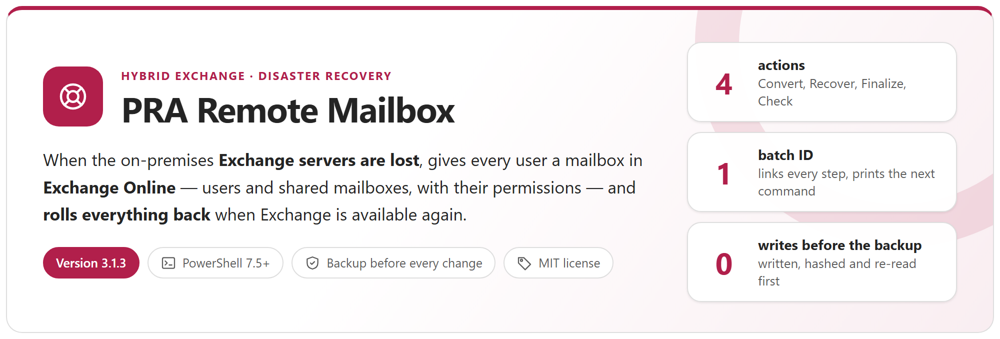
  </picture>
</p>

<p align="center">
  <a href="#get-started"><b>Get started</b></a> &nbsp;&middot;&nbsp;
  <a href="#how-it-works"><b>How it works</b></a> &nbsp;&middot;&nbsp;
  <a href="#convert-and-recover"><b>Convert and Recover</b></a> &nbsp;&middot;&nbsp;
  <a href="#console"><b>Console</b></a> &nbsp;&middot;&nbsp;
  <a href="#reports"><b>Reports</b></a> &nbsp;&middot;&nbsp;
  <a href="#requirements"><b>Requirements</b></a> &nbsp;&middot;&nbsp;
  <a href="package/docs/PraRemoteMailbox-UserGuide.md"><b>User guide</b></a> &nbsp;&middot;&nbsp;
  <a href="package/docs/PraRemoteMailbox-Guide.md"><b>Reference guide</b></a>
</p>

<p align="center">
  <a href="https://github.com/Nico77600/PraRemoteMailbox/releases/latest"></a>
</p>

> [!TIP]
> **Download the latest release.** Open the [latest release](https://github.com/Nico77600/PraRemoteMailbox/releases/latest) and download **`PraRemoteMailbox-3.1.2.zip`** under *Assets* (its SHA-256 is in the release notes). That ZIP is the signed tool, with the HTML guides. Do not use the **Source code** archives or the green **Code** button: they are a copy of the repository, not the release package.

> [!IMPORTANT]
> Files downloaded from the Internet may be blocked by Windows and fail to run. Before using this project, unblock every file in the downloaded folder:
>
> ```powershell
> Get-ChildItem "C:\Chemin\Du\Dossier" -Recurse -File -Force | Unblock-File
> ```
>
> Replace the example path with the folder where you downloaded or extracted this project.
>
> The `Install-Module` commands in this documentation use `-Force`, so they also update or reinstall a module that is already installed. If an older version still conflicts, close every PowerShell window, open a new one (as administrator for `-Scope AllUsers`), run `Uninstall-Module <ModuleName> -AllVersions -Force`, then run the `Install-Module` command again.

> [!IMPORTANT]
> **3.0.0 requires PowerShell 7.5 or later (`pwsh.exe`).** Windows PowerShell 5.1 is refused before any code runs. The **2.2.x releases remain the Windows PowerShell 5.1 version** for servers that cannot have PowerShell 7. Backups, proofs and Finalize packages written by 2.x restore unchanged with 3.0.0 (the formats did not change, [reference guide](package/docs/PraRemoteMailbox-Guide.md) annex D).

## Why

In a hybrid organisation, a mailbox hosted on-premises is only a *mail user* for Exchange Online. If the on-premises Exchange servers are lost (ransomware, site loss, corrupted databases), these users have no mailbox at all — and a normal migration is impossible, because moving a mailbox needs the on-premises servers. As long as **Active Directory and Entra Connect** still work, the fastest way back to e-mail is to give each user a **new, empty mailbox in Exchange Online** and to recreate the access to the shared mailboxes. *PRA* stands for *Plan de Reprise d'Activité*, the disaster recovery plan. When Active Directory and Entra Connect are lost too (scenario 2), use [PRA Cloud Mailbox](https://github.com/Nico77600/PraCloudMailbox) instead: it gives the users and shared mailboxes an Exchange Online mailbox on their existing identity, from the cloud only, and rolls everything back once the infrastructure is rebuilt.

<picture>
  <source media="(prefers-color-scheme: dark)" srcset="package/docs/images/readme-why-dark.png">
  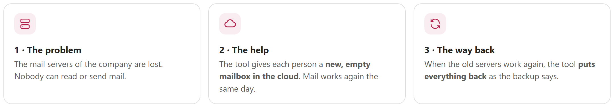
</picture>

Done by hand, this means rewriting about ten Exchange attributes per object in Active Directory, for hundreds of objects, under stress — and keeping every original value to come back later: a wrong or lost value cannot be repaired without a backup. This tool does the conversion in a planned, verified and **reversible** way.

**Author:** Nicolas Fabert · **Version:** 3.1.2, 2026-11-09 ([changelog](CHANGELOG.md)).

> [!CAUTION]
> Convert creates **new, empty** mailboxes in Exchange Online: the content of the on-premises mailboxes is not moved. A Recover deprovisions the cloud mailboxes: export first what was received in the cloud during the disaster, or protect it with a retention policy (reference guide, chapter 6).

## Get started

<picture>
  <source media="(prefers-color-scheme: dark)" srcset="package/docs/images/readme-path-dark.png">
  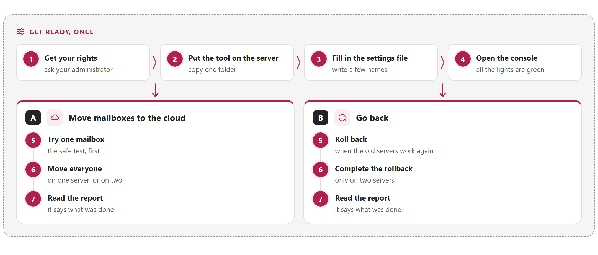
</picture>

One path for everyone. Set the tool up once (**1 to 4**), then take branch **A** to move the mailboxes to the cloud, branch **B** to go back, or both. **Always try one mailbox first** (step 5). The commands use one example — the AD server `DC01`, the domain `contoso.com`, the tool in `D:\PRA\PraRemoteMailbox`, a test user `alice.vance@contoso.com`. Change only these names to yours. The [user guide](package/docs/PraRemoteMailbox-UserGuide.md) explains each step with a picture, what you should see and what to do if not, in plain words.

### Set up once · 1 to 4

```powershell
# 1 · Get your rights. Give the table "Requirements" below to your administrator (minimum rights, derived from the code).

# 2 · On the server, in PowerShell 7.5+ as administrator: put the tool in its folder and unblock it.
#     Download PraRemoteMailbox-3.1.2.zip from the latest release (under Assets, not Source code) and extract it to D:\PRA\PraRemoteMailbox
Get-ChildItem D:\PRA\PraRemoteMailbox -Recurse -File -Force | Unblock-File
Install-Module ExchangeOnlineManagement -MinimumVersion 3.10.0 -Scope AllUsers -Force
Install-Module Microsoft.Graph.Authentication, Microsoft.Graph.Users -Scope AllUsers -Force

# 3 · Fill in the settings: scope, licence group, routing domain, Entra Connect server, tenant
notepad D:\PRA\PraRemoteMailbox\config\PraRemoteMailbox.config.psd1

# 4 · Open the console: the lights on the first page, all green or grey
pwsh -STA -File D:\PRA\PraRemoteMailbox\Invoke-PraRemoteMailbox.ps1 -Gui
```

<details>
<summary><b>What you see</b> · the Setup page: one light per prerequisite; a red light says what is missing</summary>
<br>
<picture>
  <source media="(prefers-color-scheme: dark)" srcset="package/docs/images/console-setup-dark.png">
  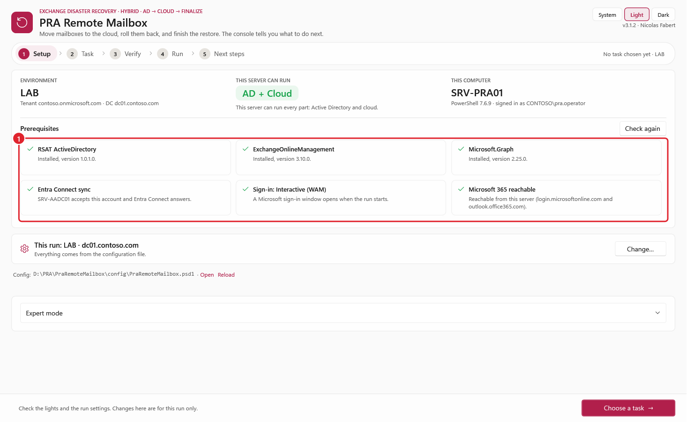
</picture>
</details>

### A · Move mailboxes to the cloud · 5 to 7

```powershell
# 5 · Try ONE mailbox first. Preview (nothing is written), then Apply.
cd D:\PRA\PraRemoteMailbox
.\Invoke-PraRemoteMailbox.ps1 -Action Convert -Identity alice.vance@contoso.com
.\Invoke-PraRemoteMailbox.ps1 -Action Convert -Identity alice.vance@contoso.com -Mode Apply

# 6 · Move everyone: the scope of the settings file, on one server
.\Invoke-PraRemoteMailbox.ps1 -Action Convert                  # preview
.\Invoke-PraRemoteMailbox.ps1 -Action Convert -Mode Apply      # backup, AD, sync, Exchange Online
#     Two servers (no single server reaches both Active Directory and Microsoft 365): on the AD server, then copy ONE zip file to the cloud server
.\Invoke-PraRemoteMailbox.ps1 -Action Convert -Phase AD -Mode Apply
.\Invoke-PraRemoteMailbox.ps1 -Action Convert -Phase Cloud -Batch 'PRA-PROD-Convert-490cc62e-for-Cloud.zip' -Mode Apply   # on the cloud server

# 7 · Read the report: the Next steps page (or the summary) gives its path. Note the batch ID.
```

In the console, the same path is five pages: **Setup**, **Task** (*Move mailboxes to Exchange Online*, *Single identity (test)*), **Verify** (**Preview**, type the confirmation word, **Convert the mailboxes**), **Run** and **Next steps**.

<details>
<summary><b>What you see</b> · Task, Verify, Run, Next steps for one test mailbox</summary>
<br>
<table>
  <tr>
    <td width="50%" valign="top"><a href="package/docs/images/console-task-light.png">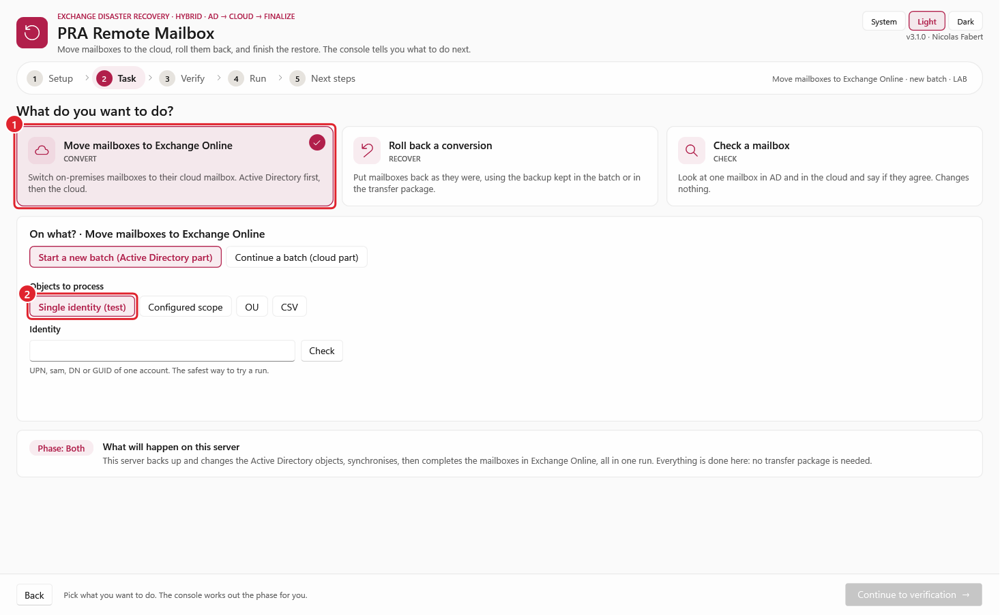</a><br><sub><b>Task</b> &middot; what to do, and on what: one test identity first</sub></td>
    <td width="50%" valign="top"><a href="package/docs/images/console-verify-light.png">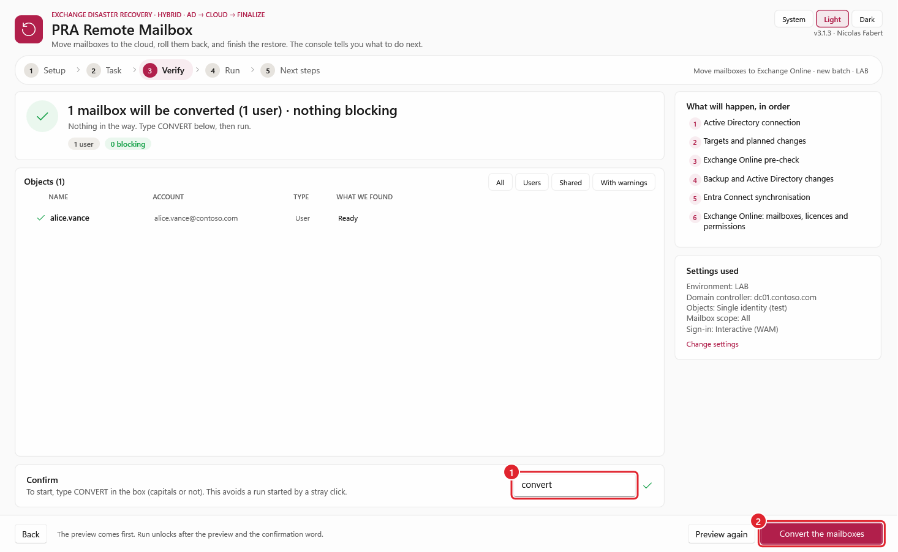</a><br><sub><b>Verify</b> &middot; the preview in plain words, then the confirmation word</sub></td>
  </tr>
  <tr>
    <td width="50%" valign="top"><a href="package/docs/images/console-run-finished-light.png">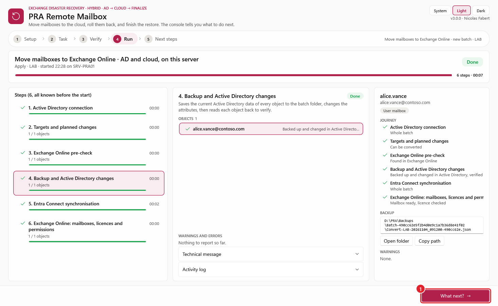</a><br><sub><b>Run</b> &middot; the steps, their waits and warnings, the journey of each mailbox</sub></td>
    <td width="50%" valign="top"><a href="package/docs/images/console-next-light.png">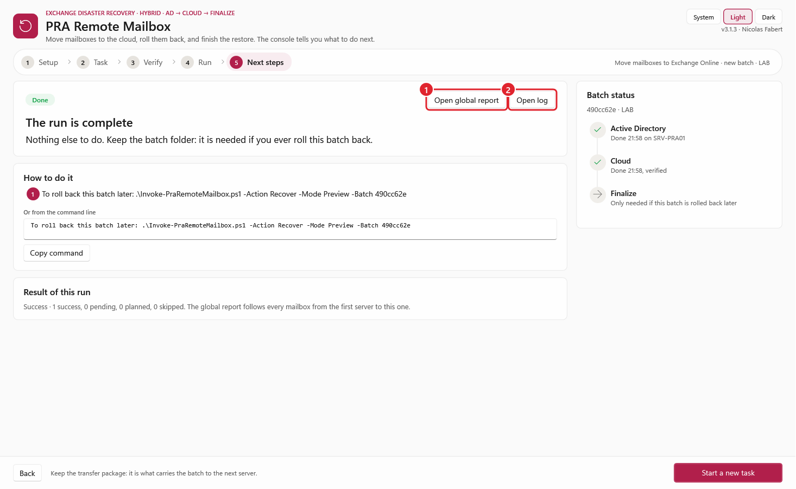</a><br><sub><b>Next steps</b> &middot; the result, the report, the next command</sub></td>
  </tr>
</table>
</details>

### B · Go back · 5 to 7

```powershell
# 5 · Roll back, when the old servers work again. Preview, then Apply, with the batch ID of the Convert.
.\Invoke-PraRemoteMailbox.ps1 -Action Recover -Batch 490cc62e
.\Invoke-PraRemoteMailbox.ps1 -Action Recover -Batch 490cc62e -Mode Apply

# 6 · Two servers only: Recover on the AD server, then on the cloud server (it writes a Finalize package), then Finalize on the AD server
#     Each package has its own ID: the one of the Convert batch is only used to pick the batch to roll back
.\Invoke-PraRemoteMailbox.ps1 -Action Recover -Phase AD -Batch 490cc62e -Mode Apply
.\Invoke-PraRemoteMailbox.ps1 -Action Recover -Phase Cloud -Batch 'PRA-PROD-Recover-5ad39f71-for-Cloud.zip' -Mode Apply
.\Invoke-PraRemoteMailbox.ps1 -Action Finalize -Batch 'PRA-PROD-Finalize-b7d41a9c-for-AD.zip' -Mode Apply

# 7 · Read the report; check a mailbox at any time
.\Invoke-PraRemoteMailbox.ps1 -Action Check -Identity alice.vance@contoso.com
```

Keep the `Backups` folder on a durable, protected volume: the backups are the only way back. The environment values of the configuration are empty in this repository. The zip of each [release](https://github.com/Nico77600/PraRemoteMailbox/releases) contains only the files needed to run; `.\tools\New-PraPackage.ps1` builds the same package from the repository.

## How it works

<picture>
  <source media="(prefers-color-scheme: dark)" srcset="package/docs/images/readme-how-dark.png">
  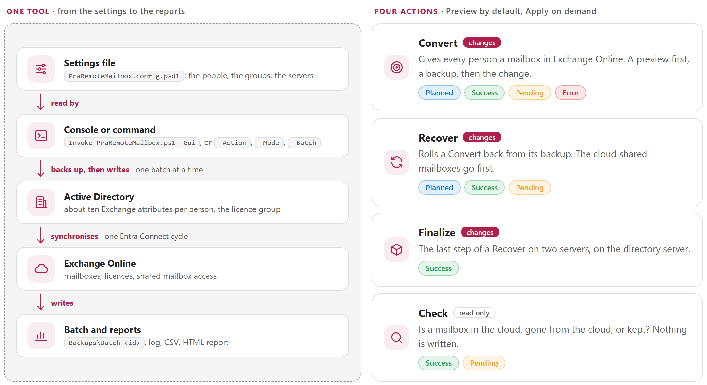
</picture>

- **Signed package.** The runtime lives in `package\` (same layout as the extracted release ZIP). Every runtime file authenticates the owner-signed manifest before it runs; a changed, missing or unexpected stable file stops the tool before any import or operation. The configuration and your CSV lists are data, outside that check. There is no unsigned mode. The tool refuses to run from any tree whose files are not signed by the owner: use a signed release package. Backup, log and report folders inside the package are limited to the canonical `Backups`, `logs` and `reports`. See [package/README.md](package/README.md).
- **One script, one configuration file.** The scope is one object (`-Identity`), an OU, the members of an AD group or a CSV list — users only, shared mailboxes only, or both.
- **Preview by default.** Without `-Mode Apply` the tool only reads. With `-Mode Apply` it shows the plan and asks **one** confirmation (`-Force` for unattended runs).
- **X500 control.** The batch records the X500 addresses (`legacyExchangeDN` and older X500) that the cloud mailbox must carry; the cloud phase proves them and warns if one is missing, because replies to old messages would otherwise bounce.
- **One batch ID** links the steps: every Apply prints it with the exact next command, and `-Action Recover -Batch <id>` rolls the batch back.
- **One or two servers**: everything from one server that reaches both Active Directory and Microsoft 365, or the AD part on the AD server and the cloud part on a **cloud server**. The cloud server is not a server hosted in the cloud: it is any Windows machine of your organisation that reaches Microsoft 365 through the Internet, with no access to Active Directory.

<picture>
  <source media="(prefers-color-scheme: dark)" srcset="package/docs/images/readme-principles-dark.png">
  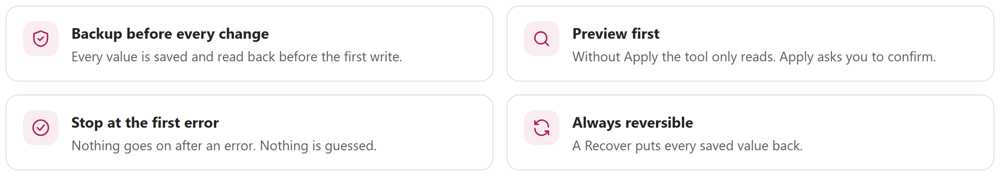
</picture>

### Two servers, one file

Between two servers, an Apply writes **one transfer package** (`Backups\Outbox\PRA-<Env>-<Kind>-<id8>-for-<Cloud|AD>.zip` with its checksum file). Copy that single file to the other server and use **Import package...** (or `-Batch <package.zip>`): the package is verified completely, including every entry hash, before anything is written. The last server writes **one global report** that follows each object from the first server to the last. The [user guide](package/docs/PraRemoteMailbox-UserGuide.md#the-whole-journey) shows the whole journey, move then rollback, on one or two servers: what to click, which file the tool writes and where to copy it.

<picture>
  <source media="(prefers-color-scheme: dark)" srcset="package/docs/images/readme-transfer-dark.png">
  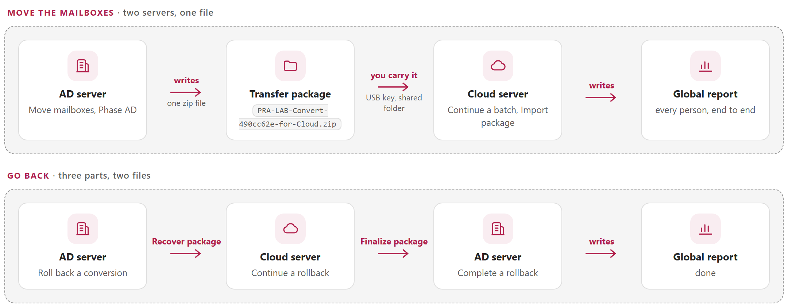
</picture>

## Convert and Recover

<picture>
  <source media="(prefers-color-scheme: dark)" srcset="package/docs/images/readme-flows-dark.png">
  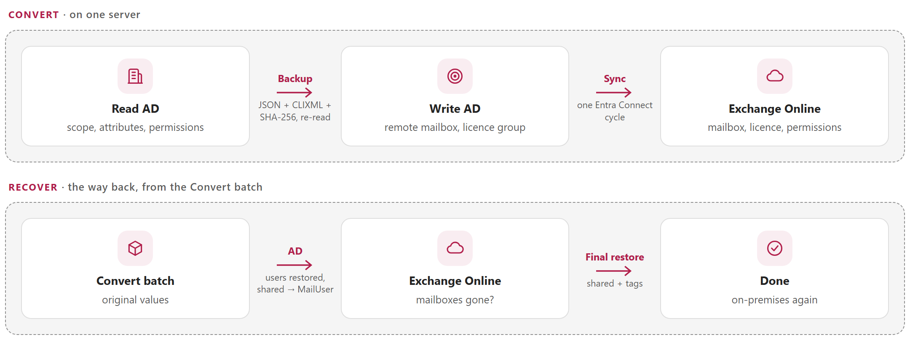
</picture>

What a Convert changes in Active Directory (a Recover puts the saved values back):

| Attribute | User mailbox | Shared mailbox |
|---|---|---|
| `msExchRecipientTypeDetails` | 1 → **2147483648** (RemoteUserMailbox) | 4 → **34359738368** (RemoteSharedMailbox) |
| `msExchRemoteRecipientType` | → **1** (3 with archive) | → **97** (99 with archive) |
| `msExchRecipientDisplayType` | → -2147483642 | → -2147483642 |
| `targetAddress` · `proxyAddresses` | → `SMTP:alias@tenant.mail.onmicrosoft.com` · + routing address | same |
| `homeMDB`, `homeMTA`, `msExchHomeServerName`, `mDBUseDefaults`, `msExchMailboxGuid` | cleared | cleared |
| retention tag (`extensionAttribute1` by default) | → `Converted` | → `Converted` |
| licence group | **added** | never |

### Shared mailbox permissions

<picture>
  <source media="(prefers-color-scheme: dark)" srcset="package/docs/images/readme-permissions-dark.png">
  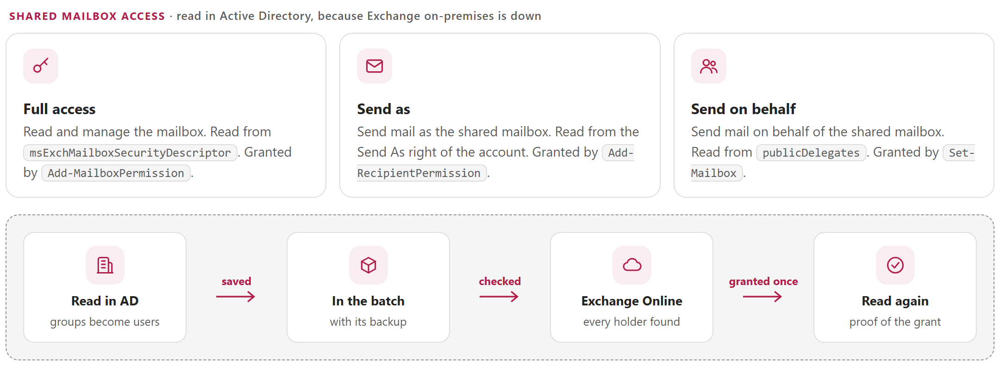
</picture>

Exchange on-premises is down, so the tool reads the permissions where Exchange keeps a copy: on the account of the shared mailbox in Active Directory. The preview lists who will get each right; the log has the complete lists. A permission already present in Exchange Online is only verified, never added twice.

## Console

Open the console with `pwsh -STA -File .\package\Invoke-PraRemoteMailbox.ps1 -Gui` (native Fluent theme, PowerShell 7.5+, English). It starts no operation by itself; every operation runs the existing engine in a separate **PowerShell 7.5+** process (the same `pwsh.exe`).

The console is a guided path of five pages: **Setup** (the environment, what this server can run, the prerequisite lights from real detection, one line of run settings), **Task** (move mailboxes, roll back, complete a rollback, check a mailbox, on what: one identity to test first, the configured scope, an OU or a CSV, or a batch or package to continue), **Verify** (the Preview in plain words, then the confirmation word in any letter case), **Run** (the steps announced by the engine, with their waits and warnings in plain words; click a step or an object) and **Next steps**. Run settings changed in the window apply to that run only, through a guarded effective copy of the configuration: the file is never rewritten. See the [reference guide, chapter 8](package/docs/PraRemoteMailbox-Guide.md#8-everyday-use).

<picture>
  <source media="(prefers-color-scheme: dark)" srcset="package/docs/images/console-run-finished-dark.png">
  
</picture>

## Reports

Every run writes a log, a PowerShell transcript, a CSV and an HTML report. Exit codes: 0 = done, 1 = failed, 2 = done, next step required.

<table>
  <tr>
    <td width="50%" valign="top"><a href="package/docs/images/report-phase-light.png">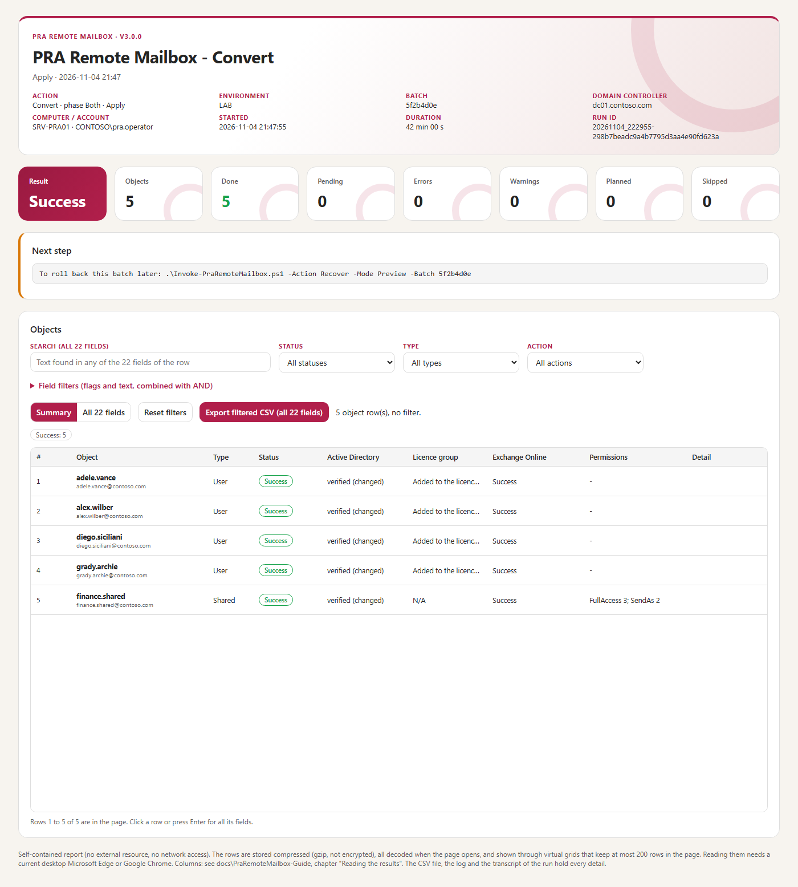</a><br><sub><b>HTML report</b> &middot; counters, next step, then virtualized, filterable rows (tested to 100,000 rows, at most 200 rows in the page) with a filtered CSV export; needs current desktop Edge or Chrome</sub></td>
    <td width="50%" valign="top"><a href="package/docs/images/report-phase-warning-light.png">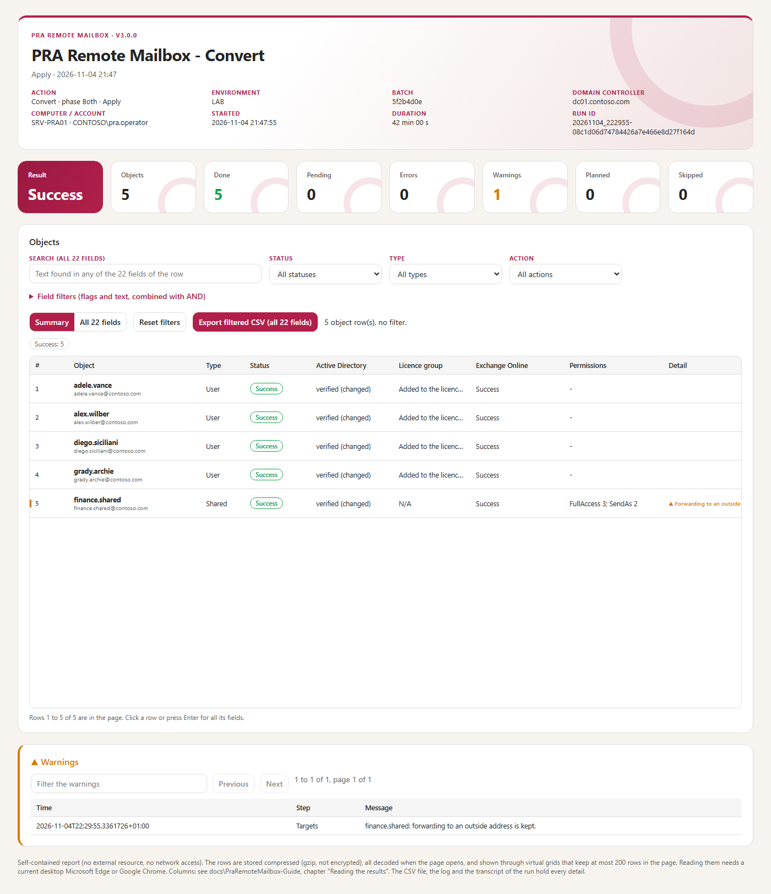</a><br><sub><b>Warnings</b> &middot; something was left aside on purpose: shown in the console, the log, the CSV and the report</sub></td>
  </tr>
  <tr>
    <td width="50%" valign="top"><a href="package/docs/images/report-global-light.png">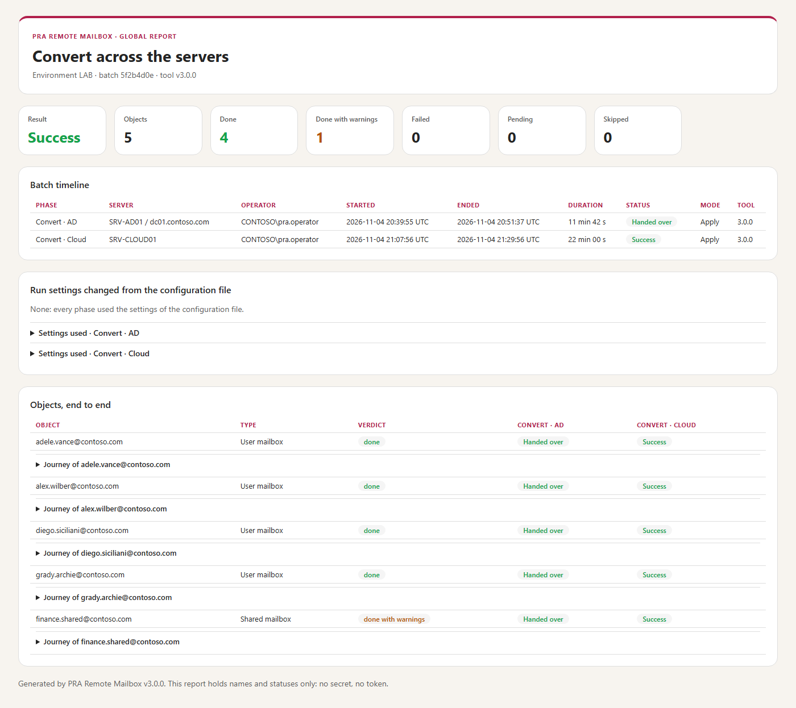</a><br><sub><b>Global report</b> &middot; on two servers, the last server writes one report that follows each object from the first server to the last</sub></td>
    <td width="50%" valign="top"><a href="package/docs/images/report-global-recover-light.png">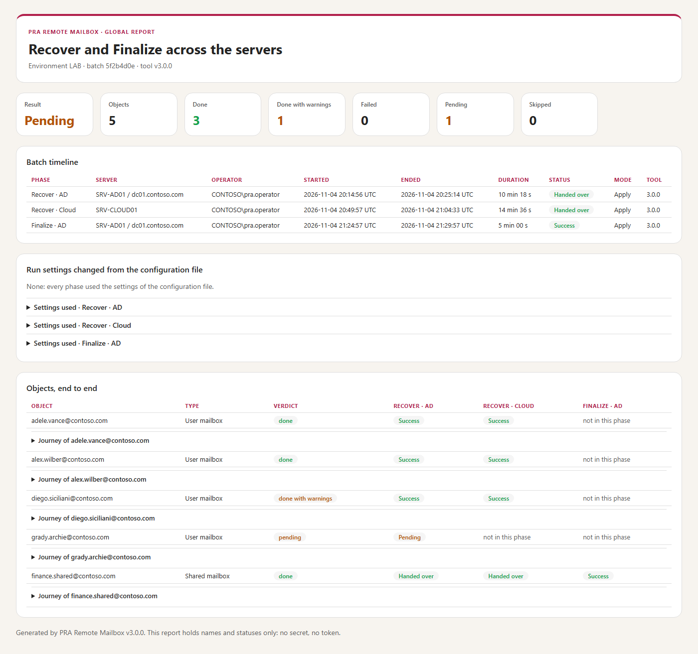</a><br><sub><b>Rollback</b> &middot; Recover on the AD server, Recover on the cloud server, then Finalize, in one report</sub></td>
  </tr>
</table>

## Requirements

| Item | Requirement |
|---|---|
| Scenario | Hybrid Exchange organisation (Exchange Server + Exchange Online) synchronised by **Entra Connect**. Exchange on-premises is not needed (it is down); Active Directory and Entra Connect must work (both lost: [PRA Cloud Mailbox](https://github.com/Nico77600/PraCloudMailbox)) |
| PowerShell | **PowerShell 7.5 or later** (`pwsh.exe`) for the operations and the window. Windows PowerShell 5.1 is refused (use the 2.2.x release there) |
| Modules | RSAT `ActiveDirectory` (native in PowerShell 7 on Windows 10 1809+ / Windows Server 2019+), `ExchangeOnlineManagement` 3.10 or later and `Microsoft.Graph.Authentication` / `Microsoft.Graph.Users`, installed **for PowerShell 7**; `ADSync` on the Entra Connect server (loaded through the Windows PowerShell compatibility layer when used locally) |
| Licences | A licence group that gives Exchange Online to the users (shared mailboxes need no licence) |
| Console | Windows Terminal for emoji and colours; the classic console shows symbols |

### Minimum permissions

Derived from the code, not from habit: no Domain Admin, no Global Administrator. The exact table, with the place in the code that justifies each line and the commands to delegate, is in the [reference guide, chapter 4](package/docs/PraRemoteMailbox-Guide.md#permissions).

<picture>
  <source media="(prefers-color-scheme: dark)" srcset="package/docs/images/readme-rights-dark.png">
  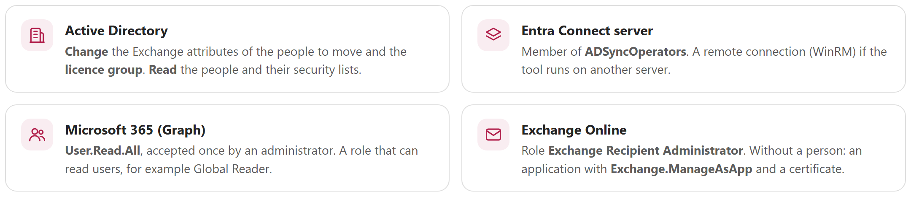
</picture>

| Where | Minimum |
|---|---|
| Active Directory | **Write property** on 10 Exchange attributes (`homeMDB`, `homeMTA`, `msExchHomeServerName`, `msExchMailboxGuid`, `mDBUseDefaults`, `msExchRecipientDisplayType`, `msExchRecipientTypeDetails`, `msExchRemoteRecipientType`, `targetAddress`, `proxyAddresses`) and one `extensionAttribute` (retention tag) of the objects in scope; **write** `member` of the licence group; **read** of the objects and their security descriptors. Optional forced replication: *Replication synchronization* on the domain |
| Entra Connect server | **ADSyncOperators** (or local administrator); WinRM access when remote |
| Microsoft Graph, interactive | Delegated `User.Read.All` (consent once), and a role that can read users (for example Global Reader) |
| Microsoft Graph, certificate | Application permission `User.Read.All` (admin consent) |
| Exchange Online, interactive | **Exchange Recipient Administrator** (or the role group Recipient Management) |
| Exchange Online, certificate | Application permission `Exchange.ManageAsApp` (admin consent) and the Entra role **Exchange Recipient Administrator** for the application; a CSP certificate in `CurrentUser\My` (reference guide, annex C) |

A few points depend on Microsoft services and are flagged for a lab check in the reference guide (*What the code cannot tell you*).

## Quick start

The short version of [Get started](#get-started), once the rights and the settings file are ready. PowerShell 7.5+, as administrator, in the tool folder:

```powershell
cd D:\PRA\PraRemoteMailbox
Get-ChildItem . -Recurse -File -Force | Unblock-File
pwsh -STA -File .\Invoke-PraRemoteMailbox.ps1 -Gui                       # the console: Setup, Task, Verify, Run, Next steps
.\Invoke-PraRemoteMailbox.ps1 -Action Convert -Identity alice.vance@contoso.com   # or the command line: one mailbox, preview only
```

## Documentation

The `package` folder of this repository holds exactly the files needed to run PRA Remote Mailbox, with both guides. The zip of each [release](https://github.com/Nico77600/PraRemoteMailbox/releases) contains the same run-time files with the HTML guides; `.\tools\New-PraPackage.ps1` builds that zip content from the repository.

| Guide | Content |
|---|---|
| **[User guide](package/docs/PraRemoteMailbox-UserGuide.md)** | **The guided path in plain words**, written for someone who has never used the tool: a checklist before you start, the rights to ask for, set up once (**1 to 4**), then **A · Move mailboxes** (one test mailbox, everyone on one server, everyone on two servers) and **B · Go back** (roll back, complete the rollback). A picture for each step, what you should see and what to do if not, a table of the common messages, and a picture dictionary. |
| **[Reference guide](package/docs/PraRemoteMailbox-Guide.md)** | Everything else: the disaster scenario, what changes in Active Directory, the shared mailbox permissions, installation, the exact minimum permissions, configuration, unattended execution with a certificate, ready-to-use recipes, the reports, troubleshooting, the internals, how to modify and test the tool, and the lab test campaign. |

Both guides also exist as a single HTML file with a light and a dark theme (`package/docs/PraRemoteMailbox-UserGuide.html`, `package/docs/PraRemoteMailbox-Guide.html`): download them and open them locally, or use the copies in the release zip. The pictures are generated from synthetic data by `tools\New-DocumentationImages.ps1`.

## Tests

```powershell
# PowerShell 7.5+ (pwsh), like the tool; Pester 5+ and PSScriptAnalyzer 1.25.0 installed
pwsh -NoProfile -File .\tests\Invoke-TestGate.ps1     # no directory, no tenant needed
```

The gate runs the real entry script against a synthetic Active Directory, Entra Connect and Exchange Online: no write before the complete backup, stop at the first error, no write in Preview, no Apply without confirmation, memory bounds, proofs and Finalize packages. It also exercises WPF selection, Preview/Apply guards and OU/CSV targeting, and checks the documentation (pictures, names, the Graph scope documented against the one of the code). Earlier versions were validated on a real Active Directory, Entra Connect and Microsoft 365 tenant (reference guide, annex B); **3.0.0 has offline validation only, not a new live-tenant campaign** (the lab list for the PowerShell 7 engine is in the guide, annex B). Files written by the real 2.2.0 under Windows PowerShell 5.1 are replayed by the gate (`tests\PraLegacyFixtures.Tests.ps1`, fixtures frozen in `tests\fixtures\ps51-2.2.0`). `tools\Build-Documentation.ps1` and `tools\New-DocumentationImages.ps1`, which rebuild the HTML guides and the pictures on a workstation, need PowerShell 7.5+ (and Microsoft Edge for the pictures).

## License

[MIT](LICENSE).

## Disclaimer

This Script is a Personal project.
It's provided "AS-IS". It's not an official Microsoft product so no support can be expected from Microsoft.

As any scripts you must read carefully the documentation and test it first in a Test environment before any run in Production.

The tool changes production objects in Active Directory and creates mailboxes in Exchange Online: run the preview, review the plan, keep the backups and test in a lab before using it in a real disaster.
