# PRA Remote Mailbox — Administrator guide

> When the on-premises Exchange servers are lost, **PRA Remote Mailbox** turns the on-premises mailboxes into **remote mailboxes**, so that every user gets a mailbox in **Exchange Online** within the hour — and rolls everything back when Exchange is available again. Only Active Directory is changed on-premises, and **every change is backed up first**.

> New here? Start with the [user guide]fPraRemoteMailbox-UserGuide.md): the same tool, one step after the other, with a picture for each step. This guide is the reference.

> [!IMPORTANT]
> Files downloaded from the Internet may be blocked by Windows and fail to run. Before using this project, unblock every file in the downloaded folder:
>
> ```powershell
> Get-ChildItem "C:\Chemin\Du\Dossier" -Recurse -File -Force | Unblock-File
> ```
>
> Replace the example path with the folder where you downloaded or extracted this project.
>
> The `Install-Module` commands in this documentation use `-Force`, so they also update or reinstall a module that is already installed. If an older version still conflicts, close every PowerShell window, open a new one (as administrator for `-Scope AllUsers`), run `Uninstall-Module <ModuleName> -AllVersions -Force`, then run the `Install-Module` command again.

```cards
target | What it does | **Convert**: on-premises mailbox → remote mailbox (AD attributes, licence group, Entra Connect, shared mailbox permissions in Exchange Online).
refresh | How to go back | **Recover** a Convert batch: original AD attributes, licence removed, cloud shared mailboxes removed before the on-premises ones come back.
shield | How it protects | Preview first; a complete, re-read **backup** of every object before the first write; the first error stops everything.
terminal | How it is used | One script, one configuration file, one short **batch ID** that links the steps together.
```

## Quick start

```steps
Check the prerequisites | **PowerShell 7.5+** (`pwsh`), RSAT `ActiveDirectory`, `ExchangeOnlineManagement` 3.10.1+, `Microsoft.Graph.Authentication` and `Microsoft.Graph.Users` 2.41.1+ (one same version for both), installed for PowerShell 7 (chapter 4).
Edit the configuration | `config\PraRemoteMailbox.config.psd1`: scope, licence group, routing domain, Entra Connect server, tenant (chapter 6).
Preview | `.\Invoke-PraRemoteMailbox.ps1 -Action Convert` — targets and planned AD changes, **nothing is written**.
Apply | `.\Invoke-PraRemoteMailbox.ps1 -Action Convert -Mode Apply` — one confirmation, then backup, AD, sync, Exchange Online.
Keep the batch ID | The summary prints it (e.g. `efb9d60a`) with the next command: `-Action Recover -Batch efb9d60a` rolls the batch back.
```

> [!IMPORTANT]
> **Preview is the default.** Without `-Mode Apply` (or with `-WhatIf`) the tool only reads. With `-Mode Apply` it asks **one** confirmation after showing the plan; `-Force` skips it for unattended runs. No option ever skips a safety check.

> [!TIP]
> **Ready-to-use commands** — one user, a whole OU, only the shared mailboxes, a list, the roll-back: [chapter 8](#8-everyday-use), recipes 1 to 6.

The **window** opens with `pwsh -STA -File .\Invoke-PraRemoteMailbox.ps1 -Gui` (native Fluent theme).
It starts no operation automatically. Version **3.0.0** has offline validation only; no new
live-tenant campaign has been performed for this version (the list to replay is in [annex B](#annex-b--lab-test-campaign-2026-09-30)).

> [!IMPORTANT]
> **Breaking in 3.0.0: PowerShell 7.5 or later is required.** Windows PowerShell 5.1 (`powershell.exe`) is refused by `#Requires` before any code runs, and so is PowerShell 7.4 (the tool reads JSON dates as text with `ConvertFrom-Json -DateKind`, new in 7.5). The **2.2.x releases remain the Windows PowerShell 5.1 version**: keep them for a server that cannot have PowerShell 7. **Backups, proofs and Finalize packages written by 2.x restore unchanged with 3.0.0** (same formats, [annex D](#annex-d--file-formats)), and the files written by 3.0.0 stay readable by 2.2.x.

# Part I · Understand

<!-- icon: book -->
## 1. Project background

> **In short:** The tool exists because turning mailboxes into remote mailboxes by hand is slow and risky. This chapter says what is lost, what is kept, and why a tool is safer.

**The disaster scenario**

- The mailboxes of the organisation are hosted **on-premises** (Exchange Server, hybrid with Exchange Online).
- The disaster recovery plan (PRA) covers the **loss of the on-premises Exchange servers**: mail must work again quickly, without waiting for their reconstruction.
- **Active Directory and Entra Connect are still available**: the identities, groups and synchronisation work.
- The decision is to give every user a **new, empty mailbox in Exchange Online** and to recreate the access to the shared mailboxes. The content of the lost mailboxes is **not** migrated by this tool (it comes back from the Exchange recovery, or from a backup product).
- When Exchange is back, the objects are **rolled back** to their on-premises state.

**Why a tool**

Turning an on-premises mailbox into a remote mailbox means rewriting about ten Exchange attributes in AD, per object, in a precise way, for hundreds of objects, under stress. A wrong value or a lost value cannot be recovered without a backup: this happened with the first script (version 1.2.5), whose backup was written **after** the changes.

| Constraint | Value |
|---|---|
| Objects | user mailboxes, shared mailboxes (rooms and equipment possible) |
| Systems changed | Active Directory (attributes, licence group), Entra Connect (one sync cycle), Exchange Online (shared mailbox permissions) |
| Systems NOT needed | Exchange on-premises (it is down) |
| Servers | one server (AD + cloud), or two servers: an AD server and an isolated "cloud" server |
| Traceability | backups, journals, logs, transcripts and reports kept for every run |

<!-- icon: flow -->
## 2. How it works

> **In short:** Convert backs up, then changes Active Directory, then waits for Entra Connect and Exchange Online. Recover does the same in reverse, from the backup.

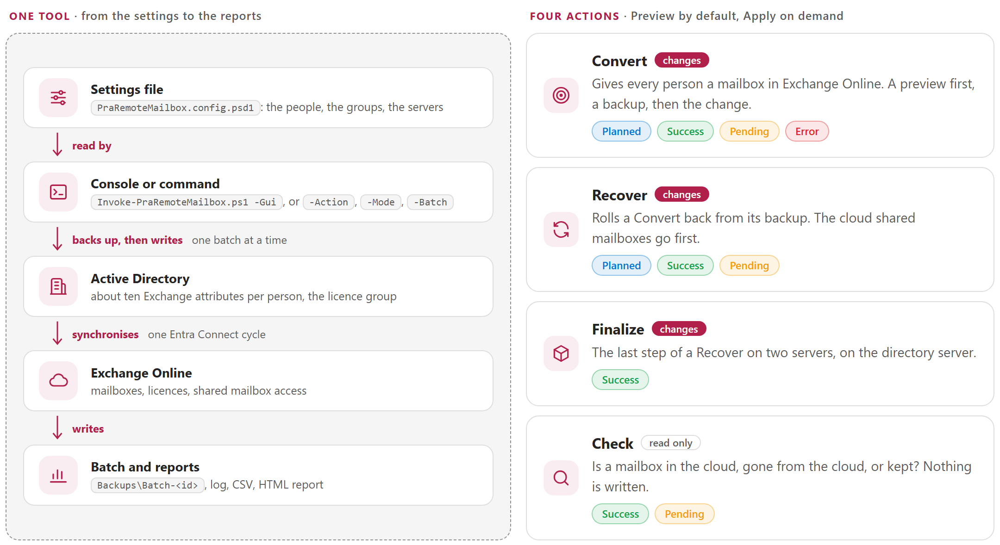

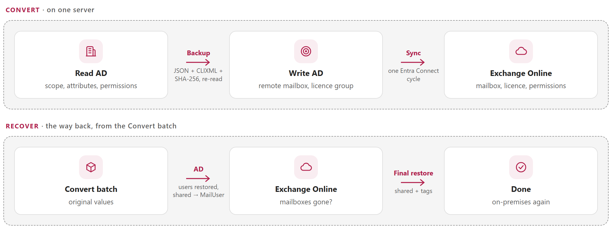

### Convert

The default flow, on one server (`Execution.Phase = 'Both'`):

```flow
directory | Read AD | scope, attributes, permissions
arrow | Backup | JSON + CLIXML + SHA-256, re-read
target | Write AD | remote mailbox, licence group
arrow | Sync | one Entra Connect cycle
cloud | Exchange Online | mailbox, licence, permissions
```

| Step | What happens |
|---|---|
| **Preview** | Every object of the scope is read, checked (it must be an on-premises mailbox) and planned. The console shows what will change. |
| **Exchange Online pre-check** | (Apply, phase Both) sign-in, every target and every permission holder resolved in Exchange Online — before any AD write. |
| **Backup** | One private folder `Backups\Batch-<id>`: the typed values to restore (JSON), every AD value (CLIXML), their SHA-256, then everything is **re-read and compared** with the plan. |
| **AD changes** | Per object: current state re-checked, `Set-ADUser`, AD re-read, licence group, AD re-read. The **first error stops the batch**. |
| **Entra Connect** | One Delta cycle, local or on `EntraConnect.Server`; the tool waits for its end. Before the first AD write the tool proves that the synchronisation is possible **for the account that runs it** (an authenticated, read-only call to `Get-ADSyncScheduler`): otherwise the run stops with nothing written. A cycle that fails after the verified AD writes does not fail the run: [Pending, exit code 2](#exit-codes). |
| **Exchange Online** | The tool waits (up to `Polling.TimeoutMinutes`) for the mailboxes and the licences, then grants FullAccess / SendAs / SendOnBehalf on the shared mailboxes and checks each grant. |
| **X500 control** | For each mailbox that is ready, the tool proves that it carries the X500 addresses recorded by the AD phase (next section). A missing one is a warning; the conversion stays done. |

### What changes in AD

| Attribute | User mailbox | Shared mailbox |
|---|---|---|
| `msExchRecipientTypeDetails` | 1 → **2147483648** (RemoteUserMailbox) | 4 → **34359738368** (RemoteSharedMailbox) |
| `msExchRemoteRecipientType` | → **1** (3 with archive) | → **97** (99 with archive) |
| `msExchRecipientDisplayType` | → -2147483642 | → -2147483642 |
| `targetAddress` | → `SMTP:alias@tenant.mail.onmicrosoft.com` | same |
| `proxyAddresses` | + `smtp:alias@tenant.mail.onmicrosoft.com` (Recover removes it again and **keeps** the cloud `X500:` address, see below) | same |
| `homeMDB`, `homeMTA`, `msExchHomeServerName`, `mDBUseDefaults`, `msExchMailboxGuid` | cleared | cleared |
| retention tag (`extensionAttribute1` by default) | → `Converted` | → `Converted` |
| licence group | **added** | never (a shared mailbox has no licence) |

### X500 addresses — replies to old messages keep working

Every message, meeting and cached Outlook entry (nickname cache, delegates, meeting organiser) addresses an on-premises mailbox by its `legacyExchangeDN` (internally an `IMCEAEX` address). Convert creates a **new** cloud mailbox. If that mailbox does not carry `X500:<legacyExchangeDN>` of the on-premises object, and the X500 addresses already in its `proxyAddresses` (older `legacyExchangeDN` values from earlier migrations), a reply to an old message, a meeting update or a cached recipient bounces with an `IMCEAEX` non-delivery report.

The tool **proves** this, per object, and never writes a cloud address:

1. **AD phase (Convert, phases AD and Both).** `legacyExchangeDN` is read with the other attributes (read only: it is not one of the managed attributes, is never written, restored or modified). The batch records, for each object, the list `ExpectedX500`: `X500:<legacyExchangeDN>` when it is not empty, then every `X500:` entry of the original `proxyAddresses`. Duplicates are removed (ordinal, ignoring case, on the whole value); each value is kept byte for byte. The preview shows *X500 to verify after the conversion: N* for each object. The field travels in the batch JSON and in the transfer package, so the cloud server on another machine has it.
2. **Cloud phase (Convert, phases Cloud and Both).** When the mailbox is ready (and its licence, and the shared mailbox permissions), the tool reads `EmailAddresses` of the mailbox in Exchange Online, or the Entra `proxyAddresses` when `Cloud.MailboxCheckVia` is `Graph`, and compares each expected value (ordinal, ignoring case, on the whole value). Exchange Online never lists the `LegacyExchangeDN` of a mailbox in its own `EmailAddresses`, although Entra Connect may have written `X500:<that value>` on premises while the object was still a MailUser: the tool also asks for the mailbox's own `LegacyExchangeDN` and counts `X500:<it>` as present (no false warning). While only these addresses are awaited, the log says *mailbox ready; X500 addresses not all visible yet, check N of 3*, never *Not ready yet*. All present: `X500: N of N present (legacyExchangeDN + older X500)`. Otherwise it re-reads, at the polling interval, up to **three reads in total** (the cloud value can lag one synchronisation; there is no long new wait), then writes ONE warning for the object: `X500 missing in Exchange Online: <values>`. It is a warning, not an error: the conversion stays done. The warning is counted in the run result, the HTML report, the global report (journey of the object) and the Next steps, which give the command to check again after an Entra Connect synchronisation.
3. **Check.** `-Action Check -Batch <id>` (or `-Identity <sAMAccountName>`, which reads AD) shows the same comparison, read only. An identity given as a UPN has no Active Directory read: the line says so and skips the control.
4. **Old batches.** A batch written before 3.1.0 has no `ExpectedX500`: the control is skipped with the information line *expected addresses not available (batch from 3.0.0 or older)*, never a failure. The field is validated like `KeptX500` when the batch is read (only strings starting with `X500:`, at most 2,000 values of at most 2,048 characters); a changed or invalid field makes the batch refused.

The control runs only when the mailbox check runs (`Cloud.CheckMailbox`). Recover is unchanged: it keeps the cloud X500 address written back on premises ([chapter 3](#3-things-to-know)).

### Shared mailbox permissions — where they come from

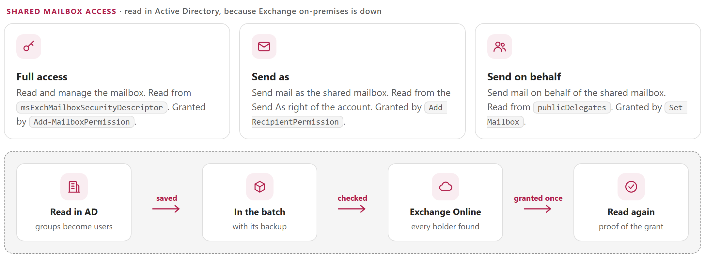

Exchange on-premises is down: the tool cannot ask it (`Get-MailboxPermission` is not available). It reads the permissions where Exchange keeps a copy in **Active Directory**, on the account of the shared mailbox itself (default `SharedMailbox.PermissionSource = 'AD'`):

| Right granted in Exchange Online | Read in AD (attribute of the shared mailbox account) | Written there on-premises by |
|---|---|---|
| **FullAccess** | `msExchMailboxSecurityDescriptor` — *Allow* entries with the FullAccess right | `Add-MailboxPermission -AccessRights FullAccess` |
| **SendAs** | `nTSecurityDescriptor` (the AD permissions of the account) — *Allow* entries with the extended right **Send As** | `Add-ADPermission -ExtendedRights Send-As`, or the Exchange admin center |
| **SendOnBehalf** | `publicDelegates` | `Set-Mailbox -GrantSendOnBehalfTo` |

```flow
directory | Read AD | 3 attributes of the shared mailbox
arrow | Clean up | groups → users, exclusions
batch | Backup | lists of UPNs in the batch
arrow | Pre-check | every holder found in Exchange Online
cloud | Grant | once, then re-read
```

1. Only explicit *Allow* entries are kept: inherited and *Deny* entries are ignored.
2. System and administration accounts are never reproduced: SELF, `NT AUTHORITY\…`, `BUILTIN\…`, Domain / Enterprise / Schema Admins, Organization Management, Exchange Trusted Subsystem, Exchange Servers, Exchange Windows Permissions, Managed Availability Servers, Delegated Setup — plus the accounts listed in `SharedMailbox.ExcludeTrusteeSamAccountNames` (service accounts, for example).
3. A **group** is expanded to its users, nested groups included: Exchange Online receives one permission **per user** (UPN), never the group itself (lab T16). A user added to the group later does not get the access by itself.
4. An entry that points to an account **no longer in AD** ("Account Unknown": deleted account, or an account of another domain) cannot be granted: it is **ignored and reported as a warning** — a yellow `▲` line under the shared mailbox, a `[WARN]` line in the log, the `Warnings` column of the CSV, and the *Warnings* tile and card of the HTML report. The run goes on and its exit code does not change. Every other holder must exist in AD with a UPN.
5. The lists are saved in the backup of the batch (`SharedPermissions` of each record): the proof of what was granted.
6. Apply (phase `Both`): **before any AD write**, every holder is looked up in Exchange Online. An unknown holder stops the run before AD is changed. A user still on-premises is fine: Entra Connect has synchronised it as a mail user.
7. When the cloud shared mailbox exists: `Add-MailboxPermission` (FullAccess, with `AutoMapping`), `Add-RecipientPermission` (SendAs), `Set-Mailbox -GrantSendOnBehalfTo` (SendOnBehalf). A permission already present is only verified; a missing one is granted **once**, then re-read until Exchange Online shows it. In a hybrid organisation, Entra Connect usually brings `publicDelegates` along with the mailbox: SendOnBehalf is then already there and only verified (lab T16).

**How to check before the Apply**: the preview prints, under each shared mailbox, `FullAccess to`, `SendAs to` and `SendOnBehalf to` with the first holders; the log of the run has the complete lists (lines `PERMISSIONS | …`). After the Apply, every grant is printed and the report shows `Permissions verified=6/6`.

**Other sources**, when the AD entries are not reliable:

| `PermissionSource` | Holders |
|---|---|
| `'Csv'` | file `SharedMailbox.CsvPath`, columns `Shared,Group` (see `config\SharedPermissions.sample.csv`): the members of `Group` get FullAccess **and** SendAs on `Shared` |
| `'CustomAttribute'` | the AD group whose `SharedMailbox.CustomAttribute` (e.g. `extensionAttribute5`) contains the name of the shared mailbox: its members get FullAccess and SendAs |
| `'None'` | no FullAccess / SendAs |

SendOnBehalf always comes from `publicDelegates` (set `CaptureSendOnBehalf = $false` to skip it). A Recover does not remove the cloud permissions one by one: they disappear with the cloud mailbox; Convert never changes the on-premises permissions.

### Recover

The way back, from the Convert batch:

```flow
batch | Convert batch | original values
arrow | AD | users restored, shared → MailUser
cloud | Exchange Online | mailboxes gone?
arrow | Final restore | shared + tags
check | Done | on-premises again
```

- **Users** get their original attributes back and leave the licence group (unless they were already members before Convert).
- **Shared mailboxes** are first **deprovisioned** in Exchange Online (`msExchRemoteRecipientType` 8, MailUser): their on-premises attributes come back only when Exchange Online confirms that the cloud mailbox is gone. Otherwise two mailboxes would exist for the same object.
- The **retention tag** keeps the value `Converted` until the cloud check, then gets its original value back.
- On two servers, the cloud server writes a **Finalize package** that the AD server applies (`-Action Finalize`).

### The four actions

| Action | Purpose | Writes |
|---|---|---|
| `Convert` | on-premises mailbox → remote mailbox | AD, Entra Connect, Exchange Online permissions |
| `Recover` | roll back a Convert batch | AD, Entra Connect |
| `Finalize` | last step of a Recover on two servers | AD, Entra Connect |
| `Check` | is a mailbox provisioned / deprovisioned / retained? | nothing |

<!-- icon: lightbulb -->
## 3. Things to know

> **In short:** The backups are the only way back, the new cloud mailboxes are empty, and the first error stops everything.

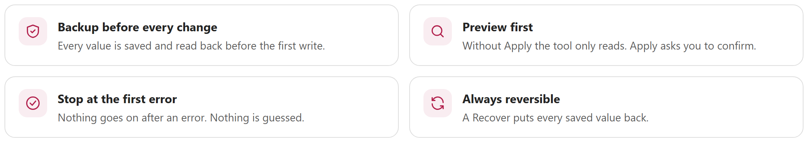

> [!WARNING]
> **The backups are the only way back.** A Recover restores what the Convert batch saved — nothing else. Keep the `Backups` folder on a durable, protected volume and copy it outside the server after each Apply. Never edit a backup: every file is checked by SHA-256 and a changed file is refused.

> [!CAUTION]
> **Convert creates new, empty mailboxes** in Exchange Online (`msExchMailboxGuid` is cleared). The content of the on-premises mailboxes is not moved. A Recover **deprovisions** the cloud mailboxes: mail received in the cloud during the disaster must be exported first if it has to be kept (or protected by a retention policy, see `Retention` in [chapter 6](#6-configuration)).
>
> What the lab showed after a deprovisioning: Exchange Online keeps the cloud mailbox **disconnected** (it is not listed as a soft-deleted mailbox), and a new Convert a few minutes later **reattached it with the same `ExchangeGuid`**. How long Exchange Online keeps it is not known, so **saving its content before a rollback stays the advice**. In Exchange Online, the synchronised mail user can have its object id as its `Name`: search by UPN, alias or address, never by `Name`.
>
> **The cloud X500 address is kept.** While an object is a remote mailbox, Entra Connect (Exchange hybrid writeback) adds an `X500:` address of the cloud mailbox to `proxyAddresses` and sets `msDS-ExternalDirectoryObjectId`. A Recover restores `proxyAddresses` as captured before the Convert **plus every `X500:` address that is on the object at that moment and was not in the original list**: nothing else is kept, the routing `smtp:` address added by Convert is still removed, no `X500:` is invented, and an address that was already original is not duplicated. Without it, a reply to a message sent from the cloud during the disaster, or a cached Outlook address, would bounce after the rollback. The Preview says *N cloud X500 address(es) kept*, and the batch records the list (`KeptX500`; a batch written before 3.0.0 has none).

> [!NOTE]
> **Nothing is automatic after an error.** The first error stops the batch: no next object, no sync, no cloud write, and no automatic rollback. The journal of the batch (`Journal-<id>.jsonl`) says exactly which write was started, applied and verified. Read the summary, fix the cause, run the same command again: objects already done are detected (`AlreadyDone`). **Once the AD changes are made, a Convert is not run again:** the objects are remote mailboxes, so the same command refuses them ("already converted by batch ...") and names the command that finishes the batch (`-Phase AD -Batch`, see [Exit codes](#exit-codes)). An Entra Connect sync that cannot run after the verified AD writes is not an error of the run (Pending, exit code 2, the transfer package is written).

> [!TIP]
> **Two servers are supported.** If no single server reaches both Active Directory and Microsoft 365 (for example an AD server on an isolated network), run the AD part with `-Phase AD` on the AD server, copy the **one transfer package** it writes (`Backups\Outbox\*.zip`, [chapter 10](#10-files-batches-proofs-and-packages)), and run `-Phase Cloud -Batch <package.zip>` on the **cloud server**. That is not a server hosted in the cloud: it is any Windows machine of the organisation that reaches Microsoft 365 through the Internet (server room or administrator workstation), with no access to AD. The summary of each step prints the command of the next one.

# Part II · Set up

<!-- icon: checklist -->
## 4. Prerequisites

> **In short:** Install PowerShell 7.5 and three modules, then ask for the rights of the Permissions table. Nothing needs Domain Admin: the exact rights come from the code.

### Server or workstation

| Item | AD server (phase AD / Both) | Cloud server (phase Cloud / Both) |
|---|---|---|
| **PowerShell 7.5 or later** (`pwsh.exe`; Windows PowerShell 5.1 is refused) | required | required |
| RSAT module `ActiveDirectory` (loaded natively by PowerShell 7 on Windows 10 1809+ / Windows Server 2019+) | required | not required for phase Cloud; final AD restoration always runs separately |
| Entra Connect | the tool runs on the Entra Connect server (module `ADSync`, loaded through the Windows PowerShell compatibility layer), **or** WinRM to `EntraConnect.Server` (the cycle then runs in the Windows PowerShell 5.1 endpoint of that server) | — |
| `ExchangeOnlineManagement` **3.10.1** or later, installed for PowerShell 7 | phase Both | required |
| `Microsoft.Graph.Authentication` and `Microsoft.Graph.Users` **2.41.1** or later, **in one same version for both**, installed for PowerShell 7 | phase Both | required |
| Durable disk for `Backups` | required | required (copies of the batches) |

The **cloud server** is not a machine hosted in the cloud: it is any Windows machine of the organisation that can reach Microsoft 365 (Exchange Online and Microsoft Graph) through the Internet, in your own server room or an administrator workstation. It needs no access to Active Directory, no RSAT and no Entra Connect. It needs the rows of the *Cloud server* column, the same signed package folder, and a configuration file with the same `Environment`.

```powershell
# PowerShell 7.5+ (pwsh), as administrator. winget install Microsoft.PowerShell installs PowerShell 7 if needed.
Install-WindowsFeature RSAT-AD-PowerShell                       # Windows Server (client: RSAT optional feature)
Install-Module ExchangeOnlineManagement -MinimumVersion 3.10.1 -Scope AllUsers -Force
Install-Module Microsoft.Graph.Authentication, Microsoft.Graph.Users -MinimumVersion 2.41.1 -Scope AllUsers -Force
```

> [!NOTE]
> Run the tool in a **new** PowerShell 7 window: it refuses an Exchange Online or Microsoft Graph session that already exists in the console (it must know which session it signs out).

**Window:** PowerShell 7.5+ (.NET 9+) supplies the native WPF Fluent controls; there is no other window. The window launches
every actual operation in a fresh **PowerShell 7.5+** process (`pwsh.exe` of the window's own `$PSHOME`) on the same computer, under the
same Windows account; the child inherits `PSModulePath`.

**Installing the modules for PowerShell 7.** `Install-Module` run in Windows PowerShell 5.1 installs under `WindowsPowerShell\Modules`, which PowerShell 7 does not search by default for modules without `Core` support. Run the `Install-Module` commands above from `pwsh`. The Windows PowerShell 5.1 copies of 2.x are not used by 3.0.0.

### Permissions

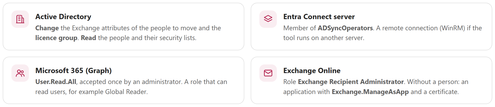

> [!NOTE]
> This list is **derived from the code**: every cmdlet that the engine calls was read in `PRA.Directory.psm1`, `PRA.Cloud.psm1` and `PRA.Gui.Directory.ps1`, and each line names the place that justifies it (file:line of this source). What the code cannot tell is listed in *What the code cannot tell you* below: have it confirmed once in a lab, before the real day. A test (`tests\PraDocumentation.Tests.ps1`) fails if the Graph scope documented here differs from the one in the code, or if a cloud cmdlet of the code is missing from this chapter. The plain "ask your administrator" version is in the [user guide](PraRemoteMailbox-UserGuide.md#ask-your-administrator-for-these-rights).

There is nothing to give to "everybody": the account that runs the **Active Directory** phases and the account (or application) that runs the **cloud** phases can be two different identities, one per server.

#### Active Directory (account that runs the phases AD, Both and Finalize)

| What the tool does | Cmdlet | Minimum right | Code |
|---|---|---|---|
| Writes a user or a shared mailbox object | `Set-ADUser -Replace / -Clear` | **Write property** on these 10 attributes of the user objects in scope: `homeMDB`, `homeMTA`, `msExchHomeServerName`, `msExchMailboxGuid`, `mDBUseDefaults`, `msExchRecipientDisplayType`, `msExchRecipientTypeDetails`, `msExchRemoteRecipientType`, `targetAddress`, `proxyAddresses` | `PRA.Directory.psm1:60` (the list), `:1492` (the write) |
| Writes the retention tag (Convert, restored by Recover/Finalize) | `Set-ADUser` | **Write property** on **one** `extensionAttributeN` (1 to 15; `extensionAttribute1` by default). Not needed when `Retention.Tag.Enabled = $false` | `:1068-1071`, `:1097`, `:1135-1141` |
| Puts a user in / out of the licence group (users only; never shared mailboxes) | `Add-ADGroupMember`, `Remove-ADGroupMember` (`-Members <user GUID>`) | **Write property** on `member` of the **one licence group** (`Licensing.GroupDN`). Not needed when `Licensing.Enabled = $false` | `:1500-1501` |
| Reads the objects | `Get-ADUser` (`-Properties` the 10 attributes + `memberOf`, `uSNChanged`, `DisplayName`, `mail`, `mailNickname`, `msExchArchiveGUID`, and for the backup `*`, `msExchMailboxSecurityDescriptor`, `nTSecurityDescriptor`, `publicDelegates`) | **Read** on the user objects in scope, including **Read permissions** (needed to read `nTSecurityDescriptor`: SendAs holders) | `:401-410`, `:943-953` |
| Reads groups and trustees | `Get-ADGroup`, `Get-ADGroupMember -Recursive`, `Get-ADObject -Filter objectSid` / `-Identity` | **Read** (default for authenticated users) | `:435`, `:481`, `:847`, `:894`, `:1007` |
| Finds the domain controller, the root and the OU | `Get-ADDomainController`, `Get-ADRootDSE`, `Get-ADObject`; `Get-ADOrganizationalUnit` (console OU list) | **Read** (default for authenticated users); Active Directory Web Services (TCP 9389) reachable on the domain controller | `:363-378`, `PRA.Gui.Directory.ps1:81` |
| *Optional* forced replication (`Directory.ForceReplication`, **off by default**) | `Sync-ADObject -Object <DN> -Source <written DC> -Destination <DC>`, then `Get-ADUser` on each destination | The control access right **Replication synchronization** (*DS-Replication-Synchronize*) on the **root of the domain**, for each destination domain controller. The *access denied* message of the tool names the same right, *Replication Synchronization*. The licence group is replicated too (when `Licensing.Enabled`) | `:1641`, `:1669`, `:1684`, `:1704` |

The tool never creates or deletes an AD object, never writes an ACL, never resets a password, and never writes any attribute other than those above. **Domain Admins is not required** by the code: only the rights of this table.

**Delegate them in plain steps** (a domain administrator does this once, on the OU that holds the mailboxes, to a dedicated group `CONTOSO\PRA-Operators` that contains the account of the operator):

1. Create the group `PRA-Operators` and put the operator account in it.
2. For the user objects: right-click the OU › **Delegate Control…** › the group › **Create a custom task to delegate** › **Only the following objects in the folder** › *User objects* › **Property-specific** › tick **Write** for the 10 attributes (and the one `extensionAttribute`). The same with `dsacls`, which is repeatable and can be reviewed:

```powershell
# Run as a domain administrator, in PowerShell 7, once. Change the OU, the group and the attribute of the retention tag to yours.
$ou  = 'OU=Mailboxes,DC=contoso,DC=com'
$who = 'CONTOSO\PRA-Operators'
foreach ($attribute in 'homeMDB', 'homeMTA', 'msExchHomeServerName', 'msExchMailboxGuid', 'mDBUseDefaults', 'msExchRecipientDisplayType',
                       'msExchRecipientTypeDetails', 'msExchRemoteRecipientType', 'targetAddress', 'proxyAddresses', 'extensionAttribute1') {
    dsacls $ou /I:S /G "${who}:WP;$attribute;user"
}
# The licence group: add and remove members (the attribute is member).
dsacls 'CN=PRA-Licence,OU=Groups,DC=contoso,DC=com' /G "${who}:WP;member"
# Only if you turn on Directory.ForceReplication: replicate a single object (root of the domain).
dsacls 'DC=contoso,DC=com' /G "${who}:CA;Replication synchronization"
```

3. Check the result: `dsacls $ou` lists the entries of the group; then run a **Preview** and an **Apply on one test mailbox** (user guide, Path 1) with this account.

#### Entra Connect server

| What the tool does | Cmdlet | Minimum right | Code |
|---|---|---|---|
| Checks, before the first AD write, that the account can use the synchronisation (read only, nothing is started) | `Get-ADSyncScheduler` (module `ADSync`), locally or through `Invoke-Command` (bounded time) | The same rights as the line below | `PRA.Directory.psm1`: `Test-PraSyncServer` |
| Waits for a running cycle, starts **one** cycle, waits for its end | `Get-ADSyncScheduler`, `Start-ADSyncSyncCycle -PolicyType Delta` (module `ADSync`) | Member of the local group **ADSyncOperators** (or local administrator) of the Entra Connect server | `PRA.Directory.psm1`: `$script:PraSyncCycle`, `Invoke-PraSync` |
| Does the same **remotely** (`EntraConnect.Server`) | `Invoke-Command -ComputerName <server>` (a job in the Windows PowerShell 5.1 endpoint) | The above, **plus** the right to open a remote session on that server: member of the local group **Remote Management Users** or of **Administrators**; WinRM (TCP 5985) reachable | `PRA.Directory.psm1`: `Invoke-PraSync`, `Start-PraSyncProbe` |

#### Microsoft Graph

| | Interactive sign-in (a person, Windows broker) | Certificate sign-in (application, nobody present) |
|---|---|---|
| **Delegated scopes requested by the code** | `User.Read.All` (the only scope: `Connect-MgGraph -Scopes 'User.Read.All'`, `PRA.Cloud.psm1:595`) | none (no scope is requested) |
| **Application permissions** | none | `User.Read.All` (Microsoft Graph, type *Application*) |
| **Admin consent** | **Yes, once**: an administrator accepts `User.Read.All` for the organisation the first time (the sign-in window shows *Permissions requested*) | **Yes**: *Grant admin consent* on the application registration |
| **What it reads** | `Get-MgUser -UserId <UPN> -Property Id,UserPrincipalName` (pre-check, `:771`); `Get-MgUser -Property assignedPlans, provisionedPlans, assignedLicenses` (`:873`); `Get-MgUserLicenseDetail -UserId <UPN> -All` (`:894`) | the same three calls |
| **Sign-in** | the admin who signs in needs a role that can read other users' licences: see *What the code cannot tell you* | `Connect-MgGraph -ClientId <AppId> -CertificateThumbprint <thumbprint> -TenantId <GUID>` (`:595`) |

The tool never writes anything through Microsoft Graph. Graph reads **user** mailboxes only (a shared mailbox has no licence and is checked through Exchange Online), and only when `Cloud.CheckLicense` is `$true` (the default) or `Cloud.MailboxCheckVia = 'Graph'` (`PRA.Cloud.psm1:941-947`).

#### Exchange Online

| What the tool does | Cmdlet | Code |
|---|---|---|
| Finds a recipient or a mailbox, its type, its holds | `Get-EXORecipient`, `Get-EXOMailbox` (also `-InactiveMailboxOnly`) | `PRA.Cloud.psm1:157`, `:186-187`, `:292` |
| Reads the FullAccess and SendAs holders of a shared mailbox | `Get-EXOMailboxPermission`, `Get-EXORecipientPermission` | `:252-253`, `:262-263` |
| Reads the SendOnBehalf holders | `Get-Mailbox -Filter` (property `GrantSendOnBehalfTo`) | `:283` |
| **Grants** FullAccess (Convert, shared mailboxes only) | `Add-MailboxPermission -AccessRights FullAccess` | `:359` |
| **Grants** SendAs | `Add-RecipientPermission -AccessRights SendAs` | `:360` |
| **Grants** SendOnBehalf | `Set-Mailbox -GrantSendOnBehalfTo @{Add=...}` | `:361` |
| *Optional* (`Retention.UseComplianceSession = $true`, interactive only): finds the GUID of the retention policy | `Connect-IPPSSession`, `Get-RetentionCompliancePolicy` | `:1067`, `:1073` |

There is **no** `Remove-*`, `New-*`, `Enable-*` or recovery cmdlet: a Recover never deletes a cloud mailbox by an Exchange Online call. The cloud mailbox disappears when Entra ID and Exchange Online process the AD change (the tool only waits and checks).

| | Interactive sign-in (a person) | Certificate sign-in (application) |
|---|---|---|
| **Role** | **Exchange Recipient Administrator** (Microsoft Entra role), or the Exchange Online role group **Recipient Management**. Read-only checks (`Check`) only: *View-Only Recipients* is enough | The application needs the **application permission** `Office 365 Exchange Online › Exchange.ManageAsApp` (admin consent) **and** the Entra role **Exchange Recipient Administrator** assigned to its service principal (a role that Microsoft lists as supported for app-only sign-in) |
| **Why this role** | it contains the *Mail Recipients* management role that carries `Add-MailboxPermission`, `Set-Mailbox` and the recipient reads | same roles; the access token carries the directory role |
| **Certificate** | none | in the **CurrentUser\My** store of the account that runs the tool (Microsoft: `-CertificateThumbprint` reads the user store), with its **private key**, **not expired** (the console's *Sign-in: Certificate* light checks the thumbprint, the expiry and the private key), created with a **CSP** key provider (a CNG key is refused by Exchange Online): [annex C](#annex-c--certificate-sign-in-application) |

#### What the code cannot tell you (have it confirmed in a lab)

These points depend on Microsoft services or on your directory, not on the code. They are **not invented here**: they are the best documented answer, marked for validation.

1. **The Entra role of the person for the Graph reads.** The code asks for `User.Read.All` (delegated). Which role the signed-in admin needs to read `assignedLicenses`, `assignedPlans` and `licenseDetails` of *other* users is decided by Microsoft Graph, not by this code. **Global Reader** is known to be sufficient and is the one to give; whether the *Exchange Recipient Administrator* role alone is enough must be tested: sign in with only that role and run **Check** on one user; an *Authorization_RequestDenied* means a reader role is missing.
2. **Which right replicates a single object.** The tool says *Replication Synchronization* in its *access denied* message (`PRA.Directory.psm1:1675`). Microsoft's protocol document for the `replicateSingleObject` operation ([MS-ADTS 3.1.1.3.3.18](https://learn.microsoft.com/en-us/openspecs/windows_protocols/ms-adts/d3d19d15-8427-4d4d-8256-d5fb11333292)) names the same control access right, **DS-Replication-Synchronize** (*Replication synchronization*, `1131f6ab-9c07-11d1-f79f-00c04fc2dcd2`), on the root of the naming context. The delegation above grants it. This has not been run with a delegated account yet. If *access denied* persists on a destination domain controller, add *Replicating Directory Changes* in the same way and report it.
3. **That an attribute-level *Write property* ACE is enough for every `msExch*` attribute** with `Set-ADUser` from a non-Exchange account. It is how Active Directory works, but it was validated in the lab with an administrator account only ([annex B](#annex-b--lab-test-campaign-2026-09-30)).
4. **The exact Exchange role of each cmdlet.** Check it in your tenant: `Get-ManagementRoleEntry "*\Add-MailboxPermission","*\Add-RecipientPermission","*\Set-Mailbox","*\Get-EXOMailbox"` lists the roles that carry each cmdlet; a custom role group with exactly those roles is a narrower alternative to *Exchange Recipient Administrator* (Microsoft, *Option 2: custom role groups* of the app-only authentication article).
5. **`ADSyncOperators` as the only membership** for `Get-ADSyncScheduler` / `Start-ADSyncSyncCycle`, and **Remote Management Users** for the remote session: Microsoft documentation, not exercised by the tests.
6. **How Exchange Online and Entra expose the X500 addresses.** The X500 control reads `EmailAddresses` (`Get-EXOMailbox -Properties EmailAddresses`) or, through Graph, `proxyAddresses`, and assumes that Entra Connect writes the on-premises `legacyExchangeDN` as an X500 address of the cloud object (the normal hybrid result). The lag (how many minutes a value takes to appear) and the property behaviour of your tenant are marked for lab validation; if the property is not returned, the control warns *could not be verified* instead of failing.
7. **The certificate store.** The console light looks in `CurrentUser\My` only, the store that Exchange Online (`Connect-ExchangeOnline -CertificateThumbprint`) reads: a thumbprint that exists only in `LocalMachine\My` shows a red light. A green light still does not prove that Exchange Online accepts the certificate (CSP key, application permission): the sign-in is proven by a **Check** on one mailbox.

Certificate sign-in for unattended runs: [annex C](#annex-c--certificate-sign-in-application).

<!-- icon: download -->
## 5. Installation

> **In short:** Copy the signed package to the server, unblock it, and put Backups on a safe disk. The package checks itself at every start.

1. Install PowerShell 7.5 or later on the server (`winget install Microsoft.PowerShell`, or the MSI of the PowerShell release page), then the modules for PowerShell 7 ([chapter 4](#4-prerequisites)). Copy the package folder (`PraRemoteMailbox-3.0.0`, the signed package built by `tools\New-PraPackage.ps1`, or the extracted release ZIP) to the server, for example `D:\PRA\PraRemoteMailbox`.
2. Unblock the files if they were downloaded: `Get-ChildItem D:\PRA\PraRemoteMailbox -Recurse -File -Force | Unblock-File`.
3. Put `Backups` on a durable volume (default: `.\Backups` in the tool folder; see `Storage.BackupFolder`).
4. Fill in the configuration ([chapter 6](#6-configuration)), then run a **Preview**: it checks the configuration, AD access and the scope without writing anything.

**Two servers**: install the same version on both, with a configuration of the **same `Environment`** (a batch is refused by a configuration of another `Environment`). The cloud server (any Windows machine that reaches Microsoft 365, see [chapter 4](#4-prerequisites)) needs only the cloud sections; the AD server needs the AD sections.

| Folder | Content |
|---|---|
| `Invoke-PraRemoteMailbox.ps1` | the only script to run |
| `PraRemoteMailbox.psd1`, `PraRemoteMailbox.psm1` | module manifest and root module: the script imports the manifest, which loads `PRA.Common` and `PRA.Directory` (`PRA.Cloud` and `PRA.Gui` are loaded only when needed) |
| `config\` | `PraRemoteMailbox.config.psd1` + CSV samples |
| `module\` | `PRA.Common` (console, log, configuration, reports, tool version), `PRA.Directory` (AD), `PRA.Backup` (capture), `PRA.Cloud` (Exchange Online, Graph), `PRA.Gui.psm1` and `PRA.Gui.xaml` (window), `PRA.Gui.Directory.ps1` (read-only OU list for the window, separate process), `Test-PackageIntegrity.ps1` (package verifier) |
| `templates\` | HTML report template |
| `docs\` | this guide (Markdown + HTML) and its images |
| `PackageIntegrity.psd1` | owner-signed manifest: SHA256 of every stable file |
| `README.md`, `LICENSE`, `CHANGELOG.md` | project information (`CHANGELOG.md` is added by the package builder and is hashed by the manifest) |
| `Backups\`, `logs\`, `reports\` | created by the runs; `Backups\`, `logs\` and `reports\` are created with a private ACL (current account, SYSTEM, Administrators; no inheritance) |

### Package integrity
The installed package is verified every time it starts. `module\Test-PackageIntegrity.ps1` and `PackageIntegrity.psd1` must carry the owner's timestamped Authenticode signature (certificate thumbprint `0F28E442889F17B5F4D251E8F96E7CC6E2C9C6D6`), every PowerShell file of the package must be signed by the same owner, and every stable file (modules, XAML, report template, sample CSV files, README, licence, change log, guide, images) must match the signed manifest. A changed, missing, duplicated, unexpected or reparse-point file stops `Invoke-PraRemoteMailbox.ps1`, the modules and the GUI helper **before** any import, window or operation. There is no unsigned mode, no switch and no environment variable to bypass it.
**Not** covered, on purpose: `config\PraRemoteMailbox.config.psd1` and the CSV lists you keep in `config\` (your data) and the generated `Backups\`, `logs\` and `reports\`. A signature detects a change; it does not stop the file system from being written.

> **Output folders.** `Storage.BackupFolder`, `Logging.Folder` and `Report.Folder` must be either a folder outside the package or, inside the package, exactly the canonical `Backups`, `logs` and `reports` folder (a sub-folder of its own canonical folder is accepted, the name is case-sensitive). Any other folder inside the package, such as `.\audit`, is refused with a clear message before a file is written, because the integrity check would reject the unexpected files at the next start. Choose an external path for a custom location. The test uses the physical location resolved by Windows: a `\\?\` prefix, an 8.3 name, a junction, a SUBST drive or an alias such as `C:\Documents and Settings` cannot hide the package (an accepted canonical folder is then used under its physical path), and a path whose location cannot be resolved is refused rather than assumed to be external.

<!-- icon: settings -->
## 6. Configuration

> **In short:** One settings file says who is converted and which groups and servers are used. Change only the lines you need: a wrong or unknown line is refused.

Everything is set in `config\PraRemoteMailbox.config.psd1` — the command line only chooses the action. The file is a PowerShell data file: text between quotes, `$true` / `$false`, numbers, `@( )` for lists. **An unknown setting is refused** (a typing mistake never goes unnoticed). Relative paths are relative to the tool folder.

### Identity of the environment

| Setting | Meaning |
|---|---|
| `Environment` | Label used in the backup file names; a batch is only accepted by a configuration of the same `Environment`. |
| `DomainController` | The writable DC used for **every** read and write of a run. Keep it fixed: AD versions (`uSNChanged`) are per DC, and the final restore of a Recover must use the DC of the AD phase. |

### Scope — which mailboxes are converted

| Setting | Meaning |
|---|---|
| `Scope.Mode` | Only a new conversion (Convert, phase AD or Both, without `-Identity` or `-Batch`) needs it: `Check`, the cloud phases, `Recover` and `Finalize` never read the scope, so a server without it (the cloud server) works. If it is empty (for instance `OU` without `SearchBase`, the default file) a conversion stops with *Scope.Mode = OU requires Scope.SearchBase: no OU is set ... Fill it in the configuration file, or give -Identity, -CsvPath or -SearchBase for this run, or set Scope.Mode = Auto*. Values: `OU` (every on-premises mailbox under `SearchBase`), `Auto` (same, `SearchBase` optional = whole domain), `Group` (members of `GroupDN`, recursive), `Csv` (column `Identity` in `CsvPath`). |
| `Scope.IncludeShared`, `IncludeRoom`, `IncludeEquip` | Mailbox types included besides user mailboxes. |
| `Scope.ExcludeSamAccountNames` | Accounts never converted. System mailboxes are always excluded. |

`-Identity` converts one object instead of the scope, **whatever its type**: `-Scope` is ignored with `-Identity` on Convert (a user, a shared mailbox, a room or an equipment mailbox that the eligibility rules accept). `-Scope UsersOnly|SharedOnly` and `-MaxObjects N` narrow a run on the configured scope (a pilot, a first wave); `-Scope` still filters a batch for Recover, the cloud phase and Check.

### Conversion

| Setting | Meaning |
|---|---|
| `Remote.RecipientType` | `msExchRemoteRecipientType` of users: **1** (provision a mailbox) or **3** (provision a mailbox and its archive); any other value is refused. With 1, +2 is added automatically when the user has an on-premises archive and `HandleArchives = $true`. |
| `Remote.HandleArchives` | `$true` (default): add the archive bit (2) for a user who has an on-premises archive. |
| `Remote.ClearMailboxGuid` | `$true`: clear `msExchMailboxGuid`, a new empty cloud mailbox is created. |
| `Routing.RoutingDomain` | `tenant.mail.onmicrosoft.com` — domain of the `targetAddress`. `AutoDetect` reuses an existing proxy address in this domain. |
| `Licensing.Enabled` | `$true` (default): users are added to the licence group at Convert and removed again at Recover (unless they were members before). `$false`: the licence is handled outside the tool. |
| `Licensing.GroupDN` | AD group, synchronised to Entra ID, that carries the Exchange Online licence (group-based licensing). **Required** when `Licensing.Enabled = $true`. |

### Shared mailboxes

| Setting | Meaning |
|---|---|
| `SharedMailbox.Enabled` | `$true` (default): shared mailboxes are converted with their permissions (when `Scope.IncludeShared = $true`). `$false`: no permission is captured or granted. |
| `SharedMailbox.RemoteRecipientType` | 97 (first provisioning of a shared mailbox), 99 with archive. |
| `SharedMailbox.PermissionSource` | Where FullAccess / SendAs holders are read, without Exchange: `AD` (default: the copy Exchange keeps on the account), `Csv` (`Shared,Group`), `CustomAttribute` (a group tagged with the name of the mailbox), `None`. Groups are expanded to their users. Details: [chapter 2](#2-how-it-works), *Shared mailbox permissions*. |
| `CaptureSendOnBehalf` | SendOnBehalf holders from `publicDelegates`. |
| `GrantFullAccess`, `GrantSendAs`, `GrantSendOnBehalf`, `AutoMapping` | What is granted in Exchange Online. |
| `ExcludeTrusteeSamAccountNames` | Accounts never reproduced (e.g. service or admin accounts found in the ACLs). |
| `KeepCloudSharedOnRecover` | `$true` = Recover keeps the cloud shared mailbox (rare). |
| `DeferOnPremRestore` | With phase Both, `$true` defers final AD restoration to Finalize. Phase Cloud always packages it, regardless of this setting. |

### Entra Connect

| Setting | Meaning |
|---|---|
| `EntraConnect.Sync` | `$true`: after the AD writes, run one cycle and wait for its end. Checked **before** the first AD write, **with the account that runs the tool**: an authenticated, read-only call to the ADSync module of the server (`Test-WSMan` is not used: it does not authenticate). If the check fails, Apply stops with "Entra Connect sync will not be possible: ..." (the reason and what to do), before the confirmation, with no backup and no write; Preview reports the same text as a warning. `$false`: the operator synchronises. |
| `EntraConnect.Server` | Entra Connect server reached by PowerShell remoting (bounded time); empty = this server (ADSync module). The console tries it too, in the background, and shows the answer on the Entra Connect light of the Setup page. |
| `EntraConnect.PolicyType`, `TimeoutMinutes` | `Delta` (default) or `Initial`; how long to wait for the cycle. |

### Active Directory replication (optional)

The attributes are written on ONE domain controller. Entra Connect reads the domain controller it is attached to: if the change has not replicated there yet, the delta
synchronisation runs for nothing. When the replication delay of the domain is a problem, turn this option on; it is **off by default**.

| Setting | Meaning |
|---|---|
| `Directory.ForceReplication` | `$true`: a step **Active Directory replication** runs just before the Entra Connect step (Convert AD or Both, Recover AD or Both, Finalize). For each object changed in the run it calls `Sync-ADObject -Object <DN> -Source <written DC> -Destination <DC>` towards every other writable domain controller, then reads the changed attributes back on each of them and compares them with the expected state. Also `-ForceAdReplication` (one run) and the checkbox **Replicate Active Directory before the Entra Connect sync** in the run settings of the console (marked *modified*, part of the effective configuration and of the Preview guard). |
| `Directory.ReplicationTargets` | Optional list of domain controllers to restrict it to (for example the ones the Entra Connect connector reads). Empty = every other writable domain controller of the domain. |
| `Directory.ReplicationVerifyAttempts`, `ReplicationVerifyDelaySeconds` | Bounded read-back: 1..30 reads, 1..60 seconds apart (6 and 10 by default). One `progress` event per attempt, one `item` event per object and domain controller. |

A Preview never replicates (the step is only listed, as skipped, when the option is on). Nothing is silent: a domain controller that is unreachable, not approved or that does not
converge is a **warning that names it**; the synchronisation still runs, and the Next steps say that it may not have seen the change and how to run it again later
(`Start-ADSyncSyncCycle -PolicyType Delta` on the Entra Connect server). **Rights**: replicating a single object needs the right *Replication Synchronization* (the extended right DS-Replication-Synchronize) on the domain naming context
(normally Domain Admins); an *access denied* is reported with that sentence. The licence group (when `Licensing.Enabled`) is replicated and read back like the users. With an explicit `-Confirm`, PowerShell asks once per destination domain controller.

### Microsoft 365

| Setting | Meaning |
|---|---|
| `Cloud.TenantId`, `Cloud.Organization` | Tenant GUID and initial domain (`tenant.onmicrosoft.com`). Every session is checked against them. **When `Cloud.AppId` is set, both are required** (the tenant must be a GUID): the configuration is refused at load otherwise. |
| `Cloud.AppId` + `Cloud.CertificateThumbprint` | Certificate sign-in (unattended, [annex C](#annex-c--certificate-sign-in-application)). Both empty = interactive sign-in (`Cloud.UserPrincipalName` = expected account). |
| `Cloud.CheckMailbox`, `CheckLicense`, `MailboxCheckVia`, `RequiredSkuPartNumber` | What "ready" means for a user: mailbox (Exchange Online type, or Graph provisioning) and licence. `MailboxCheckVia` is `Exo` by default (mailbox type in Exchange Online) or `Graph` (provisioning). |
| `Exo.MinModuleVersion` | Oldest `ExchangeOnlineManagement` accepted (default `3.10.1`). With an older module the tool stops before any change and gives the `Install-Module` command; `Exo.UseSubprocess` is the only way to the child process. The Microsoft Graph minimum (`2.41.1`, one same version for `Authentication` and `Users`) is fixed in the tool. |
| `Exo.DisableWAM` | `$false` (default): interactive sign-in through the Windows broker (WAM). `$true`: browser sign-in instead. See [chapter 8](#8-everyday-use), *Cloud sign-in from the window*. |
| `Exo.GrantVerifyAttempts`, `GrantVerifyDelaySeconds` | After **one** grant, re-read up to N times (never granted twice). |
| `Exo.UseSubprocess` | Run every Exchange Online call in a child PowerShell 7 process (certificate only; automatic with a module older than `MinModuleVersion`). |
| `Polling.IntervalMinutes`, `TimeoutMinutes` | How often (default 1 minute) and how long (default 60) the cloud part waits (15 to 60 minutes is common after a sync). |

### Retention

| Setting | Meaning |
|---|---|
| `Retention.Enabled` | `$true` (default): the retention tag is written at Convert and restored at Recover. |
| `Retention.PolicyName`, `PolicyGuid` | The Purview retention policy used by `-Action Check -Expect Retained` (default name `PRA-Converted-Retention`; the policy is created outside the tool). `PolicyGuid` is used directly when set. |
| `Retention.UseComplianceSession` | `$true`: find the GUID from `PolicyName` through an interactive `Connect-IPPSSession`. |
| `Retention.Tag.Enabled`, `Attribute`, `Value` | The AD attribute (`extensionAttribute1` to `15`) and the value (`Converted`) written at Convert. |

`Retention.Tag` writes `Converted` in `extensionAttribute1` (by default) at Convert. In Exchange Online it becomes `CustomAttribute1`: an **adaptive scope** of a Purview retention policy can use it, so that the cloud mailbox is kept (inactive mailbox) when Recover deprovisions it. The policy itself is created outside the tool; `-Action Check -Expect Retained` checks the holds (`PolicyGuid`).

### Files

| Setting | Meaning |
|---|---|
| `Storage.BackupFolder` | Backups (one private folder per batch). Durable, protected, copied outside the server. |
| `Storage.ForbiddenBackupRoots` | Volumes where a backup is refused (temporary disks). |
| `Logging.Folder`, `Report.Folder`, `Report.Enabled` | One log + one transcript per run; CSV + HTML report per run. Inside the package only `.\logs` and `.\reports` are accepted; use an external path for another location. |
| `Execution.Phase` | Default of `-Phase`: `Both` on one server; `AD` or `Cloud` on the servers of a two-server setup. |

<!-- icon: key -->
## 7. Unattended execution

> **In short:** For a run with nobody present, the tool signs in with an application and a certificate, from a scheduled task.

For a run without a person at the keyboard (scheduled task, orchestrator):

0. Start PowerShell 7, never `powershell.exe`: the action of the scheduled task is `"C:\Program Files\PowerShell\7\pwsh.exe" -NoProfile -NonInteractive -File "D:\PRA\PraRemoteMailbox\Invoke-PraRemoteMailbox.ps1" -Action Convert -Mode Apply -Force` (adapt the path of `pwsh.exe`).

1. Certificate sign-in: create the application once ([annex C](#annex-c--certificate-sign-in-application)) and set `Cloud.AppId` + `Cloud.CertificateThumbprint`. The certificate must be in the **CurrentUser\My** store of the account that runs the tool.
2. Run with `-Mode Apply -Force` under a domain account that has the AD rights of [chapter 4](#4-prerequisites). `-Confirm:$false` is accepted as an equivalent for the single confirmation (an explicit `-Confirm`, with either value, skips it); use it only after a reviewed Preview.
3. Read the exit code: **0** done, **1** failed, **2** done but a next step is required (Pending objects). With `-PassThru`, the tool also returns the result object: `Status`, `ExitCode`, `BatchId`, `NextSteps`, the counters and the paths of the log and the reports (without `-PassThru`, nothing is written to the pipeline).

```powershell
$r = & 'D:\PRA\PraRemoteMailbox\Invoke-PraRemoteMailbox.ps1' -Action Convert -Mode Apply -Force -PassThru
if ($r.ExitCode -eq 1) { throw "PRA Convert failed: $($r.Issues[0].Message)" }
$r.BatchId      # keep it: Recover -Batch <id>
```

# Part III · Use

<!-- icon: play -->
## 8. Everyday use

> **In short:** Use the console window, or copy a recipe. The routine never changes: preview, read, apply, keep the batch ID.

Everything else comes from the configuration file; the command line only says **what** to do this time.

| Parameter | Values | Use |
|---|---|---|
| `-Action` | `Convert`, `Recover`, `Finalize`, `Check` | required for command-line operations; mutually exclusive with `-Gui`. The value is **case-insensitive** for `-Action`, `-Mode`, `-Phase`, `-Scope` and `-Expect` (`convert`, `CLOUD`, `apply`): the script rewrites them to their official spelling before anything else, and the strict comparisons of the proofs and batches stay case-sensitive |
| `-Mode` | `Preview` (default), `Apply` | `Apply` writes, after one confirmation |
| `-Phase` | `Both`, `AD`, `Cloud` | Convert / Recover on two servers; default `Execution.Phase` |
| `-Batch` | batch ID (8 characters), path of the batch JSON, or **a transfer package `.zip`** (path, or the name of a file in `Backups\Inbox`, `Backups\Outbox` or the current folder) | Recover, `-Phase Cloud`, Finalize; optional for Check. Also accepted by `Convert -Phase AD` to finish a batch left without its synchronisation or package (no AD write, see [Exit codes](#exit-codes)). A package is verified, then extracted ([chapter 10](#10-files-batches-proofs-and-packages)) |
| `-Identity` | UPN, sAMAccountName, DN or GUID | one object only |
| `-SearchBase` | OU distinguished name | Convert AD/Both only; run-specific OU + child OUs, without changing configuration |
| `-CsvPath` | path of an Identity CSV | Convert AD/Both only; run-specific comma/semicolon list, without changing configuration |
| `-Scope` | `All` (default), `UsersOnly`, `SharedOnly` | filters the scope or the batch; **ignored by Convert with `-Identity`** |
| `-MaxObjects` | number (0 = no limit) | Convert: first N objects |
| `-Expect` | `Provisioned` (default), `Deprovisioned`, `Retained` | Check only |
| `-ConfigPath` | path | another configuration file (another environment) |
| `-BaseConfigPath` | path | set by the console when run settings were changed: `-ConfigPath` is then the effective copy and this is the file it was made from. The log, the result and the report list the settings that differ. Not needed on the command line |
| `-Force` | switch | Apply without the confirmation (unattended). An explicit `-Confirm` (with either value) also skips the single confirmation: `-Confirm:$false` behaves like `-Force`, a plain `-Confirm` replaces it with a PowerShell prompt for every write. Never skips a safety check. |
| `-Once` | switch | cloud checks: one pass, no wait |
| `-PassThru` | switch | also returns the result object ([chapter 7](#7-unattended-execution)) |
| `-Gui` | switch | opens the window; may be combined with `-ConfigPath`, not with an operation |
| `-WhatIf` / `-Verbose` | switches | `-WhatIf` = Preview; `-Verbose` shows the debug lines of the log |

**The routine is always the same**: run the command **without** `-Mode Apply` (preview: nothing is written), read the plan, run the **same** command **with** `-Mode Apply`, answer `Y`, and **note the batch ID** printed at the end — it is the key of the roll-back. The recipes below are complete: copy them, change the names.

### The console (WPF window)

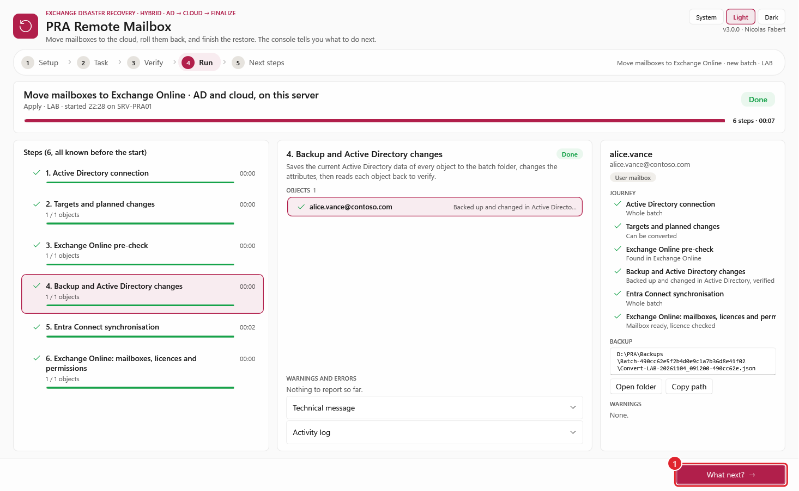

```powershell
# Native Fluent controls; the business engine runs in a separate pwsh.exe process.
pwsh -STA -File .\Invoke-PraRemoteMailbox.ps1 -Gui -ConfigPath .\config\PraRemoteMailbox.config.psd1
```

The console is a guided path of five pages, made for an operator under pressure: **Setup, Task, Verify, Run, Next steps**.
Opening it, reloading the configuration or picking a batch never connects to Active Directory or Microsoft 365; the engine does that, in its
own PowerShell 7.5+ process, when you click **Preview** or **Run**. The language of the console is English.

| Page | What it shows | What it asks |
|---|---|---|
| **1. Setup** | the environment, what **this server can run** (AD, Cloud or both) and the prerequisite lights: RSAT ActiveDirectory, ExchangeOnlineManagement (version against `Exo.MinModuleVersion`, 3.10.1 or later), Microsoft.Graph (`Authentication` and `Users` in one same version, 2.41.1 or later; the red text gives the versions found and the exact `Install-Module` command), the Entra Connect synchronisation, and the sign-in (the certificate is looked up in `CurrentUser\My` (the store the sign-in reads; a thumbprint only in `LocalMachine\My` is red) with its expiry, or the Windows account broker). A sixth light, **Microsoft 365 reachable**, appears once the programs and the sign-in are in place: an HTTPS request (HEAD, port 443, through the default system proxy, 3 s) to `login.microsoftonline.com` and to `outlook.office365.com`, sent in the background (the window never waits; **Choose a task** stays grey for those few seconds). Any HTTP answer counts as reachable. The lights come from real detection (`Get-Module -ListAvailable`, the certificate stores, the network test); **Check again** runs it again | nothing when the lights are green: read three lines, click **Choose a task**. One compact line, *This run: PROD · dc02.contoso.com · All mailboxes · Certificate sign-in*, with **Change...** to open the run settings |
| **2. Task** | four tiles: **Move mailboxes to Exchange Online**, **Roll back a conversion**, **Complete a rollback** (only when a Finalize package exists) and **Check a mailbox**; then **On what?** | the object source of a new Convert (below), or the batch or transfer package to continue. The phase is inferred and explained: *What will happen on this server* |
| **3. Verify** | the plan in order, the settings used, then the result of the **Preview** in plain words (*12 mailboxes will be converted, 2 shared, 0 blocking*) and the grid of objects with what was found | **Preview** first; the confirmation word (any letter case) unlocks **Run** after an identical Preview. **Check** has no preview and no confirmation: it never writes |
| **4. Run** | the steps announced by the engine (the `plan` event) with a glyph per state, a counter, a bar per step and the elapsed time; **explicit waits** (Entra Connect synchronisation, grant verification, deprovisioning and mailbox polling: *attempt 4 / 13, next check in 7 s*); a status pill and an overall bar | nothing: while a wait runs, the detail pane says what is awaited, the attempt, the next check and how long it may take; click a step to read what it does, its objects, its warnings and errors in plain words and, collapsed, the technical message; click an object for its journey |
| **5. Next steps** | the transfer package to carry to the next server (below), the exact command, the result, the report and log, and the status of the batch (AD, Cloud, Finalize) | **Start a new task** |

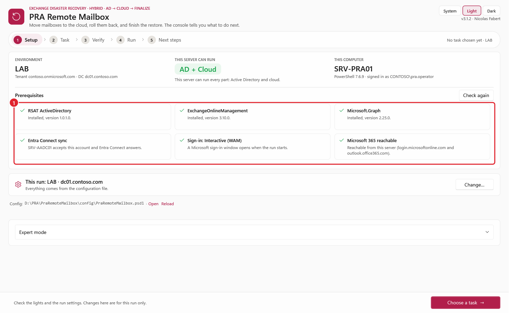

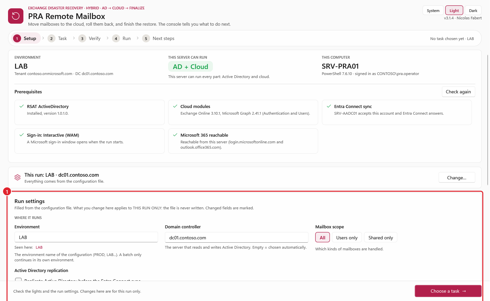

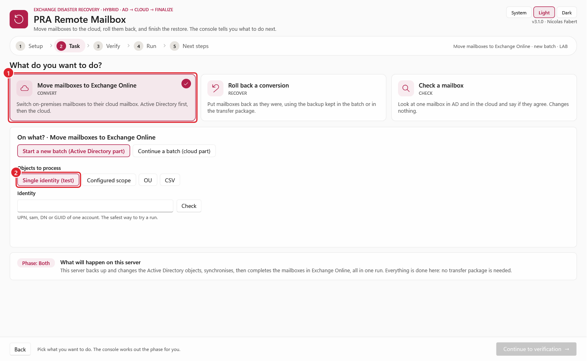

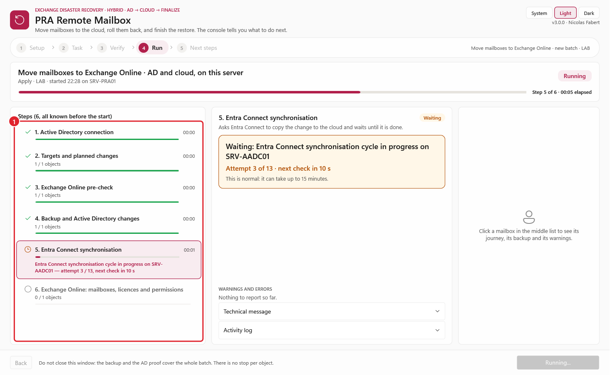

**Run settings** (page 1, *Change...*): Environment, domain controller, mailbox scope (`All`, users only, shared only), sign-in (certificate or
interactive Windows broker), tenant ID and organization. The cloud fields appear only when the chosen task needs the cloud. A value that differs from the
configuration file is marked **modified**, with **Reset**. **What you change applies to this run only and is never written to the file.** The window
writes an **effective configuration** (the file, plus your changes) in a private run folder (`logs\gui\run-<id>\effective.config.psd1`, same private ACL as
the other folders), the engine loads it with the same validation as any configuration (`Import-PraConfiguration`), and its SHA-256 is part of the Preview
guard: changing it, or the file it comes from, voids the Preview. The log and the result list the settings changed against the file
(`-BaseConfigPath`, see the table of this chapter). The **Environment** is a text field (suggestions: the environments seen in the batches of the backup folder).
When you pick a batch or a package, the Environment is **locked to the one of the batch**: a batch only continues in the environment where it started.

**The object source of a new Convert** is chosen on the Task page, never on Setup:

| Source | Selection |
|---|---|
| **Single identity (test)** (default) | one UPN, sAMAccountName, DN or GUID: the safest way to try a run |
| **Configured scope** | the `Scope` of the configuration file, shown read only |
| **OU** | its distinguished name, or **Pick an OU...** to browse the OUs of the configured DC (read in a separate PowerShell 7 process, when clicked); child OUs are included |
| **CSV** | a list with an `Identity` column (UPN, sAMAccountName, DN or GUID); comma and semicolon are supported |

The source is passed to the engine as `-Identity`, `-SearchBase` or `-CsvPath`; the configuration is **not rewritten**. Changing the source, the list or the CSV contents
voids the previous Preview. The list is revalidated and hashed before Run. AD still verifies the real object types and complete backups before writing.
**Users and shared mailboxes are supported:** use `All` (with `Scope.IncludeShared = $true`, the default), users only or shared only.

| Task | New or continue | Phase (inferred) | Needs |
|---|---|---|---|
| Move mailboxes | new batch | `Both` if this server can do AD and cloud and `Execution.Phase` is `Both`, otherwise `AD` | the object source |
| Move mailboxes | continue | `Cloud` | the Convert batch or package of the AD part |
| Roll back | new | like *new batch* | the original Convert batch |
| Roll back | continue | `Cloud` | the **Recover** batch or package (not the Convert one) |
| Complete a rollback | | AD only | the Finalize package |
| Check a mailbox | | `Cloud`, read only | one UPN |

**Continue a batch** lists the batches found in `Storage.BackupFolder` (of every environment) and the transfer packages waiting in
`<Storage.BackupFolder>\Inbox`, with their state. **Import package...** takes a `.zip` from anywhere: the console verifies it (all checks before any write, [chapter 10](#10-files-batches-proofs-and-packages)),
extracts it into `Storage.BackupFolder` and selects its batch. A package picked in the list is imported when you continue to the verification page.

A Convert batch whose AD part is verified (it has its `State-<id>.json`) but whose Entra Connect sync did not end (the last `ADSync` line of its journal is `Failed`), or that has no package in `Backups\Outbox` on a server that cannot do the cloud part, is marked **finish it here** (orange). Selecting it makes the phase **AD** and runs `Convert -Phase AD -Batch <path>` ([Exit codes](#exit-codes)): the Entra Connect check, the synchronisation again, the package; Active Directory is not written and the cloud sign-in is not needed. The Next steps page of a run whose sync could not start puts the sync before the copy of the package. An engine refusal "already converted by batch ..." sent from the console names this path (Task, Continue a batch) instead of a command line.

**Safety is unchanged.** Run is locked until a successful Preview of **exactly** the same request, files and configuration; the engine independently rereads the
directory, backs up and verifies the targets before every write. Type **CONVERT**, **RECOVER** or **FINALIZE** (any letter case, surrounding spaces
ignored). An errored, unfinished or empty preview does not unlock Run. The engine is never stopped by force and the window refuses to close while it runs.
**Expert mode** (collapsed at the bottom of Setup) holds what a normal run does not need: a manual phase, `MaxObjects`, `Expect`, `Once`, another
configuration file, and the equivalent command line.

**Pending is not failure and not completion** (exit code 2): do the next step the page tells you. The Next steps page of a failed run says what stopped, in plain words, and what to do.

#### Cloud sign-in from the window (WAM) and the child console

Each operation runs in its own PowerShell 7.5+ **child process**, started by the window. The child is
the same engine as the command line; the window only reads its event file, its output and its exit code. Two
choices matter for the interactive Microsoft 365 sign-in (`Connect-ExchangeOnline`, `Connect-MgGraph`):

- **The Windows account broker (WAM) is on by default** (`Exo.DisableWAM = $false`; Microsoft Graph keeps its
  own default, which is also WAM). The broker needs a **parent window handle**. A child started with no
  console window (the former `CreateNoWindow`) has none, and the sign-in failed with an MSAL error and no
  window. Actions that can reach the cloud (Convert and Recover with phase `Both` or `Cloud`, and Check) are
  therefore started **with a new console window of their own** and **without** `-NonInteractive`. The window starts
  the child with `CreateProcess` and the `CREATE_NEW_CONSOLE` flag (bound in memory with the same Reflection.Emit
  technique as the physical-path check of `PRA.Common`: no compiler, no temporary DLL), while its three standard
  streams stay redirected to pipes. The child therefore does **not** share the console of the terminal that started
  the window: closing or hiding that terminal in the middle of an Apply cannot stop the engine, and the broker gets
  the window of the new console as its parent. The new console is titled *PRA Remote Mailbox - cloud sign-in*; it stays
  empty, because the engine's output goes to the window, not to that console. Under Windows Terminal set as the
  default terminal application, the new console opens as a window of Windows Terminal.
- The child's **standard input is closed at once**, so a prompt receives an empty answer (end of file) instead of waiting
  for a keyboard, and the engine's own checks then refuse; this replaces `-NonInteractive`, which would also forbid
  the sign-in. AD-only children (phase `AD`, Finalize, the OU list) never sign in to the cloud and have no console
  window at all.

What to do: **leave the new console window open** (it can be minimised) while a cloud operation runs and accept the
Microsoft sign-in dialog. If the sign-in dialog cannot open, use the certificate sign-in ([annex C](#annex-c--certificate-sign-in-application)) or set
`Exo.DisableWAM = $true` (browser sign-in). The activity log shows the engine's own console lines as they arrive
(sign-in messages, waits, warnings), without repeating the events it already displays; the complete output is kept
in `logs\gui\<id>.stdout.txt` and `.stderr.txt` (the raw bytes of the child, in the console code page of the
computer).

Why a child process and not the window's own session: a child isolates assembly conflicts of the cloud modules
(Graph before Exchange Online), keeps the operation atomic (the window cannot be closed mid-batch), leaves the
UI thread free, and means that no AD or cloud module is ever imported into the WPF host. The child's output
pipes are copied straight to those two files by `Stream.CopyToAsync` (pure .NET on the thread pool: no PowerShell
code ever runs on a background thread, and a child that prints more than a pipe buffer never blocks); the window's
timer only reads what has been written so far, through a second read-only stream of the file.

#### What the console decides for you (3.0.0)

- **The phase.** A server that can do the Active Directory side **and** the cloud side (role *AD + Cloud* on Setup: RSAT, the cloud programs **and** Microsoft 365 reachable from this server) runs a new Convert or Recover as **Phase Both** (the console names it *AD and cloud, on this server*): everything is done there, there is no
  transfer package and the Task page says so. The AD phase (which writes a package) or the Cloud phase only appears when the server can do one side only, which includes a server with every program but no access to Microsoft 365 (role *AD*, amber light, the Setup page says why); Expert mode can still force a phase.
- **Identity.** Under the Identity field, **Check** (also when the field loses the focus or Enter is pressed) shows the account that was resolved (display name, UPN, mailbox type) or says plainly that it
  was not found or is ambiguous. It is a read-only lookup made by a child process (25 s at most): the window never waits for Active Directory.
- **Run page.** A step that works object by object shows *1 / 2 objects* with a proportional bar as the objects complete; the steps of the whole batch (Entra Connect, replication, package, cloud wait) are in the
  journey of every object, marked *Whole batch*; the card shows the backup of the object. After an Apply, **Back** no longer leads to the verification (use *Start a new task* to run again); *Open report*
  and *Open log* are next to the status on the Next steps page, and *Open global report* when the run produced one.
- **Run settings.** *Replicate Active Directory before the Entra Connect sync* is an ordinary run setting (see *Active Directory replication*).

### Recipe 1 — Convert one user

Nothing to change in the configuration: `-Identity` replaces the scope (UPN, sAMAccountName, DN or GUID).

```powershell
cd D:\PRA\PraRemoteMailbox
.\Invoke-PraRemoteMailbox.ps1 -Action Convert -Identity jdupont@contoso.com               # 1. preview
.\Invoke-PraRemoteMailbox.ps1 -Action Convert -Identity jdupont@contoso.com -Mode Apply   # 2. convert
```

The preview shows `jdupont  UserMailbox → RemoteUserMailbox · convert`, the attributes that change and `licence group … not member → member`. The Apply backs up the account, writes AD, adds it to the licence group, runs one Entra Connect cycle, then waits until Exchange Online shows a mailbox and a licence. The summary ends with:

```text
Batch       1d5ac20b
Next        To roll back this batch later: .\Invoke-PraRemoteMailbox.ps1 -Action Recover -Batch 1d5ac20b
```

To undo: recipe 5.

### Recipe 2 — Convert a whole OU (users and shared mailboxes)

1. In `config\PraRemoteMailbox.config.psd1`, section `Scope`:

```powershell
Scope = @{
    Mode                   = 'OU'
    SearchBase             = 'OU=Paris,OU=Sites,DC=contoso,DC=com'   # sub-OUs included
    GroupDN                = ''
    CsvPath                = ''
    IncludeShared          = $true      # also the shared mailboxes of the OU
    IncludeRoom            = $false
    IncludeEquip           = $false
    ExcludeSamAccountNames = @('svc-scan', 'test01')    # never converted
}
```

2. Then:

```powershell
.\Invoke-PraRemoteMailbox.ps1 -Action Convert                 # preview: every on-premises mailbox of the OU
.\Invoke-PraRemoteMailbox.ps1 -Action Convert -Mode Apply     # convert them all, in one batch
```

Only **on-premises mailboxes** are taken: objects without an on-premises mailbox (already in Exchange Online, mail users, contacts) are ignored. For a first wave, add `-MaxObjects 10` (the first 10 by sAMAccountName). For the shared mailboxes, the preview also lists **who will get FullAccess, SendAs and SendOnBehalf** (see [shared mailbox permissions](#shared-mailbox-permissions-where-they-come-from)).

### Recipe 3 — Convert only the shared mailboxes

All the shared mailboxes of the configured scope (recipe 2), users excluded — for example a second wave after the users:

```powershell
.\Invoke-PraRemoteMailbox.ps1 -Action Convert -Scope SharedOnly               # preview
.\Invoke-PraRemoteMailbox.ps1 -Action Convert -Scope SharedOnly -Mode Apply   # convert
```

One shared mailbox only:

```powershell
.\Invoke-PraRemoteMailbox.ps1 -Action Convert -Identity compta@contoso.com
.\Invoke-PraRemoteMailbox.ps1 -Action Convert -Identity compta@contoso.com -Mode Apply
```

Shared mailboxes never get a licence. After the sync, the tool waits for the cloud shared mailbox, then grants each permission found in AD and re-reads it; every grant is printed (`compta@contoso.com: FullAccess granted to marie@contoso.com and verified`). The permission holders do **not** need to be converted first: a user still on-premises exists in Exchange Online as a synchronised mail user and can receive the permission (it is useful as soon as that user has a cloud mailbox). `-Scope SharedOnly` takes the shared mailboxes even when `IncludeShared = $false`; with `Scope.Mode = 'Csv'`, use a file that lists only shared mailboxes. The mirror option is `-Scope UsersOnly`.

### Recipe 4 — Convert a list of mailboxes or the members of a group

| Source | Configuration (`Scope`) |
|---|---|
| A CSV file | `Mode = 'Csv'`, `CsvPath = '.\config\Wave1.csv'` — one column `Identity` (UPN, sAMAccountName, DN or GUID), see `config\Targets.sample.csv`. Every line must be an on-premises mailbox, otherwise nothing is converted. |
| An AD group | `Mode = 'Group'`, `GroupDN = 'CN=PRA-Wave1,OU=Groups,DC=contoso,DC=com'` (nested groups included). |

The commands are those of recipe 2.

### Recipe 5 — Roll back (Recover)

Use the batch ID of the Convert (summary, report, or the folder name `Backups\Batch-<id>…`):

```powershell
.\Invoke-PraRemoteMailbox.ps1 -Action Recover -Batch 1d5ac20b                                       # preview of the roll-back
.\Invoke-PraRemoteMailbox.ps1 -Action Recover -Batch 1d5ac20b -Mode Apply                           # the whole batch
.\Invoke-PraRemoteMailbox.ps1 -Action Recover -Batch 1d5ac20b -Identity jdupont@contoso.com -Mode Apply   # one object of the batch
```

Users get their original attributes back and leave the licence group. Shared mailboxes are first removed from Exchange Online; their on-premises attributes come back when Exchange Online confirms it (up to `Polling.TimeoutMinutes`), in the same run. Their on-premises permissions were never changed.

### Recipe 6 — Check, at any time

```powershell
.\Invoke-PraRemoteMailbox.ps1 -Action Check -Batch 1d5ac20b                          # are the mailboxes of the batch in Exchange Online?
.\Invoke-PraRemoteMailbox.ps1 -Action Check -Identity jdupont@contoso.com             # one mailbox
.\Invoke-PraRemoteMailbox.ps1 -Action Check -Batch 1d5ac20b -Expect Deprovisioned     # after a Recover
```

Read only. Check waits for the expected state (up to `Polling.TimeoutMinutes`); add `-Once` for a single pass. It also shows whether the mailbox carries the X500 addresses recorded by the Convert (section *X500 addresses*, [chapter 2](#2-how-it-works)).

### Scenario C — Convert on two servers

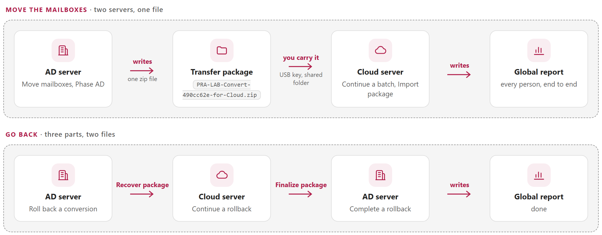

```steps
AD server | `.\Invoke-PraRemoteMailbox.ps1 -Action Convert -Phase AD -Mode Apply` — backup, AD changes, sync. The summary prints the batch ID.
Copy | Copy the **one file** `Backups\Outbox\PRA-<Environment>-Convert-<id8>-for-Cloud.zip` (and its `.sha256`) to the cloud server, anywhere. (Copying the whole `Batch-<id>` folder still works.)
Cloud server | `.\Invoke-PraRemoteMailbox.ps1 -Action Convert -Phase Cloud -Batch '<package>.zip' -Mode Apply` — verifies and imports the package, waits for the mailboxes, grants the permissions. In the console: *Move mailboxes to Exchange Online*, *Continue*, **Import package...**.
```

### Scenario D — Recover on two servers

```steps
AD server | `-Action Recover -Phase AD -Batch <convert id> -Mode Apply` — users restored, shared mailboxes deprovisioned. Exit code 2: next step required.
Copy | Copy the one file `PRA-<Environment>-Recover-<id8>-for-Cloud.zip` to the cloud server: it holds the new Recover batch **and** the original Convert batch.
Cloud server | `-Action Recover -Phase Cloud -Batch '<recover package>.zip' -Mode Apply` — checks the deprovisioning and writes the Finalize package `PRA-<Environment>-Finalize-<id8>-for-AD.zip`.
Copy back | Copy that one file to the AD server.
AD server | `-Action Finalize -Batch '<finalize package>.zip' -Mode Apply` — restores the shared mailboxes and the retention tags.
```

Since 2.1.0, `-Phase Cloud` never performs the last AD restore itself, **even with RSAT installed**.
Phase Both retains inline restoration unless `DeferOnPremRestore` is enabled. Finalize is only
required when the result supplies a Finalize package (deferred shared attributes or retention tags).

### What you see

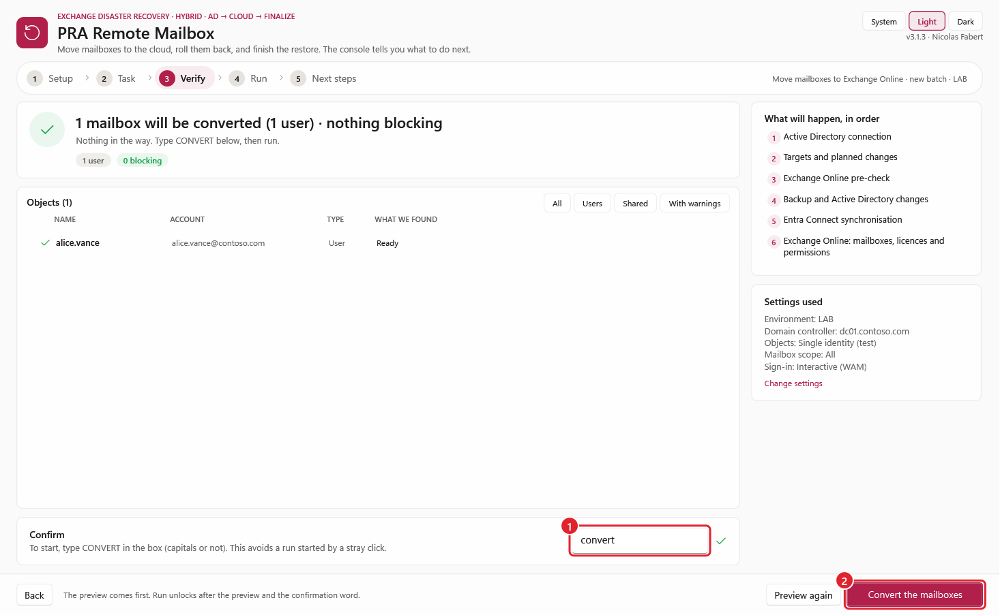

1. The **banner**: action, mode, scope, tenant, configuration and log file.
2. **Numbered steps**. In a preview, the steps that write are shown as skipped.
3. For each object: its type change (`UserMailbox → RemoteUserMailbox`) and **only the attributes that change** — green = added, yellow = changed, red = removed. For a shared mailbox, the holders that will get **FullAccess**, **SendAs** and **SendOnBehalf** in Exchange Online. The full before/after values and the complete lists of holders are in the log.
4. The **summary**: result, batch ID, backup, report, log, duration and the **next command**.

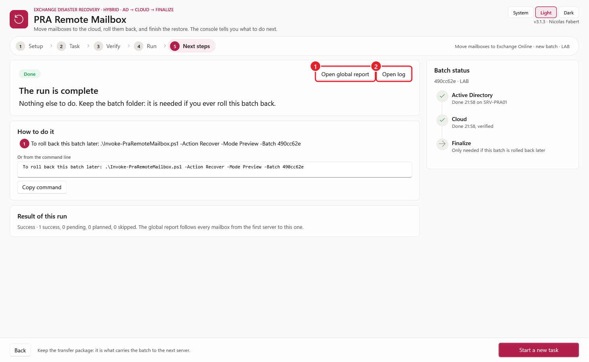

### Exit codes

| Code | Meaning | What to do |
|---|---|---|
| 0 | Done (or preview without error): nothing is left to do | nothing |
| 1 | Failed — see `Error` in the summary | fix the cause, run the same command again — **only if nothing was changed yet** (the summary says so; the Entra Connect check, the backup and the first error all stop before or at the first write). After the AD changes, go on with the batch (see below) |
| 2 | Done, but objects are **Pending**: a phase AD that ends with a transfer package (the cloud part is still to do), or a sync that did not run | run the next step printed in the summary |

A `Convert` or `Recover` with `-Phase AD` therefore exits with **2** when it ends with a package: the batch is half done, and the console shows it as "Next step required", not as an error. When the tool did not run the Entra Connect sync (`EntraConnect.Sync = $false`, or a failure), the first numbered step is *Run a delta sync on the server (`Start-ADSyncSyncCycle -PolicyType Delta`) or wait for the next automatic cycle (about 30 minutes)*, before *Copy the package*.

**The Entra Connect sync could not run after the AD changes.** The AD part is made and verified, so the run does not fail: the objects are **Pending** (exit code 2), the transfer package is still written (phase AD) and the Next steps say it plainly: *AD is changed and verified. The Entra Connect sync could not start: reason. Run a delta sync on the server (`Start-ADSyncSyncCycle -PolicyType Delta`) or wait for the next automatic cycle (about 30 minutes)*, then carry the package to the cloud server. With phase Both the cloud part is **not** started (the mailboxes would not appear): run the sync, then continue the batch with `-Action Convert -Phase Cloud -Batch <id>` (it waits for the mailboxes, up to `Polling.TimeoutMinutes`). The journal of the batch has a line `ADSync` / `Failed`.

**Finish the AD side of a batch (`-Phase AD -Batch`).** For a batch whose AD changes are made and verified (it has its `State-<id>.json` proof) but that has no package or no synchronisation, for instance after a run of an older version that stopped at the sync:

```powershell
.\Invoke-PraRemoteMailbox.ps1 -Action Convert -Phase AD -Mode Apply -Batch 490cc62e
```

The batch, its backup and its proof are checked in full; the Entra Connect check is made as for a conversion (it stops with nothing written if it fails); the synchronisation runs again; the transfer package is written. **Active Directory is not written** and the same objects are not converted twice. A Preview shows what would be done. A batch without proof is refused ("cannot be finished from here"). The same command is printed when a conversion is started again for an object that is already converted.

<!-- icon: chart -->
## 9. Reading the results

> **In short:** Every run writes a report that opens in a browser. Read the result, then the warnings, then the line of each person.

### The HTML report

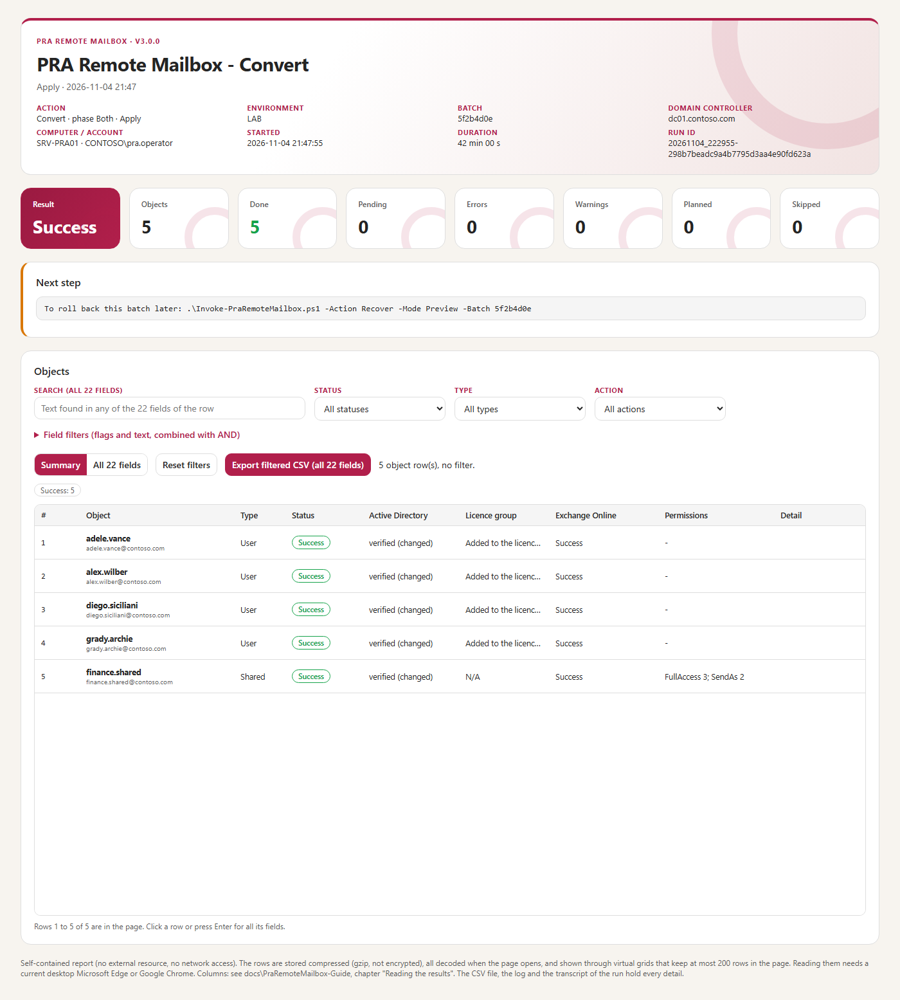

One page per run in `reports\`: tiles with the counters (including **Warnings**), the next step, the warnings of the run, one row per object, and the run errors. It is self-contained (no external resource, no network, no telemetry).

The rows are stored in the page as compressed chunks of 20,000 rows (gzip, then base64: compression, **not** encryption; protect the file like the CSV). When the page opens it decodes **all** chunks at once (eager, not lazy; about 0.3 s for 50,000 rows on the test PC), then shows only the rows in view: the *Summary* grid (the eight columns above) and the *All 22 fields* grid never hold more than 200 data rows in the page, whatever the number of rows. Scroll, or use the keyboard (arrows, Page Up/Down, Home/End, Enter for all the fields of a row). Filters (status, type, action, six yes/no flags, ten text fields and a search over the 22 fields) combine with AND, always inspect every row and show the filtered counts; **Reset filters** clears them. **Export filtered CSV** writes every matching row with the 22 fields (semicolon, UTF-8 with BOM, every field quoted, a cell starting with `=`, `+`, `-` or `@` gets a leading `'`). The CSV written next to the report is unchanged and has the raw values. Warnings and run errors are listed 100 per page with their own filter; none is dropped.

Requirement: a current desktop Microsoft Edge or Google Chrome (the page needs `DecompressionStream`). Without it, without JavaScript, or if a chunk is missing or damaged, the page says so explicitly and displays no partial result; the run summary (tiles, next step) stays visible and the CSV with the same name holds every row. A report of 50,000 or 100,000 rows is for reading; Apply itself remains designed for the batch sizes of the guide.

### The global report (two servers, one report)

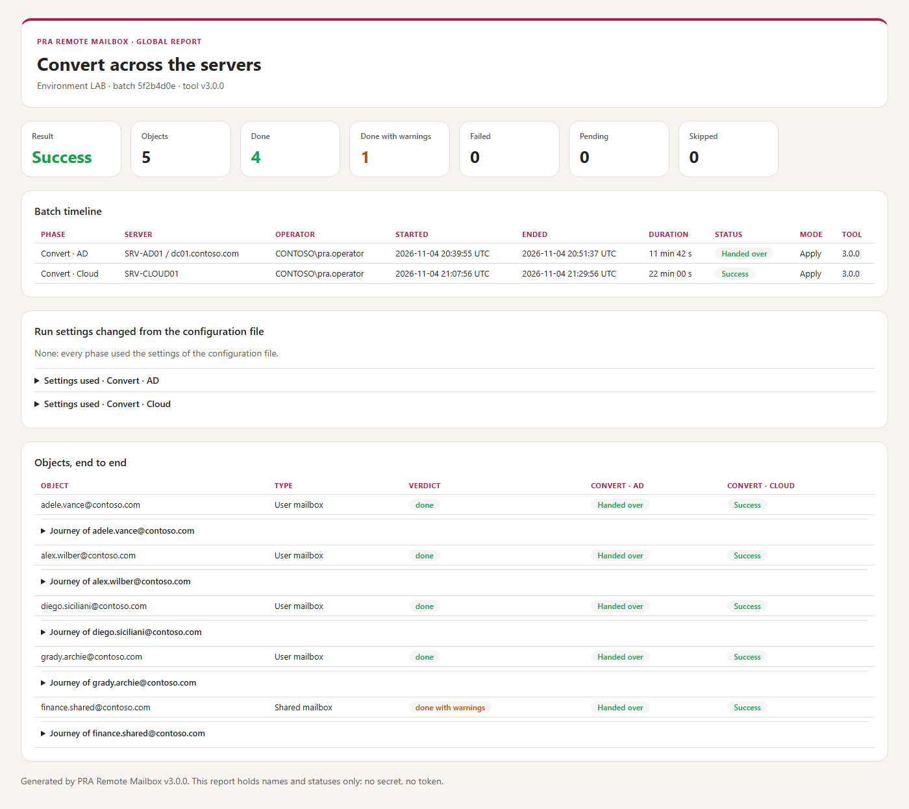

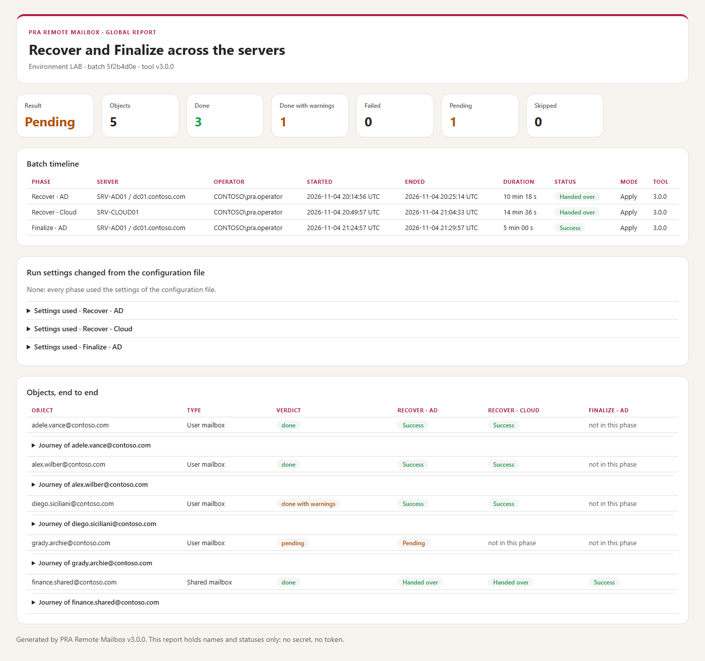

With two servers, each side writes its own report (as before). The **last** server also writes ONE **global report** that follows every object from the first server to the last,
for Convert (AD, then Cloud) as for Recover (AD, Cloud, then Finalize), whatever the type of the objects (users, shared mailboxes, all):

- **How the data travels.** Each side that hands over to another keeps what it did in `PhaseData-<time>-<phase>-<run>.json` (with its `.sha256`) **inside the batch folder it creates**: the run
  (server, operator account, start and end, mode, tool version, the run settings that differ from the configuration file, the steps), one entry per object (readable name, type,
  final status, steps with status, time and message, warnings, backup path) and the errors and warnings. The file is **in the transfer package**, listed in `transfer.json` with its
  SHA-256 like every entry: a package whose phase data was changed is refused at import. The Finalize package also carries the earlier phases (Recover on the AD server, the original
  Convert as history).
- **What is written.** On the run that ends the chain (Both, the cloud phase of a Convert, the Finalize, a Recover cloud phase that needs no Finalize), in `reports\`:
  `PRA_<run>.global.html` and `.global.csv` next to the usual per-phase files. The HTML shows the **batch timeline** (each phase: server, operator, times, duration, status, mode, tool),
  the **run settings changed** per phase, one row per object with its status on each side and, opened, its **journey** (side, step, status, time, message), the verdict (*done*,
  *done with warnings*, *failed*, *pending*, *skipped*) and the totals, then the errors and warnings of each side. An object present on one side only is shown explicitly (for example
  filtered out on the cloud side: *pending*, with the reason). Times are UTC. The CSV has one line per object (`Sides`, `Journey`, `RunSettings`...). The console opens it from **Next steps**
  (*Open global report*); the CLI result has `GlobalHtmlReport` and `GlobalCsvReport` and the Next steps name its path.
- **Older batches, folders copied by hand.** Without phase data (or with a file that fails its checksum, its schema or its Environment) the report is still written, and the missing side
  is listed as *not available (folder from an older version or copied manually)*; the verdicts then come from the sides that were carried.
- **Privacy.** Names, statuses and messages only: no secret, no token. Every value is HTML-encoded; spreadsheet formulas are neutralised in the CSV; the files are private like the other reports and
  backups. Above 2,000 objects the HTML opens the journey of the objects that are not simply *done*; the CSV lists all.
- The `.sha256` next to a PhaseData file is an integrity check, not proof of origin: the protection against a changed file is the SHA-256 of every entry in `transfer.json`, verified at import; the report decides nothing from this data.
- **Phase Both** uses the same layout (one phase). The per-phase HTML report also lists the run settings changed (the per-phase CSV keeps its 22 columns).

### Warnings

A warning never stops the run and never changes the exit code; it says that something was **left aside on purpose** and should be read. Today: the permission entries of a shared mailbox that point to an account no longer in AD ([chapter 2](#2-how-it-works)), and an X500 address missing in Exchange Online ([chapter 2](#2-how-it-works), *X500 addresses*). It is shown in four places: a yellow `▲` line in the console under the object, `[WARN]` in the log, the `Warnings` column of the CSV, and in the HTML report (*Warnings* tile, *Warnings* card, yellow mark on the row). The summary card of the console turns yellow and shows the last warnings.

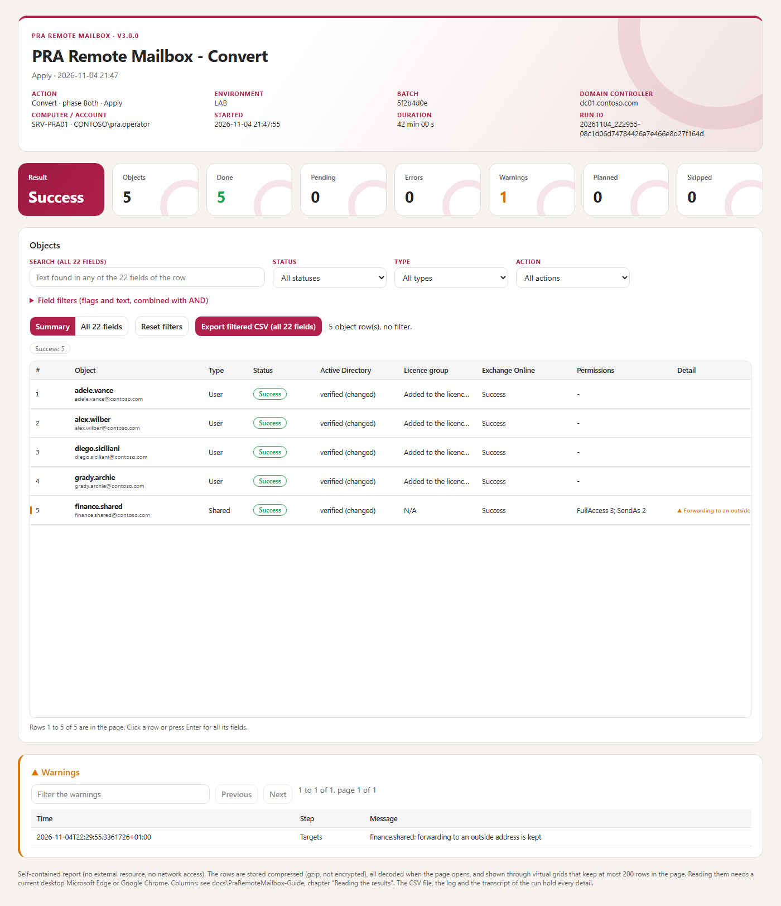

### Statuses

| FinalStatus | Meaning |
|---|---|
| `Planned` | Preview: this is what Apply would do. |
| `Success` | Done and verified (AD re-read; cloud state reached). |
| `AlreadyDone` | Nothing to change: the object was already in the expected state (counted as done). |
| `Pending` | AD done, waiting for another step (shared mailbox deprovisioning, Finalize). |
| `Error` | Stopped; see `Detail` and the log. |
| `Skipped` | Not processed (the batch stopped before it, or no applicable check). |

### The CSV columns

`ObjectGuid`, `SamAccountName`, `UserPrincipalName`, `Action`, `IsShared`, `ADApplied` (an AD write was made), `ADVerified` (AD re-read matches), `GroupAction` (Added / Removed / Preserved), `BackupPath`, `LastOperation`, `CloudMailbox`, `CloudLicense`, `CloudStatus`, `CloudDetail`, `PreserveCloudMailbox`, `PreserveLicense`, `DeprovisionConfirmed`, `PermDetail` (permissions verified / to grant / trustees missing), `PermMissing`, `FinalStatus`, `Detail`, `Warnings` (e.g. permission entries ignored). Separator `;`, UTF-8.

> [!CAUTION]
> Logs, transcripts and reports contain AD values (addresses, DNs). Protect them like the backups; never publish them unfiltered.

<!-- icon: database -->
## 10. Files: batches, proofs and packages

> **In short:** Every move is a folder with a backup and a proof. Between two servers, one zip file carries it.

```text
Backups\
  Batch-efb9d60a75054b6b9cabefa418121934\          one batch = one Apply (private ACL)
    Recover-LAB-20260930_194723-efb9d60a.json       typed records: what is restored (schema 3)
    Recover-LAB-20260930_194723-efb9d60a.json.sha256
    Recover-LAB-20260930_194723-efb9d60a.clixml     every AD value of every object (data-only CLIXML)
    State-efb9d60a75054b6b9cabefa418121934.json     AD proof: objects verified after the writes (+ .sha256)
    Journal-efb9d60a75054b6b9cabefa418121934.jsonl  Started / Applied / Verified / Failed per write
  Finalize-3f2c90e1....\                           Finalize package (Recover on two servers)
  <RunId>-cloud\CloudOperations.jsonl              journal of the Exchange Online grants of a run
  Outbox\PRA-<Env>-<Kind>-<id8>-for-<Cloud|AD>.zip  transfer package written at each handover (+ .sha256)
  Inbox\                                           packages dropped here are listed by the console
logs\     PRA_<RunId>_<n>.log  and  .transcript.txt
reports\  PRA_<RunId>_<n>.csv  and  .html
```

- **Batch ID** = the first 8 characters of the folder name; `-Batch` accepts 8 characters or more, or the path of the JSON file.
- The **State** file is the proof that the AD part was done and verified: the cloud phase and Finalize refuse to write without it.
- Carry **one transfer package** (below) between the servers; if you copy folders by hand instead, copy **whole folders**, never single files, and never rename them.
- Keep the batches at least until the Recover is finished and checked; then archive them with the logs.

### The transfer package (one file from one server to the other)

At each **handover** of a two-server run (Convert or Recover with `-Phase AD`, and the cloud phase of a Recover that needs a final AD restore), an Apply writes **one file**
in `<Storage.BackupFolder>\Outbox\` (a private folder like the backups), named after its purpose:

| File | Written by | To carry to |
|---|---|---|
| `PRA-<Environment>-Convert-<id8>-for-Cloud.zip` | Convert `-Phase AD` | the cloud server |
| `PRA-<Environment>-Recover-<id8>-for-Cloud.zip` | Recover `-Phase AD` (the new Recover batch **and** the original Convert batch) | the cloud server |
| `PRA-<Environment>-Finalize-<id8>-for-AD.zip` | Recover `-Phase Cloud` (the Finalize package) | the AD server |

A Preview with `-Batch <package.zip>` verifies the package and reads it from a private temporary folder under `logs\`, deleted at the end: nothing is written to the backup folder. The console imports a package off its window thread (a child process, with a busy state), bound to the Environment of the configuration (a package made for another Environment is refused, as on the command line), and extracts it through a staging folder renamed into place.

Each package also carries the **phase data** of the side that wrote it (see *The global report*), in the batch folder, listed and hashed like every other entry.

Each package is a standard ZIP (`System.IO.Compression`, entries in a fixed order) with its checksum file `<name>.zip.sha256` next to it. It holds the batch folders the other side needs
(JSON, data-only CLIXML, `.sha256` files, State proof, Finalize manifest) under their own folder names, and a `transfer.json` manifest: schema version, kind, `Environment`, creation time,
tool version, the **name, size and SHA-256 of every entry** and the next command. The folders in `Backups\` are written as before: they stay the source of truth, and **copying the folders by hand
still works** exactly as in 2.x. The summary and the console say: *copy this one file to the cloud (or AD) server, anywhere you like*.

**Importing** is `-Batch <package.zip>` on the command line (a path, or the bare name of a file waiting in `Backups\Inbox`, `Backups\Outbox` or the current folder) or **Import package...** in the console.
The package is **verified completely before anything is written**:

- the `.sha256` file is present and equals the SHA-256 of the ZIP; `transfer.json` is present once, well formed, of a known kind and of the **same `Environment` as the configuration**;
- every entry is exactly `transfer.json` or `<Batch-...|Finalize-...>/<file>`: a path, a separator other than that one, `..`, a drive, a rooted or UNC name, a control character, a trailing dot or space, a reserved device name, an unexpected or duplicated name is **refused** (zip-slip), and so is a manifest entry that is missing;
- declared sizes equal the real ones, and the totals are bounded (at most 2000 entries, 256 MB per entry, 512 MB in all): a compression bomb is refused before it is read;
- the SHA-256 of **every entry** is computed from the stream and compared to the manifest, **before the first byte is written**.

Then each folder is extracted under `Storage.BackupFolder` with its original name, as a **private folder** (leaf-only ACL, like the backups). A folder that already exists with **identical** files is accepted
(importing twice is harmless); a folder with any different, extra or missing file is **refused**, and nothing is left half-extracted. The normal flow then continues and **every proof and hash check of the engine is unchanged**:
the package replaces the copy of the folders, not the verifications.

```powershell
.\Invoke-PraRemoteMailbox.ps1 -Action Convert -Phase Cloud -Mode Apply -Batch 'PRA-PROD-Convert-490cc62e-for-Cloud.zip'
```

# Part IV · Maintain

<!-- icon: layers -->
## 11. Inside the tool

> **In short:** For developers: the order of the steps and the safety rules that no option can skip.

### Execution flow

```flow
terminal | Invoke-PraRemoteMailbox | action, mode, phase
arrow | PRA.Common | config, audit, console
directory | PRA.Directory | plans, backup, AD writes
arrow | PRA.Backup | CLIXML capture
cloud | PRA.Cloud | EXO, Graph, grants
```

The run state is one hashtable, the **context** (`$context`), created by the entry script and passed to every function: configuration, mode, the result rows, the run errors (`Issues`), the files produced, the current step, and two callbacks: `Approval` (ShouldProcess before every write) and, in the cloud phase, `AssertCloudAuthorization` (re-reads the AD proof before every Exchange Online grant).

### The safety contract

1. **Read everything, then write.** Every object of the batch is read and planned before the first write.
2. **Backup before the first write**, for the whole batch: typed JSON (what Recover restores), data-only CLIXML (every AD value), SHA-256, private folder, new files only, then **re-read and compared** with the plans. A failure at the 13th object stops before any write.
3. **Before each write**: no previous error, Apply mode, approval, backup unchanged, and the object **re-read**: same `uSNChanged`, same DN, same values as in the backup. After each write: re-read of the expected values.
4. **First error = stop**: no next object, no sync, no cloud write, no automatic rollback. The journal records `Started` before and `Applied` after every write.
5. **Proofs**: the State file lists the objects verified; the cloud phase, Finalize and the sync refuse a batch without a valid proof, and Finalize refuses an object changed since the proof. One change is accepted: the writeback of Entra Connect, when the `X500:` addresses of `proxyAddresses` are the only difference from the list of the proof and every other managed attribute is as the proof left it (the list of kept addresses is then computed again).
6. **A cloud error is never "absent"**: deprovisioning is confirmed only when Exchange Online returns no mailbox **and** a MailUser recipient. Only then are the shared mailboxes restored on-premises.
7. **Preview and Check never write** (AD, Entra Connect, Exchange Online); they still write their log, transcript and report.
8. **Strings are compared ordinally.** On PowerShell 7 (.NET, ICU) the usual comparison operators ignore zero-width and control characters (`"a" -ceq "a<U+0001>"` is true). Every comparison that guards integrity, identity or authorisation (hashes, GUIDs, `Environment`, `Operation`, file names, the `RawFormat` marker, codec type and XML names, trustees, the typed confirmation) is ordinal; a character that does not belong refuses the object instead of matching it. See the pitfalls table ([chapter 12](#12-modifying-the-tool)) and the limitations note below.

**Limitations of the ordinal comparison.** The ordinal rule applies to the runtime files of the package; the tests, the tools and the display-only sorts (lists shown in the window, the OU picker) keep the usual operators. `ValidateSet` still uses the culture comparison: the entry script and the window request refuse a value that has no ordinal match. Lists that the tool writes in a canonical order (permission holders, multi-valued attributes, batch order) are now sorted ordinally (upper-case before lower-case, by UTF-16 code unit), which can differ from the order written by 2.x under Windows PowerShell 5.1; the comparison of two states sorts both sides, so old backups still compare equal. Regular expressions are anchored with `\z` (not `$`, which also accepts a trailing line feed).

### Code map

| File | Content |
|---|---|
| `Invoke-PraRemoteMailbox.ps1` | Parameters, context, the four actions step by step, batch resolution (`Get-PraBatchFile`), one confirmation (`Confirm-PraApply`), Finalize package (`Save-PraFinalizePackage`, `Get-PraFinalizeInput`), the transfer package at each handover (`Publish-PraTransferPackage`) and its import by `-Batch <zip>` (`Resolve-PraTransferPackagePath`), the plan of steps, next-step hints. |
| `PraRemoteMailbox.psd1`, `PraRemoteMailbox.psm1` | Module manifest (`ModuleVersion`, `GUID`, `PowerShellVersion 7.5`, explicit `FunctionsToExport`, no wildcard) and root module (package check, then `PRA.Common` and `PRA.Directory`). `PRA.Cloud` stays on demand (Graph before Exchange Online in the dedicated process) and `PRA.Gui` is for `-Gui` only. |
| `module\PRA.Common.psm1` | 1 console theme · 2 console and log (`Write-PraBanner/Step/Item/Log/Summary`) · 3 configuration (`Import-PraConfiguration`, defaults = list of valid keys; `New-PraEffectiveConfiguration` writes the effective copy of one run) · 4 audit (log + transcript) · 5 results (`Get-PraOutcome`, CSV/HTML, `Complete-PraRun`) · transfer packages (`New-`, `Get-` and `Import-PraTransferPackage`: ZIP, manifest, verification before any write) · events (`Write-PraEvent`, `Write-PraProgress`). |
| `module\PRA.Directory.psm1` | 1 receipts and files · 2 directory reads (`Get-PraTarget`, `Get-PraUser`) · 3 attribute states and before/after display · 4 shared permissions from AD · 5 plans (`New-PraPlan`) · 6 backups and proofs · 7 writes (`Invoke-PraAdBatch`) · 8 Entra Connect (`Invoke-PraSync`). |
| `module\PRA.Backup.psm1` | Data-only CLIXML codec (write, stream-validate). |
| `module\PRA.Cloud.psm1` | Exchange Online worker (fixed commands, identity checks), sessions, pre-check, cloud phase (polling, grants), retention check. |
| `module\PRA.Gui.psm1`, `module\PRA.Gui.xaml` | The console: five pages (layout and Fluent theme in the XAML), real prerequisite detection, run settings and their effective configuration, task and batch/package lists, preview guard, confirmation, child-process supervision (cloud child: own console, `STARTUPINFOEX` with a handle list so that only its three pipe ends are inherited), and the run model built from the `PRA_EVENT_FILE` events (`plan`, `step`, `item`, `progress`, `result`). Notifying rows are `ExpandoObject`s: no compiled helper type. |
| `module\PRA.Gui.Directory.ps1` | Read-only OU list for the window, run in a separate PowerShell 7 process (AD only, no write). |
| `module\Test-PackageIntegrity.ps1` | Package verifier, run by the entry, the root module, every module and the GUI helper before they do anything. |

Environment variables read by the tool (all optional):

| Variable | Use |
|---|---|
| `PRA_ICONS` | `Emoji`, `Symbols` or `Ascii`: force the console icon set (the window sets `Ascii` for its child). |
| `PRA_ANSI` | `1`: colours as ANSI sequences (console captures for the documentation). |
| `PRA_EVENT_FILE` | Path of the JSONL event file; set by the window, it makes the engine emit start, plan, step, item, progress, summary and result events (the console builds its steps, waits and next steps from them). |
| `PRA_STOP_FILE` | Reserved name, **not read by the engine** in this version; the window removes it from the child's environment so that an inherited value can never matter. |

<!-- icon: wrench -->
## 12. Modifying the tool

> **In short:** For developers: where to change the code to manage one more attribute, another address or a new check.

The rule: **change the plan, never the guards.** The backup, the re-reads and the proofs work for any attribute listed in the plan.

### Manage one more AD attribute

1. Add it to `$script:AttributeKinds` in `PRA.Directory.psm1` with its type (`String`, `MultiString`, `Bytes`, `Bool`, `Int`, `Long`).
2. Set its target value in `New-PraPlan` (branch `Convert`, and `Deprovision` if needed). Recover restores it automatically from the backup.
3. Old batches do not contain it: `Assert-PraStoredRecord` refuses them for Recover. Decide explicitly (new backup schema, or keep old batches on the previous version).
4. Add a gate test ([chapter 13](#13-testing-a-change)) with a synthetic user having and not having the attribute.

### Change the routing address or the recipient types

`Get-PraRoutingAddress` (routing) and the `Convert` branch of `New-PraPlan` (types). Keep `msExchRemoteRecipientType` of shared mailboxes at 97/99: 100/102 mean "already migrated" and are refused.

### Add a cloud check

In `Invoke-PraCloudPhase` (`PRA.Cloud.psm1`): add the fact in `Get-PraGraphFact` or in the worker (`Mailbox`, `Recipient`), then include it in `$mbok` / `$licok`. A new Exchange Online **write** must go through `Invoke-PraPermissionGrant` (approval, proof, journal, one call, bounded re-read).

### Change the console or the report

Texts and icons: `PRA.Common.psm1`, region 1-2. The HTML report: `templates\Report.template.html` (markers `{{...}}`; the data is written by `Write-PraReportHtml`, which fills `{{DATA}}`; no change of the data format without changing the viewer script). The template is covered by the package integrity check. The CSV columns: `$script:RowFields`.

### PowerShell pitfalls met during the build

| Pitfall | Rule |
|---|---|
| The Windows PowerShell 5.1 transcript (2.x) wrote every `Write-Host -NoNewline` piece on its own line (kept as a rule: the transcript stays readable in every host) | one `Write-Host` per line, one colour per line (`Write-PraHost`) |
| PowerShell 7 on .NET (ICU) compares strings with the culture collation, which ignores zero-weight characters: `-eq`, `-ceq`, `-ne`, `-cne`, `-in`, `-cin`, `-contains`, `-like`, `switch`, `Group-Object`, `Select-Object -Unique`, `Sort-Object`, `.StartsWith(string)`, `.EndsWith(string)`, `.IndexOf(string)` and hash tables built on a culture comparer treat `"a"` and `"a<U+0001>"` as equal. Regular expressions, `.Contains(string)`, `[string]::Equals` and the default `Dictionary` / `HashSet` are ordinal. | for a hash, an identity, a name or a mode: `Test-PraOrdinalEqual`, `Test-PraOrdinalIgnoreCaseEqual`, `Test-PraOrdinalIn`, `Get-PraOrdinalSorted`, `Get-PraOrdinalUnique` (`PRA.Common`) or an explicit `[StringComparison]::Ordinal` / `OrdinalIgnoreCase`; never `-ceq`, `-cne`, `-cin`, `-cnotin` (a test refuses them in the runtime files) |
| `GetNewClosure()` copies the variables of the current scope, including parameters with validation attributes (an empty `[ValidateSet]` parameter throws) | create closures inside a small function (`New-PraApprovalCallback`) |
| `ShouldProcess` reads `$ConfirmPreference` of the calling scope | the approval closure sets it from `$context.ConfirmPreference` |
| App-only Exchange Online sessions report the organisation domain as `TenantID` | the session guard accepts `Cloud.Organization` + `AppId` |
| `Import-Module ActiveDirectory` creates an `AD:` drive on a default DC | `$env:ADPS_LoadDefaultDrive = 0` before the import |
| Files without BOM are read as ANSI by Windows PowerShell 5.1 (the BOM also makes an accidental run under 5.1 stop at `#Requires` with a readable message) | every `.ps1/.psm1/.psd1` is UTF-8 **with BOM** (checked by the gate) |
| `ConvertFrom-Json` of PowerShell 7 turns ISO 8601 strings into `[DateTime]` (`CapturedUtc`, `CreatedUtc`, `Utc`), so the byte-exact comparisons of the proofs fail | every read goes through `ConvertFrom-PraJson` (`-DateKind String`, PowerShell 7.5+); a test refuses any other `ConvertFrom-Json` in `package\` |
| `[IO.Directory]::CreateDirectory(path, security)` and `GetAccessControl(path)` do not exist on .NET | `[IO.FileSystemAclExtensions]::Create` / `GetAccessControl` on a `DirectoryInfo` (the folder is still created with its private ACL) |
| `Export-Csv -Encoding UTF8` writes no BOM in PowerShell 7 (Excel then reads the `;` CSV as ANSI) | `-Encoding utf8BOM` for the CSV report |
| `Get-ADUser -Identity` does not search the UPN | exact, escaped LDAP filter (`Get-PraUser`) |
| With `-ErrorAction Stop`, Windows PowerShell 5.1 writes a `TerminatingError` line in the transcript even when the error is caught and expected (e.g. "No permissions were found" before a FullAccess grant) | read an expected error through `-ErrorAction SilentlyContinue -ErrorVariable` and check every record; anything else is thrown |
| `Get-EXORecipient -UserPrincipalName` answers an absent object with HTTP 404 (`ManagementObjectNotFoundException`), not with an empty result | only that exact answer, for that exact UPN, means "absent" (`MissingRecipient`); any other error stops |
| Exchange Online assemblies stay loaded in the console after a run; Microsoft Graph loaded later fails (`GetTokenAsync ... does not have an implementation`) | Graph is connected before EXO within a run; between runs, a clear message asks for a new window |

<!-- icon: beaker -->
## 13. Testing a change

> **In short:** The test gate runs without a directory or a tenant. Run it after every change.

### The gate (no directory, no tenant)

```powershell
pwsh -NoProfile -File .\tests\Invoke-TestGate.ps1   # in the repository; tests and tools are not part of the package
```

It checks every file (parse, UTF-8 BOM, help), runs PSScriptAnalyzer (PowerShell 7 compatibility profiles), then the Pester suites `tests\PraRemoteMailbox.Tests.ps1`, `tests\PraRemoteMailbox.Gui.Tests.ps1`, `tests\PackageIntegrity.Tests.ps1`, `tests\PraReport.Tests.ps1` and `tests\PraDocumentation.Tests.ps1` (the documentation suite checks pictures, names, the Graph scope and readability; the integrity logic on a controlled copy where only the signature call is substituted, plus the real package, which fails closed unless every file carries the valid owner signature): synthetic AD and ADSync modules, a synthetic cloud barrier, the **real** entry script in a separate PowerShell 7 process, and the WPF window without live connections. It proves in particular: no write before the complete backup, stop at the first error, no write in Preview/-WhatIf, no Apply without confirmation in a non-interactive process, memory bounds with 13 shared mailboxes × 500 trustees, proofs and Finalize packages, GUI phase/command boundaries and preview invalidation. Evidence: `tests\evidence\gate\<date>\` (`RESULT.txt`, `gate-result.json`, Pester XML).

Requirements: Pester 5 or later and PSScriptAnalyzer 1.25.0 (machine-wide modules). Every test is mandatory: a skipped or missing test fails the gate.

Release 3.0.0 (2026-11-05, signed and timestamped, PowerShell 7.5+): **764 tests, 764 passed**, 0 analyzer error, about 80 minutes under `pwsh` 7.6 (the analyzer lists 1263 non-error diagnostics, among them the 7.5 additions that the PowerShell 7.0 profiles do not know). The gate of 2.3.0 under Windows PowerShell 5.1 was 506 tests; the extra tests are the PowerShell 7 engine, the review fixes, the 54 tests of the ordinal comparisons (tag `Ordinal`), the replay of the 2.2.0 fixtures and the 25 tests of the documentation (`tests\PraDocumentation.Tests.ps1`: pictures, private names, permissions against the code, readability of the user guide).

Release 2.3.0 (2026-11-03, unreleased source, working tree **not yet signed**): **506 tests, 506 passed**, 0 analyzer error; the native-state test accepts the fail-closed state of the unsigned package. Run the gate from a Windows PowerShell whose `PSModulePath` does not start with the PowerShell 7 module folders (the tests start `powershell.exe` children that inherit it).

Release 2.0.0 (2026-10-01, VMLLM): **279 tests, 279 passed**, 0 analyzer error, about 12 minutes — evidence `tests\evidence\gate\v2.0.0-release`. The only analyzer warnings on the delivered files are expected: `Write-Host` in the console module (14, by design) and `ConvertFrom-Markdown` in the documentation builder (6, PowerShell 7 tool). Compared with the 325 tests of 1.3.6, the 61 combinations of the removed path options (`-BackupFile`, `-StateFile`, `-LogPath`, `-TranscriptPath`, `-ReportDirectory`) are replaced by 9 tests of `-Batch` and of the confirmation.

### The documentation and its pictures

Two guides: the **user guide** (PraRemoteMailbox-UserGuide.md, plain words, one picture per step) and this **reference guide**. Both are built into one HTML file each, with a light and a dark theme:

```powershell
pwsh -NoProfile -File .\tools\New-DocumentationImages.ps1   # every picture, then the two HTML guides (needs Microsoft Edge)
pwsh -NoProfile -File .\tools\Build-Documentation.ps1       # only the HTML guides (the pictures are embedded)
```

No picture is drawn by hand. `tools\New-DocumentationImages.ps1` rebuilds them all from the repository: the **console** is the real window (PRA.Gui.psm1) driven against a synthetic engine (`tools\DocumentationImages\Show-ConsoleScreens.ps1` and `StubEngine.ps1`), with numbered callouts on what the operator clicks; the **reports** come from the real report code on synthetic phase data; the **diagrams** use the CSS of the built guides. The data is synthetic only (contoso.com, SRV-PRA01, CONTOSO\pra.operator, D:\PRA\PraRemoteMailbox, D:\PRA\Backups); the console harness stops if a real machine name, user name or local path reaches a window. **Run it again after any change of the console, of the reports or of the guides**, then commit the pictures with the guides. The suite `tests\PraDocumentation.Tests.ps1` checks that every picture used exists, has an alternative text and is in the integrity inventory, that no real name appears, that the documented Graph scope is the one of the code, and that the *Start here* part of the user guide stays short and simple.

### The lab campaign

After a change of the engine, repeat the campaign of [annex B](#annex-b--lab-test-campaign-2026-09-30) on the lab: Preview, Convert Apply (users + shared), Check, Recover on two servers (AD, Cloud with Finalize package, Finalize), plus a Recover of a batch written by the previous version.

# Annexes

<!-- icon: lifebuoy -->
## Annex A — Troubleshooting

> **In short:** The message you see, its cause, and what to do. The [user guide, chapter 7](PraRemoteMailbox-UserGuide.md#7-when-something-goes-wrong) (file `PraRemoteMailbox-UserGuide.html`) has the same in plainer words.

| Message | Cause | What to do |
|---|---|---|
| `Configuration: unknown setting X` | typing mistake or setting of another version | compare with [chapter 6](#6-configuration) |
| `Batch <id> not found under ...` | the batch folder is not in `Storage.BackupFolder` | copy the whole `Batch-...` / `Finalize-...` folder there, or give the path of the JSON file |
| `The Convert batch used by this Recover is not in ...` | cloud phase of a Recover without the original Convert batch | copy the `Batch-<convert id>` folder too |
| `Batch ... is a Convert batch: the cloud phase of a Recover needs the batch printed by its AD phase` | wrong ID | use the ID printed by `Recover -Phase AD` |
| `EntraConnect.Sync = $true but the ADSync module is not on this server` | AD part not on the Entra Connect server | set `EntraConnect.Server`, or run on the Entra Connect server, or `Sync = $false` |
| `Entra Connect sync will not be possible: this account has no right on X ...` | the check made before the first AD write was refused: the account cannot open a remote session on X, or cannot use `ADSync` there | give the account **Remote Management Users** (or **Administrators**) and **ADSyncOperators** on X, or set `EntraConnect.Sync = $false` and synchronise by hand. Nothing was changed |
| `Entra Connect sync will not be possible: X does not answer to PowerShell remoting` | wrong name in `EntraConnect.Server`, WinRM (TCP 5985) closed, firewall | fix the name or the access (`Test-WSMan X` shows the network part only). Nothing was changed |
| `AD is changed and verified. The Entra Connect sync could not start: ...` (Pending, exit code 2) | the check passed, then the cycle failed (right removed, server down, timeout) | do not convert again: run a delta sync on the Entra Connect server, then carry the package (or `-Phase Cloud -Batch <id>`) as the Next steps say |
| `<account> is already converted by batch <id> (it is a remote mailbox now)` | a Convert was started again for an object that the batch `<id>` already converted | nothing is converted. To finish that batch (sync + package) run the command in the message: `-Action Convert -Phase AD -Mode Apply -Batch <id>` |
| `This batch has no AD proof (State file) ... cannot be finished from here` | `-Phase AD -Batch` on a batch whose AD changes were not verified | use the cloud phase only for a batch with a proof; otherwise run a Preview of a new Convert |
| `An Exchange Online session already exists in this console` | the console was used for EXO before | open a new PowerShell 7 window |
| `Microsoft Graph: found Microsoft.Graph.Authentication 2.40.0; Microsoft.Graph.Users 2.35.1. The tool needs both in one same version 2.41.1 or later` | the Graph modules installed are too old, or not in one same version (two versions of Graph in one session fail with *Assembly with same name is already loaded*) | run the command of the message: `Install-Module Microsoft.Graph.Authentication,Microsoft.Graph.Users -MinimumVersion 2.41.1 -Scope AllUsers`. Nothing was changed. The tool imports both modules in that same version. The same text is on the Microsoft.Graph light of the Setup page |
| `ExchangeOnlineManagement: found 3.9.0; the tool needs 3.10.1 or later` | the module is too old | `Install-Module ExchangeOnlineManagement -MinimumVersion 3.10.1 -Scope AllUsers`. Nothing was changed |
| `Microsoft Graph 2.40.0 is already loaded in this PowerShell session` | an older Graph was loaded earlier in this window | close the window, start the tool in a new PowerShell 7 window |
| `Nothing was changed in AD. This account cannot write to <DC>: run the tool on that domain controller, or with an account that has the rights` | the domain controller refused the first write (for instance the account is `SYSTEM` of another server and `DomainController` names a remote domain controller) | run the tool on that domain controller, or with an account that has the rights ([chapter 4](#4-prerequisites)). The backup folder written before the refusal holds `NOT-APPLIED.txt`: it is not a batch to continue or to roll back, and is kept as a record |
| `Configuration: Scope.Mode = OU requires Scope.SearchBase: no OU is set` | a conversion (not a Check, not a cloud phase) without any source of mailboxes | fill `Scope.SearchBase` (or `GroupDN`, `CsvPath`) in the configuration file, or give `-Identity`, `-CsvPath` or `-SearchBase`, or set `Scope.Mode = Auto`. Nothing was changed |
| Next steps of a Preview started with a package (`-Batch <package.zip>`) | the Preview extracts nothing into the backup folder | the commands name the package itself (`-Batch '<package.zip>'`): run the same command with `-Mode Apply` |
| `-Action is missing: nothing was done` | the command has no `-Action` | always give `-Action Convert`, `Recover`, `Finalize` or `Check` (the tool no longer waits for an answer at a prompt) |
| `Microsoft Graph cannot load in this console (assembly conflict ...)` | Exchange Online was used earlier in the same window (for example Recover, then Check): its assemblies stay loaded and Microsoft Graph cannot load next to them | open a new PowerShell 7 window for each run that needs Microsoft Graph (Check, Convert of users) |
| `Exchange Online session: wrong tenant (...)` | signed in to another tenant, or `Cloud.Organization` wrong | fix `Cloud.TenantId` / `Cloud.Organization` |
| `uSNChanged changed: the object was modified since it was planned` | someone (or a sync) changed the object between plan and write | run the command again (a new plan is made) |
| `Finalize: use the domain controller of the proof` | `DomainController` differs from the DC of the Recover AD phase | set the same `DomainController` |
| `Expected state not reached (timeout or -Once)` | Exchange Online is slow (provisioning up to 60 min after a sync) | run the cloud phase again later (`-Phase Cloud -Batch <id>`); nothing is granted twice |
| `Permission ... trustees missing in Exchange Online` | a permission holder is not known in Exchange Online (not synchronised) | check that Entra Connect synchronises the holder, or exclude it (`ExcludeTrusteeSamAccountNames`) |
| `Trustee not found in Exchange Online at the pre-check: <upn>` | same, found before any AD write (phase Both) | same; nothing was written |
| `▲ <mailbox>: N permission entries ignored, account unknown in AD (deleted, or from another domain): FullAccess S-1-5-21-...` (warning) | a permission entry of the shared mailbox points to an account that no longer exists ("Account Unknown") | nothing to do: the other holders are granted. To clean the source: SendAs entries in *Active Directory Users and Computers* → account of the shared mailbox → *Security*; FullAccess entries are removed when Exchange is back (`Remove-MailboxPermission`). If the account belongs to **another domain** and must keep its access, grant it by hand in Exchange Online |
| `▲ <mailbox>: X500 missing in Exchange Online: X500:/o=...` (warning) | the cloud mailbox does not carry an older X500 address that the on-premises object had (the `legacyExchangeDN` of the mailbox itself is counted as present). The text says it is not serious: the mailbox works, and a reply to a very old message could bounce (`IMCEAEX`) until the address appears. The conversion itself is done | check that Entra Connect synchronises `proxyAddresses` and `legacyExchangeDN` for the object (a customised or filtered rule, an object not yet synchronised, an empty `legacyExchangeDN`), run a synchronisation, then `-Action Check -Batch <id>`. Nothing is written by the tool |
| `Trustee without UPN` / `Unsupported trustee type` | a holder is an account without UPN, or a contact / computer | give it a UPN, or exclude it (`ExcludeTrusteeSamAccountNames`) |
| `Apply needs a confirmation and this console cannot ask for one` | `-Mode Apply` in a non-interactive run | add `-Force` |

> [!TIP]
> Start with the **summary card**, then the **log** (`[ERROR]` lines, full before/after values with `[DETAIL]`), then the **journal** of the batch to see which write was started and applied.

<!-- icon: check -->
## Annex B — Lab test campaign 2026-09-30

> **In short:** What was tested in a lab, and what is still to replay for 3.0.0.

Lab Active Directory domain (two domain controllers DC1 and DC2, Entra Connect on AADC, Exchange servers stopped = disaster), Microsoft 365 test tenant, operator account `LAB\pra-operator`, certificate sign-in. Objects of `OU=PRA-PILOT-OU`: `pra-user04`, `pra-user05` (user mailboxes), `pra-shared02`, `pra-shared03` (shared mailboxes, 3 FullAccess + 3 SendAs each).

All runs were made with the **real** script on `VMLLM` (Windows PowerShell 5.1), against the real directory, the real Entra Connect server and the real tenant. Result: **28 runs**: 26 PASS, and 2 runs (T17, T18) that found defects 3 and 4, fixed since and covered by the gate (list below).

| # | Command (short form) | What was checked | Result |
|---|---|---|---|
| T1 | `-Action Convert` (Preview) | plan of the 4 objects of the scope, nothing written, report with "Planned" rows | PASS |
| T2a | `-Action Recover -Batch <1.3.6 batch> -Mode Apply -Force` | backward compatibility: Recover of a Convert batch written by **1.3.6** (`pra-user01`, `pra-shared01`), AD restore + sync + cloud | PASS after fixes 1 and 2 |
| T2b | `-Action Recover -Phase Cloud -Batch <id>` without the Convert batch | clear message naming the missing `Batch-<convert id>` folder, nothing written | PASS |
| T2c | `-Action Recover -Phase Cloud -Batch <id> -Mode Apply -Force` | cloud phase of the 1.3.6 Recover, on-premises restore made inline | PASS |
| T3 | `-Action Convert -Mode Apply -Force` (phase Both) | 2 users + 2 shared, 12 permissions: backup, AD writes and proofs, remote delta sync, licence group, provisioning wait, permissions re-granted and verified. Batch `1d5ac20b`, **10 min 16 s** | PASS |
| T4 | `-Action Check -Expect Provisioned` | the 4 mailboxes are cloud mailboxes, permissions present | PASS |
| T5a | `-Action Recover -Phase AD -Batch 1d5ac20b -Mode Apply -Force` | AD restore, proof, sync; **exit code 2** (cloud phase due). Batch `f4e7a0bd` | PASS |
| T5b | `-Phase Cloud -Batch 1d5ac20b` (negative), then `-Phase Cloud -Batch f4e7a0bd` with a "cloud server" configuration (`DeferOnPremRestore`) | the Convert ID is refused with the right ID to use; cloud phase OK and **Finalize package** `593c9c5f` written | PASS |
| T5c | `-Action Finalize -Batch 593c9c5f` (Preview, then Apply) | package and proof hashes verified, on-premises restore of the shared mailboxes | PASS |
| T6 | `-Action Finalize -Batch 593c9c5f -Mode Apply -Force` (replay) | idempotent: nothing to write, success | PASS |
| T7 | `-Action Convert -Phase AD -Identity pra-shared02 -Mode Apply -Force` | one object, AD part only. Batch `79f5a1e1`, exit code 2 | PASS |
| T8 | `-Action Convert -Phase Cloud -Batch 79f5a1e1` (Preview) | one pass, 3 permissions reported "to grant", no wait, nothing granted | PASS |
| T9 | `-Action Convert -Phase Cloud -Batch 79f5a1e1 -Mode Apply -Force` | provisioning wait, permissions granted and verified | PASS |
| T10 | `-Action Recover -Batch 79f5a1e1 -Mode Apply -Force` (phase Both, one server) | AD restore, sync, cloud phase and on-premises restore inline, **12 min 29 s** | PASS |
| T11 | `-Mode Apply` without `-Force` in a non-interactive process | stops **before the backup** with "Apply needs a confirmation", exit code 1, nothing written | PASS |
| T12 | `-Action Check -Expect Deprovisioned` | the objects are back on-premises | PASS |
| T13 | `-Action Convert` (Preview) | final plan of the 4 objects (run again on 2026-10-01 for the screenshot of [chapter 8](#8-everyday-use)) | PASS |
| T14 | `-Action Convert -Scope SharedOnly` (Preview, 2026-10-01) | only the 2 shared mailboxes; FullAccess / SendAs holders listed under each one, complete lists in the log | PASS |
| T15 | `-Action Convert -Identity pra-shared02` (Preview, 2026-10-01) after giving FullAccess + SendAs to a temporary account, then deleting it | the 2 entries of the deleted account are ignored: yellow line and yellow summary card, `[WARN]` in the log, CSV column `Warnings`, *Warnings* tile and card in the report; exit code 0; the permissions of `pra-shared02` were restored after the test | PASS |
| T16 | `-Action Convert -Identity pra-shared03` (Preview, then `-Mode Apply -Force`, 2026-10-01) after adding on `pra-shared03`: FullAccess for the group `PRA-Shared03-Team` (`pra-user01` + a nested group with `pra-user02`), SendOnBehalf for `pra-user01`, and removing its SendAs in Exchange Online | 9 permissions: the group becomes its 2 users (nested group included) and never gets a right itself; FullAccess **granted** and verified for 5 users, SendAs **granted** and verified for 3; SendOnBehalf already brought by Entra Connect, verified; an independent read of Exchange Online shows the same; **0 `TerminatingError` line** in the transcript. Batch `662e8b6d`, **8 min 48 s** | PASS |
| T17 | `-Action Recover -Batch 662e8b6d -Mode Apply -Force` | AD part and sync OK; at the first cloud check Exchange Online answered 404 "couldn't be found" for the mailbox that was turning into a MailUser: stop, nothing restored on-premises (defect 3) | defect found → fix 3 |
| T17b | `-Action Recover -Phase Cloud -Batch 8995dcbf -Mode Apply -Force`, after removing the T16 test material from the object | refused before any write: "the AD proof is out of date" (the object changed after the AD phase) | PASS (protection) |
| T17c | `-Action Recover -Batch 662e8b6d -Mode Apply -Force` (again) | AD already in the expected state (0 change, no sync), deprovisioning confirmed, on-premises restore (10 attributes) and sync. **4 min 24 s**, 0 `TerminatingError` line | PASS |
| T18 | `-Action Check -Expect Deprovisioned -Identity pra-shared03`, in the same process as T17 | Microsoft Graph cannot load after the Exchange Online assemblies of T17 (`GetTokenAsync ... does not have an implementation`) (defect 4) | defect found → fix 4 |
| T18b | same command in a new process | `pra-shared03` deprovisioned in Exchange Online (MailUser), back on-premises in AD | PASS |

Measured durations: delta sync on the Entra Connect server (remote) about **5 min 30 s**; cloud phase alone 28 s to 61 s once the objects are provisioned.

Defects found by the campaign and fixed in 2.0.0 (all now covered by the gate):

1. With `-Force`, the approval callback of the AD engine still called `ShouldProcess` with `ConfirmImpact High` → "Windows PowerShell is in NonInteractive mode" in the scheduled task, **before any write** (fail-closed). Fix: the single confirmation of the run sets `ConfirmPreference = None` for the callbacks.
2. The session guard compared the organisation domain of a certificate session with `Cloud.TenantId` and refused it (finding 1 of [annex F](#annex-f--code-review-2026-09-30)). Fix: the guard accepts `Cloud.Organization` and checks the `AppId`.
3. (T17) `Get-EXORecipient -UserPrincipalName` answers an absent object with HTTP 404 `ManagementObjectNotFoundException`. During the Recover cloud check, while the mailbox turns into a MailUser, this answer stopped the run (fail-closed). Fix: this exact answer, for this exact UPN, means "not there yet": the check waits and reads again; any other error still stops.
4. (T18) A run that needs Microsoft Graph after a run that used Exchange Online in the same console failed with an obscure `GetTokenAsync` error. Fix: a clear message asks for a new Windows PowerShell window ([annex A](#annex-a--troubleshooting)).
5. (transcripts of T3 and T9) Before each FullAccess grant, the normal "No permissions were found" answer appeared as a `TerminatingError` line in the transcript. Fix: read through `-ErrorVariable`; T16 and T17c: 0 such line.

The lab was left as before the tests: T16 test material removed (groups deleted, `msExchMailboxSecurityDescriptor` identical to its copy taken before the test, `publicDelegates` empty), `pra-shared03` back on-premises.

Lab fixes made before the campaign (outside the tool): domain controller `DC2` had not replicated from `DC1` since 2026-09-18 (Kerberos `0x80090322`, stale KDC ticket); fixed by purging the tickets of the computer account and forcing the replication. Account `LAB\pra-operator` and the lab application ([annex C](#annex-c--certificate-sign-in-application)) were created for the campaign.

<!-- icon: key -->
### Lab revalidation of the PowerShell 7 engine (3.0.0)

3.0.0 has offline validation only (the gate, which replays the files written by the real 2.2.0 under Windows PowerShell 5.1: `tests\PraLegacyFixtures.Tests.ps1`, 23 checks on the fixtures frozen in `tests\fixtures\ps51-2.2.0`). Before any use in production, replay on the lab, with PowerShell 7.5+:

1. **Prerequisites on each lab server:** `pwsh` 7.5+, RSAT `ActiveDirectory` (`Get-Module ActiveDirectory -ListAvailable` shows `Core`), `ExchangeOnlineManagement` 3.10+ and `Microsoft.Graph` 2.x installed for PowerShell 7, the application certificate reachable.
2. **Restoration of a real 2.2.0 history (acceptance test of the compatibility promise):** Recover (AD phase, then cloud phase, then Finalize on two servers) of a Convert batch produced by 2.2.0 under Windows PowerShell 5.1 in the lab, and Check on that batch.
3. Convert Preview and Apply, users and shared mailboxes (FullAccess, SendAs, SendOnBehalf); Recover; Retention / RestoreTag; Finalize.
4. **Entra Connect:** a Delta cycle started **locally** on the Entra Connect server (`ADSync` loaded through the Windows PowerShell compatibility layer: check the `Result` and `SyncCycleInProgress` values), a cycle started **remotely** with `EntraConnect.Server` from the AD server, and `EntraConnect.Sync = $false`.
5. **Cloud:** certificate sign-in (Graph and Exchange Online); interactive sign-in with `Exo.DisableWAM = $true` (browser) and `$false` (WAM); Graph, then Exchange Online, then Graph again in the same pwsh window; `Exo.UseSubprocess = $true`; sign-out by `ConnectionId`.
6. A scheduled task `pwsh.exe -NoProfile -NonInteractive -File ... -Force` (confirmation, transcript, exit codes).
7. **Window:** Preview, Apply, OU browser, opening of the reports; interactive cloud sign-in from the window (console of the child).
8. **Reports:** the CSV opened in Excel (accents), the HTML report with a large volume.
9. Manual check of a capture written by 3.0.0: `Import-Clixml` for audit, and a Recover that reads it.
10. **Minimum permissions ([chapter 4](#4-prerequisites), *What the code cannot tell you*):** with an account that is **not** a Domain Admin and holds only the `dsacls` delegation of [chapter 4](#4-prerequisites), run a Preview and an Apply on one user and one shared mailbox, then a Recover (if an attribute is refused, note which). With `Directory.ForceReplication` on, check that *Replication synchronization* alone is enough on every destination domain controller. Sign in to Graph with only the Entra role *Exchange Recipient Administrator* and run **Check** (a refusal of the licence read means a reader role such as *Global Reader* is needed). For each cmdlet of the Exchange Online table, `Get-ManagementRoleEntry "*\<cmdlet>"` and confirm the role. Certificate sign-in with a certificate created by the [Annex C](#annex-c--certificate-sign-in-application) command (CSP provider) in `CurrentUser\My`.

## Annex C — Certificate sign-in (application)

> **In short:** How to sign in without a person: one application, one certificate, two permissions, one role.

Least privilege for unattended runs: one application, one certificate, two application permissions (`User.Read.All` for Microsoft Graph, `Exchange.ManageAsApp` for Exchange Online, both with admin consent) and one Entra role (Exchange Recipient Administrator) for its service principal. These are exactly the rows of the *Certificate sign-in* column of [chapter 4](#4-prerequisites), *Permissions*. The tool reads and grants nothing else through the application.

**What the certificate must be** (the console light *Sign-in: Certificate* checks the first three; Microsoft requires the last two for Exchange Online):

- in the **CurrentUser\My** store of the account that runs the tool (the console light looks in this store only; a certificate that is only in `LocalMachine\My` shows a red light);
- with its **private key** on this server;
- **not expired**: renew it before the date shown in the light (*valid until …*); add the new certificate to the application before removing the old one;
- created with a **CSP** key provider: a CNG key (the default of recent Windows) is refused by Exchange Online. The command below names the provider;
- the `.cer` (public part) is uploaded to the application; the private key never leaves the server.

```powershell
# 1. Certificate, in the store of the account that runs the tool (private key not exportable, CSP provider)
$cert = New-SelfSignedCertificate -Subject 'CN=PRA Remote Mailbox' -CertStoreLocation Cert:\CurrentUser\My `
    -Provider 'Microsoft Enhanced RSA and AES Cryptographic Provider' `
    -KeyExportPolicy NonExportable -KeySpec Signature -KeyLength 2048 -HashAlgorithm SHA256 -NotAfter (Get-Date).AddYears(1)
Export-Certificate -Cert $cert -FilePath .\pra-app.cer
$cert.Thumbprint                                   # -> Cloud.CertificateThumbprint
```

```powershell
# 2. Application (Azure CLI, Global Administrator or Privileged Role Administrator)
$app = az ad app create --display-name 'PRA Remote Mailbox' --sign-in-audience AzureADMyOrg --query appId -o tsv
az ad app credential reset --id $app --cert '@pra-app.cer' --append
$sp = az ad sp create --id $app --query id -o tsv
# Microsoft Graph: User.Read.All (application)
az ad app permission add --id $app --api 00000003-0000-0000-c000-000000000000 --api-permissions df021288-bdef-4463-88db-98f22de89214=Role
# Office 365 Exchange Online: Exchange.ManageAsApp (application)
az ad app permission add --id $app --api 00000002-0000-0ff1-ce00-000000000000 --api-permissions dc50a0fb-09a3-484d-be87-e023b12c6440=Role
az ad app permission admin-consent --id $app
# 3. Entra role Exchange Recipient Administrator for the service principal
az rest --method POST --url https://graph.microsoft.com/v1.0/roleManagement/directory/roleAssignments `
    --body "{ \"roleDefinitionId\": \"31392ffb-586c-42d1-9346-e59415a2cc4e\", \"principalId\": \"$sp\", \"directoryScopeId\": \"/\" }"
$app                                               # -> Cloud.AppId
```

> [!NOTE]
> With certificate sign-in, Exchange Online identifies the session by the **organisation domain** and the **AppId**: `Cloud.Organization` must be the initial domain (`tenant.onmicrosoft.com`) and `Cloud.AppId` the application ID. To revoke: delete the certificate credential of the application (or the application).

> [!WARNING]
> **To validate in the lab.** The `-Provider` parameter (CSP key, not CNG) follows Microsoft's requirement for app-only sign-in in Exchange Online; it was added to this command in 3.0.0 and has not been replayed on a tenant. The command of the earlier versions used the default provider. If `Connect-ExchangeOnline` refuses the certificate, recreate it with the provider named above. Whether the Entra role *Exchange Recipient Administrator* alone covers every cmdlet of [chapter 4](#4-prerequisites) is also a point to confirm once ([chapter 4](#4-prerequisites), *What the code cannot tell you*).

<!-- icon: file -->
## Annex D — File formats

> **In short:** The formats of the files, so that old backups still restore.

| File | Format | Key fields |
|---|---|---|
| Backup `<Op>-<Env>-<date>-<id>.json` | schema **3** (schema 1 and 2 of 1.2.x/1.3.0-1.3.2 still read) | `Operation` (Convert, Recover, Finalize), `BatchId`, `Environment`, `Server`, `RawFile` + `RawHash`, `SourceBackupHash` (Recover/Finalize: SHA-256 of the Convert backup), `Records[]` (`Attributes` = before, `PlannedAttributes` = after, `Licensing`, `Retention`, `SharedPermissions`, `CapturedUsnChanged`) |
| Capture `.clixml` | `PraDataOnlyClixml-v1` | every attribute returned by AD, closed descriptors (no native object) |
| AD proof `State-<id>.json` | schema 2 | `Kind = ADVerified`, `BackupFile` + `BackupHash`, `Records[]` (`ObjectGuid`, `Operation`, `VerifiedUsnChanged`) |
| Journal `Journal-<id>.jsonl` (AD) and `CloudOperations.jsonl` (cloud phase, folder `<RunId>-cloud`, created after the confirmation) | one JSON per line | `RunId`, `Utc`, `Target`, `Operation`, `Status`, `Detail`. Statuses: **Started**, **Applied**, **Verified** (a write and its re-read), **FailedOrIndeterminate** (AD write failed or unknown), **Failed** (cloud write failed), **Initialized** (cloud journal opened, no cloud write yet), **Completed** (Entra Connect cycle finished) |
| Finalize package manifest | schema 2, `Operation = RecoverFinalize` | `SourceBackupHash`, `StateHash`, `Items[]` (`RestoreShared`, `RestoreTag`, `DeprovisionConfirmed`) |

3.1.0 adds one optional field to each record of a Convert backup, `ExpectedX500` (the X500 addresses to verify in Exchange Online); a backup without it is read as before.

Every JSON has a `.sha256` file; a mismatch is refused. **Version 2.0.0 reads the batches of 1.3.x** (tested: Recover of a 1.3.6 Convert batch in the lab).

**The formats did not change in 3.0.0** (backup schema 3, `PraDataOnlyClixml-v1`, proof schema 2, Finalize manifest schema 2). The codec writes the same bytes under PowerShell 7 and under Windows PowerShell 5.1 (by design; `tests\PraLegacyFixtures.Tests.ps1` replays, in the gate, backups, proofs and a Finalize package written by the real 2.2.0 under Windows PowerShell 5.1 and frozen in `tests\fixtures\ps51-2.2.0`), and every hash is a hash of the file bytes, so a backup, a proof or a Finalize package produced by 2.x is read, verified and restored by 3.0.0 without conversion. The JSON written by PowerShell 7 is formatted differently (2-space indentation, no Unicode escapes for the characters `<`, `>`, `&` and the apostrophe) but is the same JSON; 2.2.x reads it. One cosmetic difference in new files: the order of the multi-value lists is an ordinal sort (upper-case before lower-case, by UTF-16 code unit), where 2.x wrote the culture-aware order of Windows PowerShell 5.1; the comparisons sort both sides again, so no check depends on it. The CSV report keeps its UTF-8 BOM, as in 2.x.

<!-- icon: tag -->
## Annex E — Versioning and upgrade from 1.3.6

> **In short:** What changed between versions and how to upgrade.

**From 2.x to 3.0.0.** Install PowerShell 7.5+ and the AD, Exchange Online and Graph modules for PowerShell 7 ([chapter 4](#4-prerequisites)); replace the package folder; keep `Backups\` and the configuration file (same format; nothing to change); run the commands with `pwsh` (and change the action of scheduled tasks from `powershell.exe` to `pwsh.exe`, [chapter 7](#7-unattended-execution)). Windows PowerShell 5.1 and PowerShell 7.4 are refused before any code runs. The 2.2.x package remains the Windows PowerShell 5.1 version and is the fallback on a server that cannot have PowerShell 7; both versions read the backups of the other.

- **One source**: `$script:ToolVersion` in `module\PRA.Common.psm1`, exported as `Get-PraToolVersion`. The entry script (run context, report, audit, log), the window (title) and the package builder (`tools\New-PraPackage.ps1`, which reads that line as text) take the version from it. Nothing else in the code carries a version literal.
- **Literals that cannot be computed** (the signature and the manifest hash the exact bytes, so a comment cannot be generated at run time). Change them together with the source, in the same commit; `tests\PraRemoteMailbox.Tests.ps1` fails if one differs:
  - `ModuleVersion` of `PraRemoteMailbox.psd1` (a test compares it with `Get-PraToolVersion` and with the top entry of `CHANGELOG.md`);
  - `Version : x.y.z` in the help `.NOTES` of `Invoke-PraRemoteMailbox.ps1`, `PraRemoteMailbox.psm1`, and in the header of `module\PRA.Common.psm1`, `PRA.Directory.psm1`, `PRA.Backup.psm1`, `PRA.Cloud.psm1`, `PRA.Gui.psm1`, `PRA.Gui.Directory.ps1`, `config\PraRemoteMailbox.config.psd1` and `templates\Report.template.html` (signed or hashed files);
  - the sample banner in the help of `Write-PraBanner` (`vx.y.z`, `PRA.Common.psm1`) and the first line of `PackageIntegrity.psd1` (comment, regenerated with the manifest);
  - `version:` in the front matter of this guide, and the generated `docs\PraRemoteMailbox-Guide.html` (rebuild it);
  - `README.md` (package and repository) and the `CHANGELOG.md` heading;
  - the repository-only headers `Version` of `tools\New-PraPackage.ps1`, `tools\Build-Documentation.ps1`, `tests\Invoke-TestGate.ps1`, `tests\IntegrityFixture.ps1`, `tests\PackageIntegrity.Tests.ps1`, `tests\PraRemoteMailbox.Tests.ps1`, `tests\PraReport.Tests.ps1`.
- Release checklist: gate PASS · lab campaign ([annex B](#annex-b--lab-test-campaign-2026-09-30)) · `pwsh tools\New-DocumentationImages.ps1` (PowerShell 7.5+, Microsoft Edge, documentation only: every picture of the README and the guides, then the two HTML guides) · **owner signature and manifest (below)** · `tools\New-PraPackage.ps1` · git tag `vX.Y.Z`.
- **Signature and manifest after a change.** Editing a signed or hashed file invalidates its signature or hash, and the package then refuses to start (by design). The owner (1) signs, with the timestamp, every PowerShell file of the inventory (`Invoke-PraRemoteMailbox.ps1`, `PraRemoteMailbox.psd1`, `PraRemoteMailbox.psm1`, `module\PRA.Common.psm1`, `PRA.Directory.psm1`, `PRA.Backup.psm1`, `PRA.Cloud.psm1`, `PRA.Gui.psm1`, `PRA.Gui.Directory.ps1`, `Test-PackageIntegrity.ps1`); (2) regenerates `PackageIntegrity.psd1` with the SHA256 of **every** inventory file taken from the final signed bytes (the hash of a signed script includes its signature block, so it cannot be computed before signing), then signs the manifest; (3) runs the gate and `tools\New-PraPackage.ps1`. The gate and the Pester suites also pass on an unsigned working tree (the native-state tests accept the fail-closed state); `tools\New-PraPackage.ps1` and the CI *Package* stage refuse an unsigned or changed source.

**From 1.3.6**: keep the old `Backups` folders; copy the values of `DRP-Config.psd1` into the new file (same sections; `ADConnect` → `EntraConnect`; `BackupFolder/LogFolder/ReportFolder` → `Storage/Logging/Report`; `Safety` → `Storage.ForbiddenBackupRoots`); keep the same `Environment` to use the old batches. Command mapping: see `CHANGELOG.md` (table "Changed").

<!-- icon: search -->
## Annex F — Code review 2026-09-30

> **In short:** The review of the code and what was fixed.

Review of version 1.3.6 (script 513 lines, four modules 3,386 lines, gate 325 tests) before the 2.0.0 rewrite.

| # | Finding | Impact | 2.0.0 |
|---|---|---|---|
| 1 | Certificate sign-in to Exchange Online always refused by the session guard (TenantID of an app-only session = organisation domain) | cloud phase impossible unattended; explains the "UnAuthorized" blocker of the 1.3.4 pilot | **fixed** ([annex C](#annex-c--certificate-sign-in-application)) |
| 2 | Missing ADSync detected **after** the AD writes | batch half done (AD written, no sync, no cloud) — seen in the E2E pilot | checked before the first write; remote sync added |
| 3 | One ShouldProcess prompt per AD write and per grant (ConfirmImpact High) | dozens of prompts for a batch; operators used `-Force` blindly | one confirmation after the plan |
| 4 | `-BackupFile` / `-StateFile` long paths, implicit choice of "the most recent backup" | copy/paste errors (a line break in a path stopped a Recover on 09-09) | short batch IDs, explicit, proof and source found automatically |
| 5 | Two modes that do the same thing (Inventory / Simulate), three ways to say "do not write" | confusion | Preview + `-WhatIf` |
| 6 | Settings read but ignored (`WaitForSync`, `VerifyTrusteeInCloud`), obsolete switches kept | misleading configuration | removed; unknown keys refused |
| 7 | Preview of a cloud phase reported missing permissions as errors and waited up to 60 min | preview unusable before an Apply | one pass, "to grant" |
| 8 | Console: every AD read and memory probe on screen, French/English mix, 358-character lines | unreadable runs, hard to maintain | compact console, English, details in the log |
| 9 | Two operator documents (guide + technical documentation, 210 KB) plus release notes and many session notes | no single reference | this guide |
| 10 | Exit code 0 for Pending | an orchestrator cannot see that a next step is due | exit code 2 |
| 11 | `Disconnect-ExchangeOnline` message on stdout of the child process (subprocess mode) | would break the one-line JSON protocol of the child | output suppressed |

No defect was found in the backup, receipt and proof engine; its logic is unchanged in 2.0.0 and covered by the gate.
