---
title: PRA Remote Mailbox
subtitle: User guide
version: 3.1.4
author: Nicolas Fabert
updated: 2026-11-13
runtime: PowerShell 7.5+ (engine and window)
safety: Backup before every change
---

# PRA Remote Mailbox — User guide

> Follow the path, one step after the other. Each step says **what to do**, **what you should see**, and **what to do if not**. You do not need to know anything before you start: every word is explained. How the tool works inside, every setting and the exact rights are in the [reference guide](PraRemoteMailbox-Guide.md). It is a second file, `PraRemoteMailbox-Guide.html`, in the same `docs` folder as this one.

> [!IMPORTANT]
> Files downloaded from the Internet may be blocked by Windows and fail to run. Before using this project, unblock every file in the downloaded folder:
>
> ```powershell
> Get-ChildItem "C:\Chemin\Du\Dossier" -Recurse -File -Force | Unblock-File
> ```
>
> Replace the example path with the folder where you downloaded or extracted this project.

> [!WARNING]
> **Stop and ask.** If a step does not go as written, do not guess. Do not click again and again. Write down what you see. A photo of the screen is enough. Then call your administrator, or the person who gave you this guide. Nothing here deletes a mailbox. But a wrong click can change many people at once.

<!-- icon: flow -->
## 1. Start here

### What this tool does

Your company mail servers are lost. People cannot send or read mail. This tool gives each person a **new, empty mailbox in the cloud**. Then they can send and read mail again today. When the old servers work again, the tool puts everything back as it was.

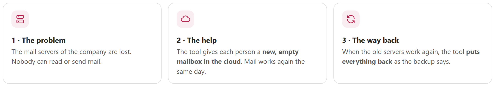

Think of a fire in an office building. Everyone moves to a temporary office the same day. When the building is repaired, everyone moves back. The tool is the moving team. It writes a list of every desk before it moves anybody. The list is the **backup**.

> [!CAUTION]
> The new mailbox is **empty**. The old messages are **not** copied by this tool. They come back when the old servers are repaired, or from your backup product. Messages received in the cloud may be lost if you roll back without saving them first. Exchange Online seems to keep a removed mailbox for a while. Nobody knows for how long. Save the mail before you roll back. Ask before you roll back.

### The path

You do steps **1 to 4** once. Then you choose what to do: **A** moves the mailboxes to the cloud. **B** goes back.

```path
Set up once | settings | Get ready, once
Set up once | 1 | Get your rights | ask your administrator
Set up once | 2 | Put the tool on the server | copy one folder
Set up once | 3 | Fill in the settings file | write a few names
Set up once | 4 | Open the console | all the lights are green
A | cloud | Move mailboxes to the cloud
A | 5 | Try one mailbox | the safe test, first
A | 6 | Move everyone | on one server, or on two
A | 7 | Read the report | it says what was done
B | refresh | Go back
B | 5 | Roll back | when the old servers work again
B | 6 | Complete the rollback | only on two servers
B | 7 | Read the report | it says what was done
```

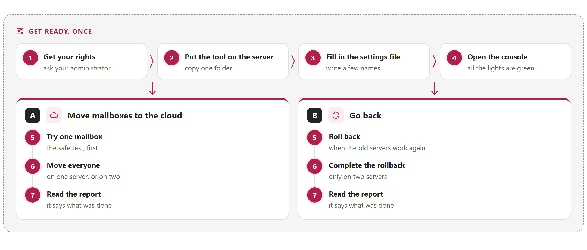

### Which path is mine?

Ask one question. **Can one server reach both Active Directory and Microsoft 365?** Microsoft 365 is reached through the Internet.

| Your answer | Your path |
|---|---|
| **Yes.** One server does both. | **One server.** Do Path 1, then Path 2. |
| **No.** No server does both. | **Two servers.** Do Path 1, then Path 3. The directory part runs on a server that sees Active Directory. The cloud part runs on a machine that reaches the Internet. |

Not sure? Ask your administrator this one question. Do not guess.

> [!IMPORTANT]
> **Two words you will meet often.**
>
> - **Directory server**: the server that can reach Active Directory. It has the add-on called RSAT.
> - **Cloud server**: any Windows machine of your company that can reach Microsoft 365 through the Internet. It is **not** a server in the cloud. You do not rent or build anything. It can stand in your own server room. It can be an administrator's PC. It does **not** need Active Directory.
>
> With one server, the same machine is both.

### The whole journey

This is the whole story on one page. First you move the mailboxes to the cloud. Weeks later, you go back. With two servers, one package goes from one server to the other each time. It is a zip file and its `.sha256` file.


Read the table from the top. Each row is one step. Do the steps in this order.

| Step | Server | What you click | The tool writes | You copy it to |
|---|---|---|---|---|
| **1 · Move, directory part** | Directory server | **Move mailboxes to Exchange Online**, then **Start a new batch (Active Directory part)**. The pill says **Phase: AD**. | `PRA-PROD-Convert-490cc62e-for-Cloud.zip` | The cloud server |
| **2 · Move, cloud part** | Cloud server | **Move mailboxes to Exchange Online**, then **Continue a batch (cloud part)**, then **Import package…** | The global report | Nowhere. The move is done. |
| **Wait** | Both servers | Nothing. Keep the `Backups` folder. Write down the batch ID. | Nothing | Nowhere |
| **3 · Roll back, directory part** | Directory server | **Roll back a conversion**. Pick the batch of the move. | `PRA-PROD-Recover-5ad39f71-for-Cloud.zip` | The cloud server |
| **4 · Roll back, cloud part** | Cloud server | **Roll back a conversion**, then **Continue a rollback (cloud part)**, then **Import package…** | `PRA-PROD-Finalize-b7d41a9c-for-AD.zip`, only if something remains for the directory | The directory server |
| **5 · Complete the rollback** | Directory server | **Complete a rollback**, then **Import package…** | The global report | Nowhere. The rollback is done. |

Step 5 exists only if step 4 wrote a Finalize package. Shared mailboxes need it. So do mailboxes with a retention tag. If step 4 writes no package, it ends with the global report. The rollback is then done.

With **one server**, there is no file to carry. Steps 1 and 2 are one run on the same machine: see [Path 2](#path-2--move-everyone-one-server). Steps 3 and 4 are one run too: see [Path 4](#path-4--roll-back).

**The batch ID links the move to its rollback.** The move gets a short ID, like `490cc62e`. You see it in the report and on the **Next steps** page. Write it down. Weeks later, you pick the move in the list of the rollback. The list shows the folder name. It starts with `Batch-` and the ID. The rollback and the Finalize package get **new** IDs of their own, like `5ad39f71` and `b7d41a9c`. They are in the file names. You do not need to write them down.

**Keep the `Backups` folder** on both servers until the rollback is done. Do not delete, rename or edit anything in it. The directory server needs it to start the rollback. The cloud server keeps its own record of the move there.

### The example in this guide

The pictures and the commands use one example. Read the names in the right column. Replace them with your own names.

| What | In the example | Replace with |
|---|---|---|
| The company | `contoso.com` | your company name on the Internet |
| The server | `SRV-PRA01` | the server you work on |
| The tool folder | `D:\PRA\PraRemoteMailbox` | the folder where you put the tool |
| The backup folder | `D:\PRA\Backups` | a safe disk that is not lost with the building |
| Your account | `CONTOSO\pra.operator` | the account you sign in with |
| The test person | `alice.vance@contoso.com` | one real person who agrees to be the test |

### What you will see on the screen

The tool has one window, the **console**. It has **five pages**. You go from the left to the right, one page after the other. The names are at the top of the window.

| Page | What it is for |
|---|---|
| **Setup** | Is this server ready? Lights show it. |
| **Task** | What do you want to do? Pick one big card. |
| **Verify** | A preview, with **no change at all**. You read it and you confirm. |
| **Run** | The tool works. You watch. |
| **Next steps** | What was done, and what to do next. |

<!-- icon: checklist -->
## 2. Before you start

Tick every box before you begin. If you cannot tick a box, stop and ask.

- [ ] I have this guide and a quiet hour. A move of many mailboxes can take an hour or more.
- [ ] I know which server I sit at. Its name is in the box **This computer**, on the right of the **Setup** page.
- [ ] I know if I use **one server** or **two servers** (see [Which path is mine?](#which-path-is-mine)). With two servers, I know which one is the directory server and which one is the cloud server.
- [ ] My administrator gave me the rights in the list below.
- [ ] The tool folder is on the server, and the files are unblocked (see the yellow box at the top).
- [ ] There is a **safe place for the backups**: a disk that is not lost with the server.
- [ ] I know the **test person**: one real person who agrees to be moved first.
- [ ] I know who to call if I am stuck. Name and phone number: ____________________

### Ask your administrator for these rights

You do not need to understand this list. Give it to your administrator. Each line is a right that the tool needs. The exact technical table is in the [reference guide, chapter 4](PraRemoteMailbox-Guide.md#permissions). The reference guide is the file `PraRemoteMailbox-Guide.html`, in the same `docs` folder as this guide.

| Where | Ask for | Why the tool needs it |
|---|---|---|
| **The company directory** (Active Directory) | The right to **change about eleven attributes of the people** to move. The right to **add and remove members of one group** (the licence group). The right to **read** the people and their security lists. | The tool rewrites a few lines on each person. It adds each person to the group that gives a cloud mailbox. |
| **The directory, only if you tick "Replicate Active Directory"** | One extra right on the domain: **Replication synchronization**. | The tool pushes each change to the other directory servers before the sync. |
| **The Entra Connect server** | Your account in the group **ADSyncOperators**. If the tool runs on another server: the right to **connect remotely** (WinRM): your account in the group **Remote Management Users** or **Administrators** of that server. | The tool starts one synchronisation. It sends the changes to the cloud. Before it changes anything, it tries this with your account. If it cannot, it stops and nothing is changed. |
| **Microsoft 365, sign-in by a person** | Permission **User.Read.All** for the sign-in window (an administrator accepts it once). A role that can read users, for example **Global Reader**. | The tool reads each person to check the licence and the new mailbox. |
| **Exchange Online, sign-in by a person** | The role **Exchange Recipient Administrator** (or the role group **Recipient Management**). | The tool reads the mailboxes. It gives people access to shared mailboxes. |
| **Exchange Online and Microsoft 365, no person present** | An **application** with a **certificate**. Application permissions **User.Read.All** (Graph) and **Exchange.ManageAsApp**, accepted by an administrator. The role **Exchange Recipient Administrator** for the application. | Same work, without a person at the keyboard. [Annex C of the reference guide](PraRemoteMailbox-Guide.md#annex-c--certificate-sign-in-application) shows the commands. |

> [!NOTE]
> A few rights could not be confirmed from the tool itself. They are marked in the [reference guide, chapter 4](PraRemoteMailbox-Guide.md#permissions) (file `PraRemoteMailbox-Guide.html`). Your administrator tests them once in a lab, before the real day.

<!-- icon: settings -->
## 3. Set up once

You do this part **one time**. It is best to do it **before** the disaster, as a rehearsal. With two servers, do steps 2, 3 and 4 on **each** server.

### 1 · Get your rights

**Do:** give your administrator the table [Ask your administrator for these rights](#ask-your-administrator-for-these-rights), in [chapter 2](#2-before-you-start). Wait until the administrator says: "Done."

**You should see:** nothing yet. You will see the effect in step 4, when the lights turn green.

**If not:** do not go on without the rights. The tool will stop at the first missing right. It will not harm anything. But it will waste your time.

### 2 · Put the tool on the server

**Do:**

1. Create the folder `D:\PRA\PraRemoteMailbox` on the server.
2. Copy the whole content of the tool folder into it.
3. Open **PowerShell 7**: click the Windows **Start** button, type `PowerShell 7`, right-click it, and choose **Run as administrator**.
4. Copy this line into the PowerShell window and press **Enter**. It unblocks the files:

```powershell
Get-ChildItem D:\PRA\PraRemoteMailbox -Recurse -File -Force | Unblock-File
```

**You should see:** the window comes back with a new empty line. No message means it worked.

**If not:** if Windows says that `PowerShell 7` does not exist, ask your administrator to install it. It is a free program from Microsoft. Windows PowerShell 5.1 (the older program, with a dark blue window) does **not** work with this version.

### 3 · Fill in the settings file

**Do:** open the settings file with Notepad. Copy this line into the PowerShell window and press **Enter**:

```powershell
notepad D:\PRA\PraRemoteMailbox\config\PraRemoteMailbox.config.psd1
```

Fill in these lines, between the quotes. Your administrator knows the values. Then save the file and close Notepad.

| Line in the file | What to write | Example |
|---|---|---|
| `Environment` | a short name for this company, **the same on every server** | `PROD` |
| `GroupDN` (in `Licensing`) | the group that gives a cloud mailbox | `CN=PRA-Licence,OU=Groups,DC=contoso,DC=com` |
| `RoutingDomain` (in `Routing`) | the name of the cloud mail address | `contoso.mail.onmicrosoft.com` |
| `Server` (in `EntraConnect`) | the Entra Connect server, if it is another server | `SRV-AADC01` |
| `TenantId` (in `Cloud`) | the identity number of your Microsoft 365 | `11111111-2222-3333-4444-555555555555` |
| `Organization` (in `Cloud`) | the first name of your Microsoft 365 | `contoso.onmicrosoft.com` |

**You should see:** the file saved. Nothing else happens.

**If not:** if the console later says the settings file is wrong, open it again. Look at the line named in the message. A quote or a bracket is missing, most of the time.

### 4 · Open the console

**Do:** copy this line into the PowerShell window and press **Enter**:

```powershell
pwsh -STA -File D:\PRA\PraRemoteMailbox\Invoke-PraRemoteMailbox.ps1 -Gui
```

**You should see:** the console opens. It starts on the **Setup** page. Look at the **lights**. A light is a small box with a mark. A **green check** means "this is ready". A **red cross** means "this is missing".

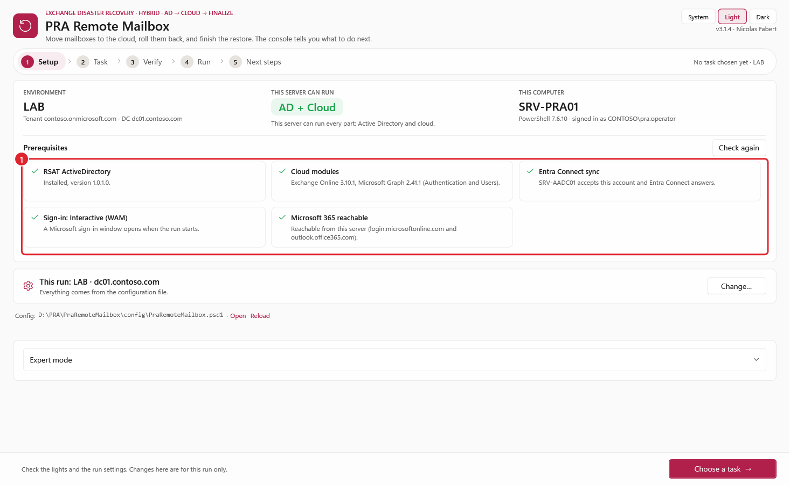

Here is what each light checks.


| Light | In plain words |
|---|---|
| **RSAT ActiveDirectory** | The program that talks to the company directory. |
| **Cloud modules** | The programs that talk to the cloud. One is for the cloud mail (Exchange Online). One reads people in Microsoft 365 (Microsoft Graph). Green says the versions found, for example *Exchange Online 3.10.1, Microsoft Graph 2.41.1*. If the light is red, its text says what is missing and gives the commands to run. |
| **Entra Connect sync** | The way to send the changes to the cloud. Grey means "not used". When the sync is done on another server, the console tries it **with your account** (a few seconds). Orange means that it will not work: read the text, it says why. |
| **Sign-in** | How the tool signs in to Microsoft 365. |
| **Microsoft 365 reachable** | Can this server reach Microsoft 365 through the Internet? The console tries for 3 seconds. This light shows only when the cloud programs are installed. If the connection is blocked, the text says so in plain words (firewall or proxy) and keeps the technical message for your administrator. |

**If a light is red:** read the red text inside it. It says what is missing. Ask your administrator to fix it. Then press **Check again**.


> [!NOTE]
> A red light is **not always a problem**. In the middle box, **This server can run**, a big word says what *this* server can do. **AD + Cloud** means everything. **AD** means the directory part only. **Cloud** means the cloud part only. **Nothing yet** means a light must be fixed first. The word comes from the programs installed here and from a short test of the Internet. If Microsoft 365 cannot be reached, the word is **AD**, even when every program is installed. The cloud part must then run on another machine that reaches the Internet (two servers). On the directory server, the cloud lights stay red. On the cloud server, the **RSAT ActiveDirectory** light stays red. That is normal. You do the other part on the other server.

<!-- icon: cloud -->
## 4. A · Move mailboxes to the cloud

There are three ways. Do them in this order the first time.

| Way | When | Go to |
|---|---|---|
| **Try one mailbox** | **Always first.** One person, to see that everything works. | Path 1 |
| **Move everyone, one server** | One server reaches Active Directory **and** Microsoft 365. It does both parts. | Path 2 |
| **Move everyone, two servers** | No single server reaches both. The directory server does the directory part. The cloud server does the cloud part. | Path 3 |

### Path 1 · Try one mailbox

This is the safest start. One person is moved. Everybody else is left alone.

### 1 · Open the console

**Do:** open the console as in [step 4 of chapter 3](#4--open-the-console). Make sure the lights are green. Press **Choose a task →** at the bottom right.


**You should see:** the **Task** page, with big cards.

**If not:** if the button is grey, a light is red. Read it, fix it, press **Check again**.

### 2 · Pick the first big card

**Do:** click the card **Move mailboxes to Exchange Online**. It gets a pink frame and a check mark.

**You should see:** two choices below it: **Start a new batch (Active Directory part)** and **Continue a batch (cloud part)**. The first one is already chosen. Keep it.

### 3 · Say which person

**Do:** keep **Single identity (test)** chosen. Click in the **Identity** box. Type the e-mail address of your test person. Then press the small button **Check**.


**You should see:** a green line under the box with the name of the person, for example *Alice Vance · alice.vance@contoso.com · User mailbox*. At the bottom of the page, the card **What will happen on this server** has a pink pill on its left. The pill says **Phase: Both** (number 3 in the picture). It means that this server does everything alone. On a directory server of a two-server move, it says **Phase: AD**: see Path 3. A server that cannot reach Microsoft 365 also says **Phase: AD**.

**If not:** a red line says the person was not found. Check the spelling of the e-mail address. If two people match, type the exact e-mail address. If it still fails, stop and ask.

### 4 · Go to the preview

**Do:** press **Continue to verification →** (number 4 in the picture above).

**You should see:** the **Verify** page. It is still empty. Nothing was changed.

### 5 · Press Preview

**Do:** press the **Preview** button at the bottom. A preview is a trial that **changes nothing**.


**You should see:** after a few seconds, a title like *1 mailbox will be converted · nothing blocking*, and one line for the person.

**If not:** a red number such as **1 blocking** means the tool refuses this person. Click the line and read the reason. Do not go on. Stop and ask.

### 6 · Confirm

**Do:** read the title one more time. Is it the right number of people? Then type the word **CONVERT** in the box (small or capital letters, both work). Then press the red button **Convert the mailboxes**.

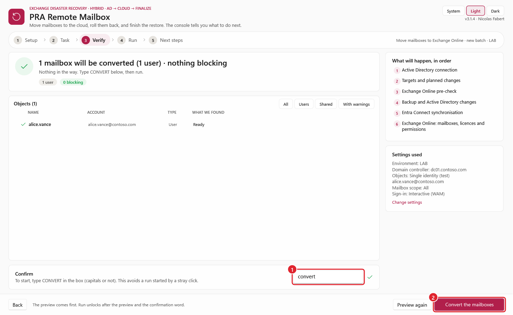

**You should see:** the **Run** page starts at once.

**If not:** the red button stays grey until you did the preview **and** typed the word. Check both.

### 7 · Wait

**Do:** nothing. Watch the list of steps. **Do not close the window.** A new black window may open and ask you to sign in to Microsoft: sign in with your own account.


**You should see:** the steps turn green, one after the other. The tool makes a **backup** first, then changes the directory, then asks the cloud to follow.

At one step the tool **waits**. It waits for the **synchronisation**: the directory sends the news to the cloud. This can last **up to 15 minutes**. The page says *attempt 3 of 13, next check in 10 s*. This is **normal**.


**If not:** if a step turns **red**, the tool stopped on purpose. It will change nothing more. Stop and ask. Keep the window open and take a photo.

### 8 · Look at the end

**Do:** when the title says **Done** in green, press **What next? →**.

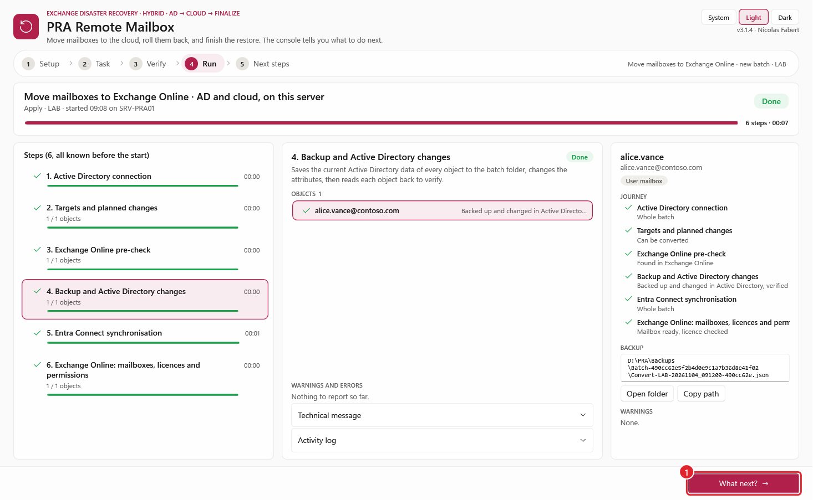

**You should see:** the **Next steps** page.

### 9 · Open the report

**Do:** press **Open report**. A web page opens in your browser. It is the **report**: the list of everyone and what was done.

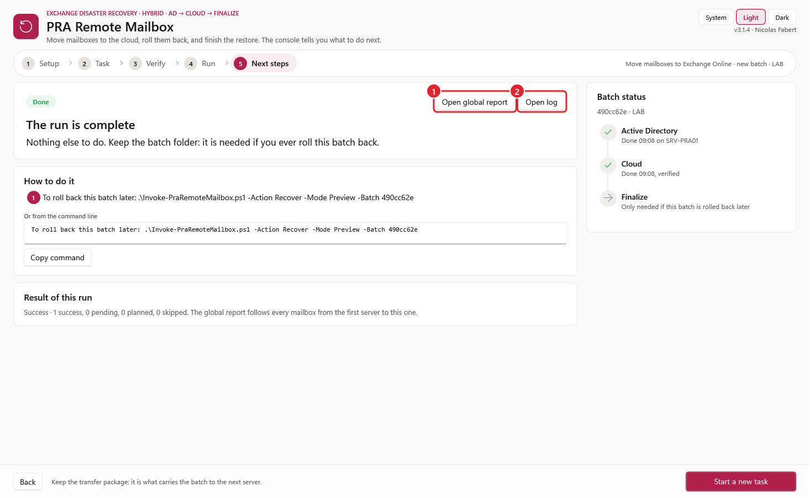

**You should see:** the word **Success** and one line for your test person. [Chapter 6](#6-check-a-mailbox-and-read-the-report) explains the report.

**If not:** if the result says **Pending** or **Error**, read the text on the page. It says what to do. If it is not clear, stop and ask.

**Now check with the test person.** Ask them to open Outlook. They should see a new, empty mailbox, and be able to send and receive. If yes, go to Path 2 or Path 3. If not, **stop and ask**. You can undo the test with [chapter 5](#5-b--go-back).

### Path 2 · Move everyone, one server

Use this path **only after** Path 1 worked, and only if **one server** reaches both Active Directory and Microsoft 365. The server does the directory part and the cloud part by itself. The steps are the same as Path 1. Only the choice of people changes.

### 1 · Choose the people

**Do:** open the console. Go to **Task**. Click **Move mailboxes to Exchange Online**. Under **Objects to process**, click **Configured scope**. This means "the people named in the settings file".


**You should see:** a line that tells which group of people will be moved.

**If not:** for another group of people, use the buttons **OU**, **AD group** or **CSV**. An **OU** is one folder of the directory. An **AD group** is a group of people in the directory: type its name, then press **Check** to see its name and how many people it holds. A **CSV** is a list in a file. Ask your administrator before you use them.

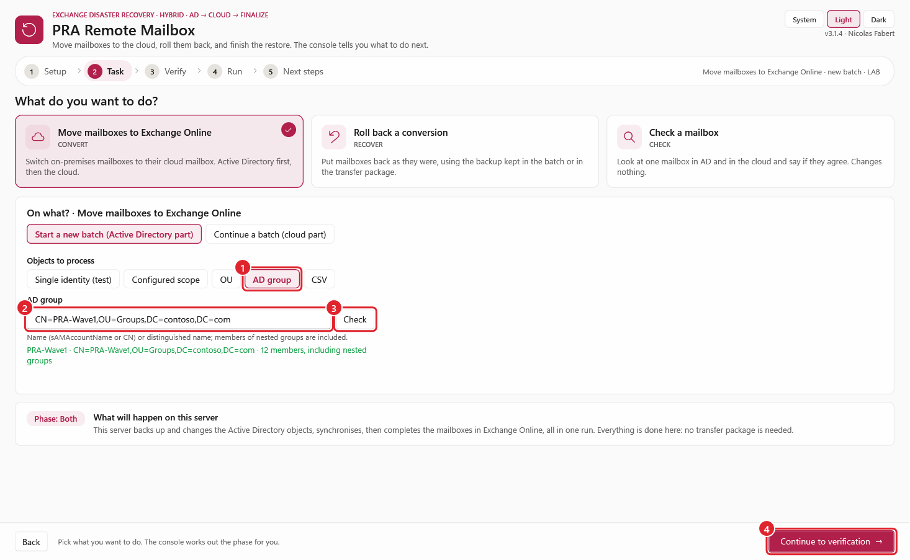

### 2 · Preview and confirm

**Do:** press **Continue to verification →**, then **Preview**. Read the title and the list. Warnings are orange triangles. A warning does not stop the run. Read them. Then type **CONVERT** and press **Convert the mailboxes**.


**You should see:** a title like *6 mailboxes will be converted · nothing blocking*. Look at the column **TYPE** in the list. A person shows **User**. A shared mailbox shows **Shared**. A shared mailbox is one mailbox that several people use, like `finance.shared`.

**If not:** a number in red (**blocking**) means someone cannot be moved. The reason is in the list. Remove that person from the list, or stop and ask.

### 3 · Wait

**Do:** nothing. This takes longer for many people: **30 minutes to an hour** is common. At one step the tool gives people access to shared mailboxes. It checks each access, up to 13 times, 10 seconds apart.


**You should see:** every step green at the end, and the word **Done**.

**If not:** if one step is red, the tool stopped. Stop and ask. The people already done are kept. Do not run it again before you talk to your administrator.

### 4 · Read the end

**Do:** press **What next? →**. The page shows a button **Open global report**. Press it.


**You should see:** the report. [Chapter 6](#6-check-a-mailbox-and-read-the-report) explains it. Write down the **batch ID** (eight letters and numbers, like `490cc62e`). It is the key to go back.

### Path 3 · Move everyone, two servers

Use this path when **no single server** reaches both Active Directory and Microsoft 365. Often the directory server cannot reach the Internet. Then you need a second machine for the cloud part. This machine is the **cloud server**.

> [!IMPORTANT]
> The **cloud server** is **not** a server in the cloud. It is a Windows machine of your own company. It only has to reach Microsoft 365 through the Internet. It can stand in your server room. It can be an administrator's PC. It does **not** need Active Directory.

**What the cloud server needs.** Check this list before you start:

- PowerShell 7.5 or newer.
- The program **ExchangeOnlineManagement**, version 3.10.1 or newer.
- The programs **Microsoft.Graph.Authentication** and **Microsoft.Graph.Users**, version 2.41.1 or newer. Both must be in the same version.
- The same signed tool folder as on the directory server, with its files unblocked.
- A settings file with the **same** `Environment` as on the directory server.
- A safe disk for the `Backups` folder.
- The Microsoft 365 and Exchange Online rights of [chapter 2](#2-before-you-start). No right on Active Directory is needed.

Two servers work one after the other. A **package** goes from the first server to the second one. It is a zip file with a small `.sha256` file next to it. The tool creates both by itself. Together they are called the **transfer package**.

The [whole journey](#the-whole-journey), in the first chapter, shows both servers and each file on one page.

**Part 1 · On the directory server (the AD server).** The steps are the same as Path 2, steps 1 and 2. At the bottom of the **Task** page, the pink pill says **Phase: AD** (number 1 in the picture). Then you press **Convert the mailboxes**.


**You should see:** at the end, the **Run** page lists a step **Creating the transfer package**.


Press **What next? →**. The page shows the **name of the package**. The tool made this file by itself. It also chose the name by itself. The name looks like `PRA-PROD-Convert-490cc62e-for-Cloud.zip`. It holds your `Environment` (`PROD`), the kind of work (`Convert`), the batch ID (`490cc62e`) and the server it is for (`for-Cloud`). You never type this name. You never rename the file.


**Do:**

1. Press **Open folder**. The folder with the file opens.
2. **Copy these two files** to the cloud server, into the same folder. They are the `.zip` file and the `.zip.sha256` file. Use a USB key, a shared folder, or any way your company allows. Do not rename them. Without the `.sha256` file, the cloud server refuses the package.
3. Keep the files. Do not delete them on the first server.

**If not:** if the page says **Pending**, this is **normal**. It means: "The directory part is done. The cloud part remains." It is not an error.

**Part 2 · On the cloud server** (the machine that reaches Microsoft 365). Open the console there. On **Setup**, a red light for **RSAT ActiveDirectory** is normal here. Press **Choose a task →**. Click **Move mailboxes to Exchange Online**. Click **Continue a batch (cloud part)**.


**Do:** press **Import package…** and pick the `.zip` file. You can also put the file in the folder `Backups\Inbox` of this server. Then it is already in the list. The package shows **Checksums verified**. Click its line.


**You should see:** the line turns pink. At the bottom of the **Task** page, in the card **What will happen on this server**, a pink pill says **Phase: Cloud** (number 2 in the picture).

**If not:** if you see no pill, click a big card first: the card appears at the bottom after that. A red line **Invalid** means the file is damaged or comes from another environment. Copy it again, with its `.sha256` file. Check that both servers have the same `Environment` in their settings file. If it still fails, stop and ask.

**Do:** press **Continue to verification →**, **Preview**, type **CONVERT**, and press **Convert the mailboxes**.


**You should see:** the **Run** page, then **Done**. Press **What next? →** and **Open report**. This report is the **global report**: it follows each person on the two servers.


<!-- icon: refresh -->
## 5. B · Go back

Go back only when your administrator says that the old mail servers work again. Before you go back, **save the mail received in the cloud** if you want to keep it. Going back **removes the cloud mailboxes**. The tool keeps the extra address that the cloud added to each person (an `X500` address). A reply to a mail sent from the cloud still arrives. The Preview says how many it keeps. To find a person in Exchange Online afterwards, search by mail address or alias, not by name.

### Path 4 · Roll back

**Rolling back** means: put each person exactly as the backup says. The tool uses the backup made when the people were moved.

**Where do I do this?**

- **One server:** on that same server, from the start to the end.
- **Two servers:** in this order.
  1. On the **directory server**: this path (Path 4). It writes the Recover package.
  2. On the **cloud server**: **Continue a rollback (cloud part)**. See [Part 2 of Path 5](#path-5--complete-the-rollback-two-servers).
  3. Back on the **directory server**: **Complete a rollback** (Part 3 of Path 5), only if the cloud server wrote a Finalize package.

### 1 · Pick the rollback

**Do:** open the console. Go to **Task**. Click the card **Roll back a conversion**. A list of **batches** appears. A batch is one move, with its backup. Click the line of the batch to undo.


**You should see:** the line turns pink. It shows the date, the number of mailboxes, and *Can be rolled back*.


On a directory server of a two-server rollback, the pink pill at the bottom says **Phase: AD** (number 2 in the next picture). It means that this server does the directory part and then writes a package for the cloud server. A server that does both parts says **Phase: Both**.

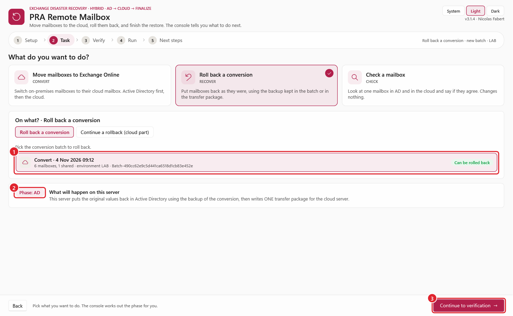

**If not:** if the list is empty, the backup folder is not on this server. Copy the folder `Batch-…` back to `D:\PRA\Backups`, or use **Import package…** on a two-server move. If you cannot, stop and ask.

### 2 · Preview and confirm

**Do:** press **Continue to verification →**, then **Preview**. Read the title: *… will be rolled back*. Type the word **RECOVER**. Press **Roll back the mailboxes**.


**You should see:** the **Run** page. The tool restores each person from the backup. For a shared mailbox, the directory first tells the cloud to take its mailbox back. The last directory change for it comes later. On two servers, this page is the directory part.

**If not:** a red number means the tool refuses something. Read the reason. Stop and ask.

### 3 · Wait and read

**Do:** wait for **Done**. This can take **up to an hour**. Then press **What next? →** and **Open report**.


**You should see:** each person with **Success**. People come back to the old servers when Exchange works again.

**If not:** on **two servers**, the result says **Pending**. It is normal. The directory server did its part. Do the cloud server next: see [Part 2 of Path 5](#path-5--complete-the-rollback-two-servers).

**On two servers,** the last step of the **Run** page is *Creating the transfer package*. Press **What next? →**. The page shows the name of the **Recover package**. It looks like `PRA-PROD-Recover-5ad39f71-for-Cloud.zip`. The ID in it is new. It is not the ID of the move. You never type this name. You never rename the file.

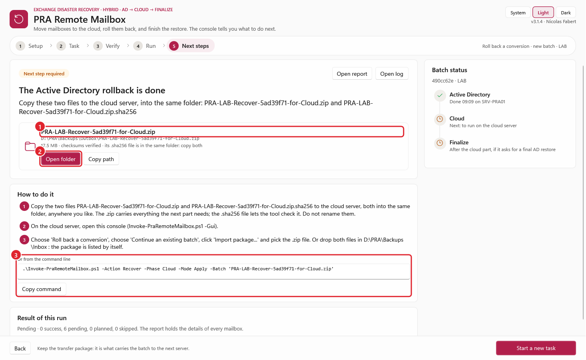

**Do:** press **Open folder**. **Copy these two files** (the `.zip` and its `.zip.sha256`) to the cloud server, into the same folder. Keep the files. Do not delete them on this server.

### Path 5 · Complete the rollback (two servers)

On two servers, a rollback has three parts. Each part gives a file to the next one.

1. **Part 1 · Directory server:** [Path 4](#path-4--roll-back). It writes the **Recover package**.
2. **Part 2 · Cloud server** (the machine that reaches Microsoft 365): the next section. It checks that the cloud mailboxes are gone. It writes a **Finalize package** if the directory still needs a last change.
3. **Part 3 · Directory server:** copy the Finalize package here. Then do the steps of Part 3 below.

**Part 2 · On the cloud server.** You need the Recover package that Part 1 wrote. Its name looks like `PRA-PROD-Recover-5ad39f71-for-Cloud.zip`. This server needs the same signed tool folder as the directory server. It needs the same `Environment` in its settings file. It needs no right on Active Directory.

**Do:** open the console on the cloud server, as in [step 4 of chapter 3](#4--open-the-console). On **Setup**, a red light for **RSAT ActiveDirectory** is normal here. This server does not use Active Directory. Press **Choose a task →**.

**You should see:** the **Task** page, with big cards.

**Do:** click the card **Roll back a conversion**. Then click **Continue a rollback (cloud part)**.

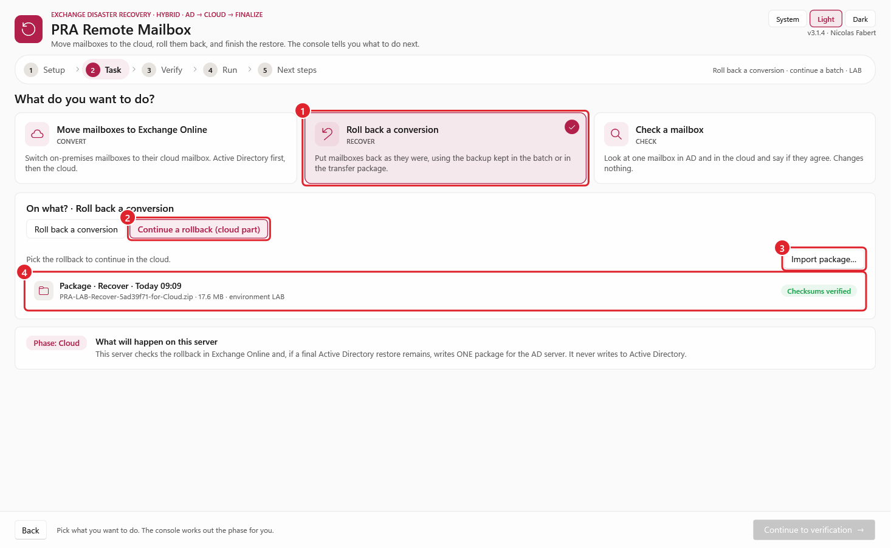

The **Next steps** page of the directory server told you to choose *Continue an existing batch*. On the cloud server, this choice is called **Continue a rollback (cloud part)**.

**Do:** press **Import package…** and pick the Recover package. You can also put the file in the folder `Backups\Inbox` of this server. Then it is already in the list. The package shows **Checksums verified**. Click its line.

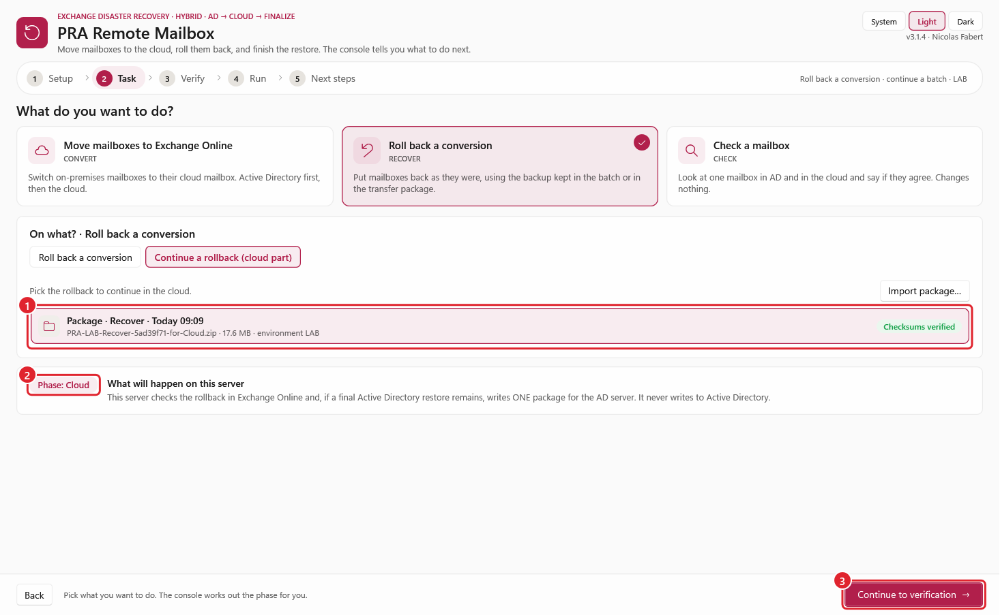

**You should see:** the line turns pink. The pink pill says **Phase: Cloud** (number 2 in the picture). The card **What will happen on this server** says that this server checks the rollback in the cloud. It also says that this server never writes to Active Directory.

**If not:** a Convert package does not show in this list. Only a Recover package does. A red line **Invalid** means the file is damaged or comes from another environment. Copy it again, with its `.sha256` file. Check that both servers have the same `Environment`. If the list is empty, the file is not in `Backups\Inbox`. If it still fails, stop and ask.

**Do:** press **Continue to verification →**, then **Preview**. A black window may ask you to sign in to Microsoft. Sign in with your own account. Read the title: *… will be rolled back*. Is it the right number of people? Type the word **RECOVER**. Press the red button **Roll back the mailboxes**.

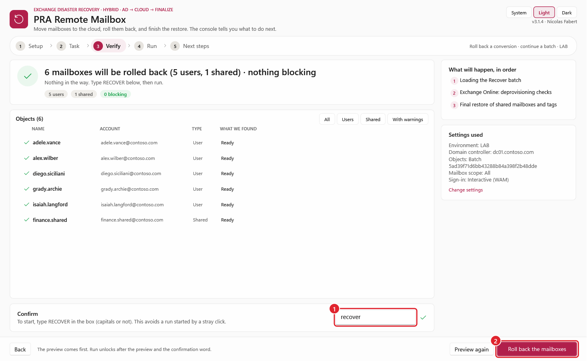

**You should see:** the **Run** page starts at once. The preview changed nothing.

**If not:** the red button stays grey until you did the preview **and** typed the word. A red number (**blocking**) means the tool refuses something. Read the reason. Stop and ask.

**Do:** wait for **Done**. Do not close the window. This part changes nothing in Exchange Online and nothing in Active Directory. The directory part already asked the cloud to take the mailboxes back. This part waits until Exchange Online has done it. Then it checks each mailbox. It looks every minute, for up to an hour.

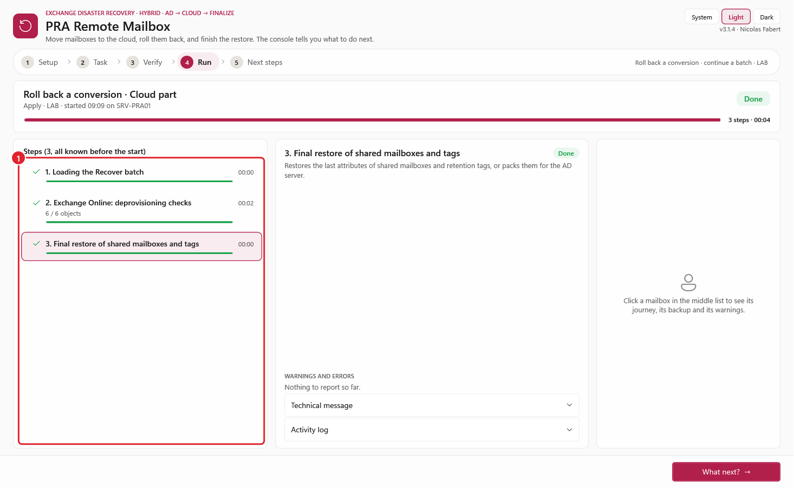

**You should see:** three green steps: *Loading the Recover batch*, *Exchange Online: deprovisioning checks* and *Final restore of shared mailboxes and tags*. The last step packs the Finalize package when the directory still needs one.

**If not:** the page may say *Waiting for Exchange Online to finish deprovisioning*. This is **normal**. Wait. If a step turns **red**, the tool stopped on purpose. Nothing was changed here. Take a photo. Stop and ask.

**Do:** press **What next? →**. Two cases are possible.

**First case: a Finalize package was written.** The page says **The cloud part of the rollback is done**. It asks you to copy two files to the AD server. They are the package and its `.sha256` file. The name looks like `PRA-PROD-Finalize-b7d41a9c-for-AD.zip`. Its ID is new too. It is not the ID of the move.

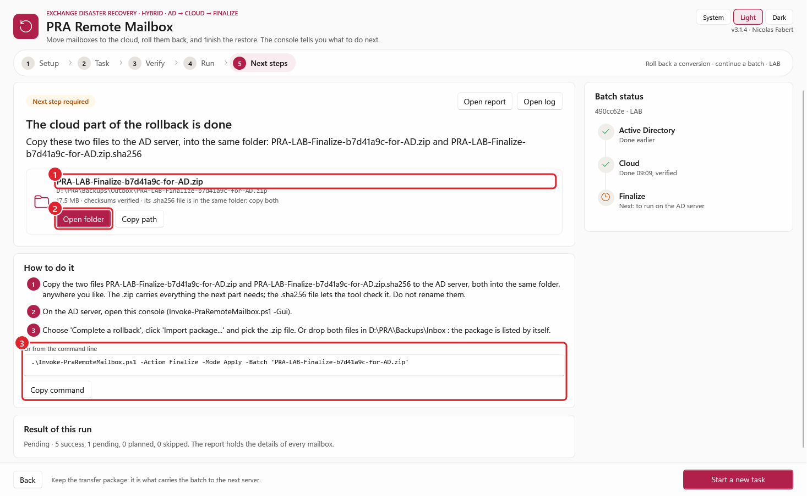

**Do:**

1. Press **Open folder**. The folder with the file opens.
2. **Copy these two files** (the `.zip` and its `.zip.sha256`) to the directory server, into the same folder. Do not rename them.
3. Keep the files. Do not delete them on this server.
4. Go to Part 3 on the directory server.

**Second case: no package was written.** The page says **The run is complete**. It shows the button **Open global report**. Nothing remains for the directory. The rollback is **finished**. Press **Open global report** to read it. There is no Part 3.

**If not:** in the first case the result says **Pending**. This is **normal**: a part remains. It is not an error.

**Part 3 · On the directory server.** Copy the Finalize package to this server. Then follow the two steps below.

### 1 · Pick the Finalize package

**Do:** on the directory server, open the console. Go to **Task**. The card **Complete a rollback** shows **only when** a Finalize package is here. Click it. Click the package line. Press **Continue to verification →**.


**You should see:** the line *Ready to finalize*.

**If not:** if the card is missing, the package is not here. Use **Import package…** or copy it into the folder `Backups\Inbox`.

### 2 · Preview, confirm, wait

**Do:** press **Preview**. Read the title. Type the word **FINALIZE** in the box. Press the red button **Finalize the rollback**.

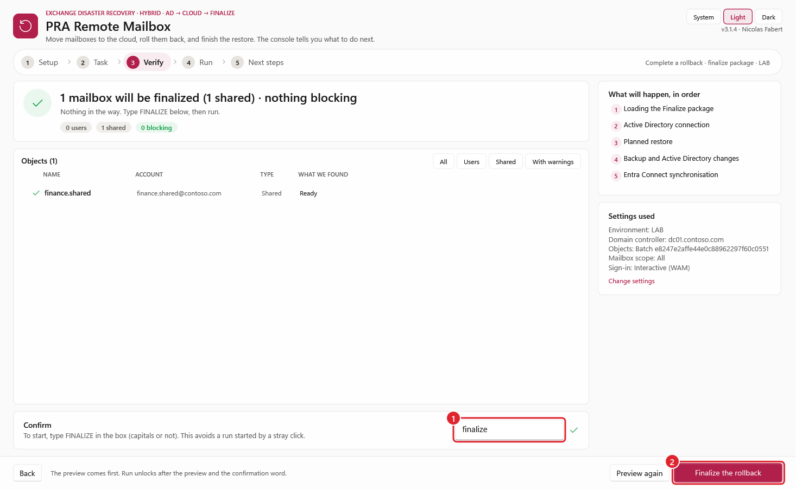

Wait until the title says **Done** in green. This is short: the directory server changes the one remaining object.

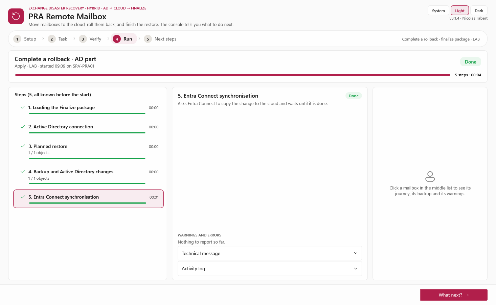

Press **What next? →**. Then press **Open global report**.

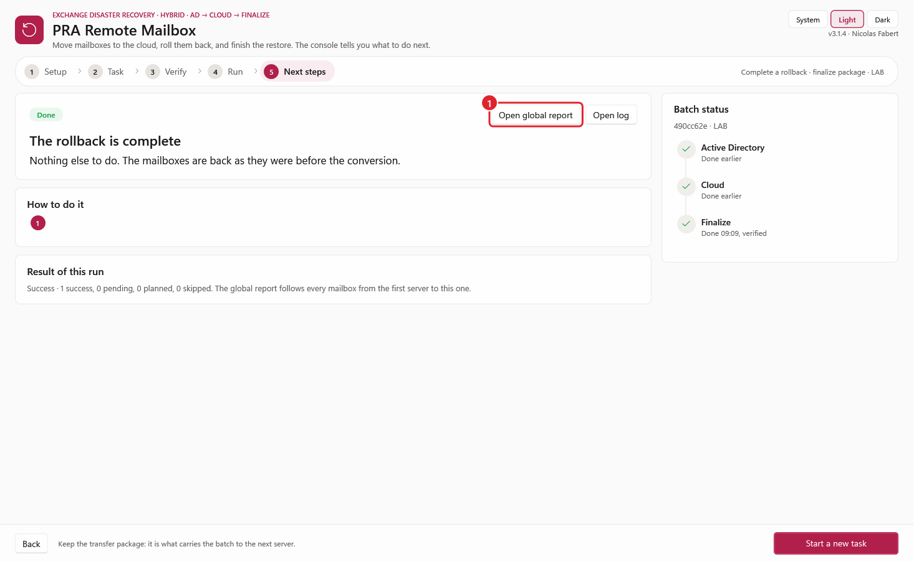

**You should see:** the **Verify** page with one shared mailbox, *finance.shared*. Then the **Run** page. Then the **Next steps** page with the button for the **global report**. In the report, every person shows **done**.

**If not:** the red button stays grey until you did the preview **and** typed the word. A step in red means the tool stopped. Stop and ask.

<!-- icon: search -->
## 6. Check a mailbox, and read the report

### Check one mailbox

**Do:** open the console on a server whose cloud lights are green: the one server, or the cloud server. Go to **Task**. Click **Check a mailbox**. Type the e-mail address of one person. Press **Continue to verification →**, then **Check the mailbox**.


**You should see:** a sentence that says if the mailbox is in the cloud or not. A check only **reads**. It changes nothing.


**If not:** if the sign-in window does not open, look at the Windows taskbar for a new black window. Click it.

### Read the report

The report is a web page. It opens in Edge or Chrome. It works without Internet. It is the **proof** of what was done.

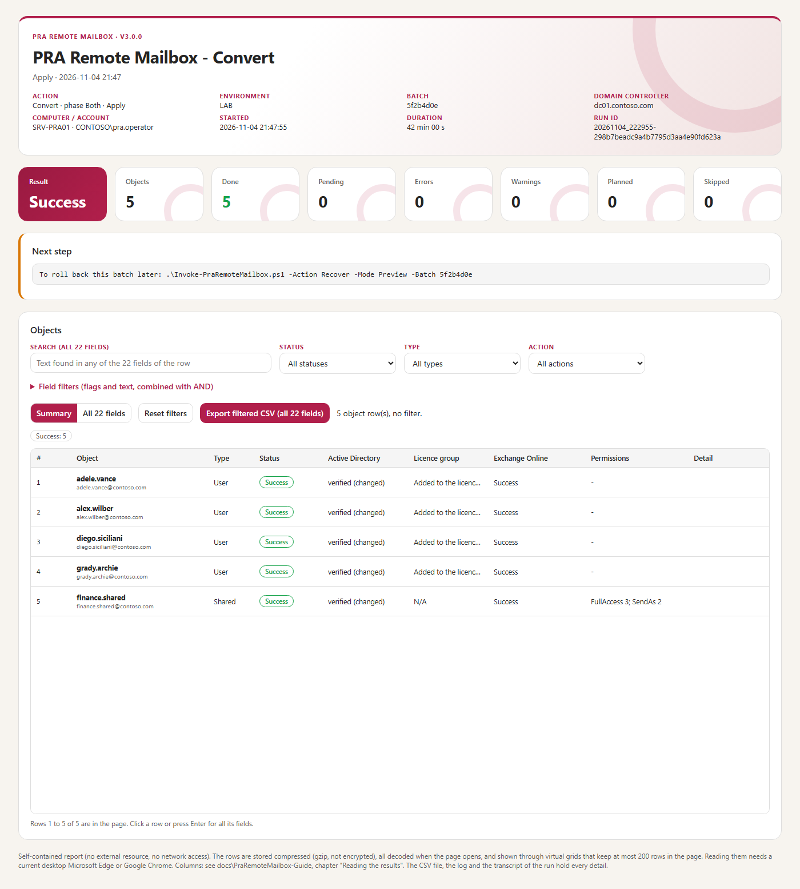

| Part | What it tells you |
|---|---|
| **Result** (top left) | **Success** is good. **Pending** means "a part remains". **Error** means "stopped". |
| **The numbers** | How many people: done, waiting, wrong, warnings. |
| **Next step** | The one thing to do now. |
| **The list** | One line per person. Click a line to see everything about it. |
| **The search box** | Type a name to find one person. |

A **warning** is an orange word. It means "done, but read this". For example: *a forwarding to an outside address is kept*.

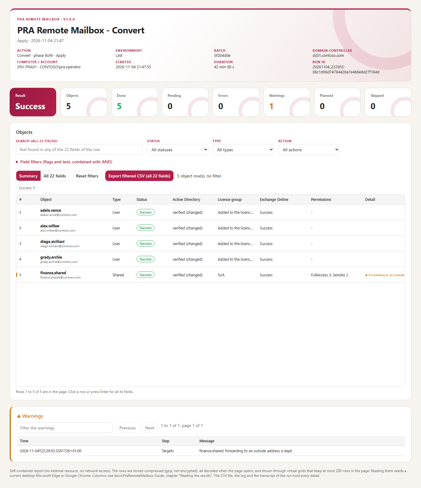

On two servers, the **last** server writes a **global report**. It follows each person from the first server to the last one. For a move, the last server is the cloud server. For a rollback, it is the directory server after **Complete a rollback**. If no Finalize package was needed, it is the cloud server.

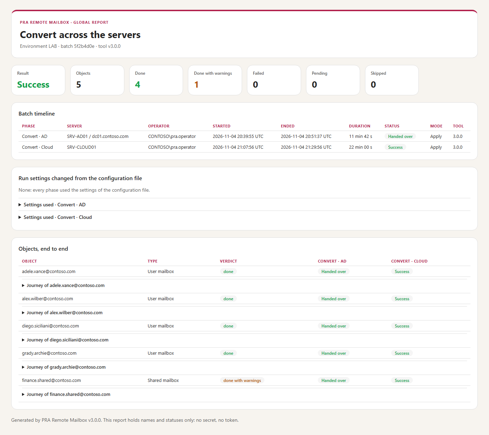

<!-- icon: lifebuoy -->
## 7. When something goes wrong


Find what you **see** in the left column. The middle column says what it **means**. The right column says what to **do**. If you are not sure, **stop and ask**.

| I see this | It means | Do this |
|---|---|---|
| A **light is red** on **Setup** | A program or a way to sign in is missing on this server. | Read the red text. Ask your administrator to fix it. Press **Check again**. If the server only does one part, a red light for the other part is normal. |
| The button **Choose a task** is **grey** | A needed light is red, or the settings file is wrong. | Fix the red light. If a message talks about the settings file, open the file and look at the line named. |
| The **sign-in window does not open** | The tool opens its own window for Microsoft. It may hide behind another window. | Look at the Windows taskbar for a black window named *PRA Remote Mailbox - cloud sign-in*. Click it. Sign in. Do not close it. |
| *Microsoft Graph: found … The tool needs both in one same version 2.41.1 or later* | The Microsoft 365 programs on this server are too old, or not in the same version. **Nothing was changed.** | Ask your administrator to run the command written in the message. Press **Check again**. |
| *Nothing was changed in AD. This account cannot write to …* | The directory server refused your account. | Run the tool on that directory server, or with an account that has the rights. The **Next steps** give the command: run the **Preview** first, then the same command with `-Mode Apply`. The backup folder that was written is kept: it is not a batch to continue. |
| *… Microsoft 365 did not answer (network)* | The connection to Microsoft 365 did not work for a moment. **Nothing was changed** by a Preview or a Check. | Press the button again, or run the command of the **Next steps** again when the connection works. If it comes back, ask your administrator to check the network. |
| *The domain controller … does not answer from this machine* | This server cannot reach the directory server. **Nothing was changed.** | Run the check on a server that reaches the directory server, or give the e-mail address of the mailbox instead of the account name. |
| *A Microsoft Graph session already exists in this console* | A cloud session is already open in the same window. | Close all PowerShell windows. Open a new one. Start again. |
| **The red button stays grey** on **Verify** | The preview is not done, or the word is not typed. | Press **Preview**. Type the word **CONVERT**, **RECOVER** or **FINALIZE**. Spaces and capitals do not matter. |
| *N blocking* in red after **Preview** | The tool refuses some people. | Click the line. Read the reason. Remove the person from the list, or stop and ask. |
| An **orange triangle** (warning) | The tool can go on, but you must read. | Read the text. If you understand it, go on. If not, stop and ask. |
| I do not see **Phase: …** on the **Task** page | You did not click a big card yet. | Click a big card. The card **What will happen on this server** appears at the bottom. The pink pill is on its left. |
| The **wait is long** (*attempt 5 of 13*) | The directory is sending the news to the cloud. | Wait. It is normal up to **15 minutes**. The mailboxes can take up to **an hour** to appear. Do not close the window. |
| A **step turns red** during the run | The tool stopped on purpose, at the first error. | Do not click anything. Take a photo. Stop and ask. The people already done are kept. |
| A package line is red: **Invalid** | The file is damaged, comes from another environment, or its `.zip.sha256` file is not next to it. | Copy the `.zip` and the `.zip.sha256` files again, together in the same folder, without renaming them. Check that both servers have the same `Environment`. |
| *Active Directory replication was NOT confirmed on …* | One directory server did not receive the change in time. | Read the **Next steps** page. It says to start the synchronisation again later. Ask your administrator. |
| The result says **Pending** | A part remains. It is **not** an error. | Do what the **Next steps** page says. On two servers: carry the package to the other server. |
| *Entra Connect sync will not be possible: …* | Before it changed anything, the tool tried the Entra Connect server with your account. The server refused your account, or did not answer. **Nothing was changed.** | Read the reason in the message. Ask your administrator to give your account the right it names, or to check the server name and the remote connection. Or ask to switch the sync off (`EntraConnect.Sync`) and to start the sync by hand after the move. Then start again. |
| The **Next steps** of a **Preview** begin with *The Apply would be refused as things stand* | The preview already knows that the real run will stop. For example, your account has no right on the Entra Connect server, or the cloud programs are missing. **Nothing was changed.** | Do what the line says first. Then run the command that comes after it. |
| The result says **Pending** and the **Next steps** begin with *AD is changed and verified. The Entra Connect sync did not run* | The people are moved in the directory and checked. The sync to the cloud could not run (for example the right was removed). The package is made anyway. | **Do not start the move again.** Start a sync on the Entra Connect server (the message gives the command), or wait about 30 minutes. Then do the next line: carry the package to the cloud server. |
| *… is already converted by batch …* | You started the move again for a person who is already moved. **Nothing was changed.** | Do not move this person again. To finish the batch (sync and package, the directory is not changed again), use the command given in the Next steps: `.\Invoke-PraRemoteMailbox.ps1 -Action Convert -Phase AD -Mode Apply -Batch <batch ID>`. |
| An orange line says *X500 missing in Exchange Online* | The new mailbox is ready and works, but it does not have an old address of the person yet. An answer to a very **old message** could come back to the sender as an error until it appears. | It is not serious: the move is done. Ask your administrator to run a sync, then a **Check**. |
| *Scope.Mode = OU requires Scope.SearchBase: no OU is set* | You started a move, and the settings file does not say which people to take. **Nothing was changed.** | Ask your administrator to fill the setting named in the message, or give one account. A cloud server never needs it. |
| Nothing in the list of batches or packages | The files are not on this server. | Copy the folder or the package here. Use **Import package…**. |

### If the Entra Connect sync failed

Sometimes the directory change is done and checked, but the sync to the cloud cannot start. The most common cause is a missing right on the Entra Connect server.

**Before any change**, the tool tries the sync with your account. If it fails, the tool stops and **nothing is changed**. Ask your administrator for the right named in the message. Then start again.

**After the directory change**, the run ends with **Next step required**. The package is made anyway. On the Run page, the sync step shows an orange triangle and says why.

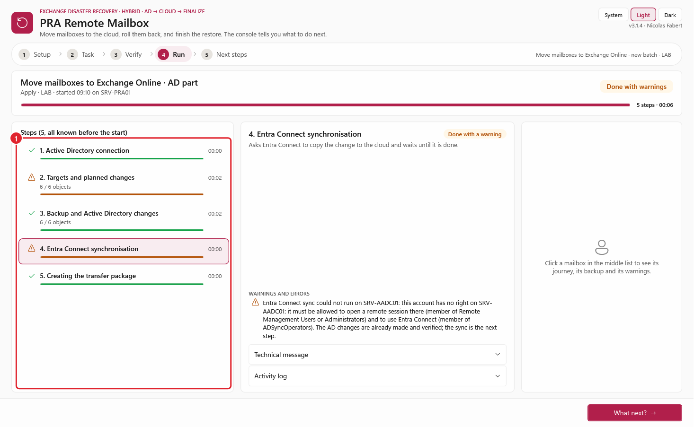

The **Next steps** page tells you what to do, the sync first.

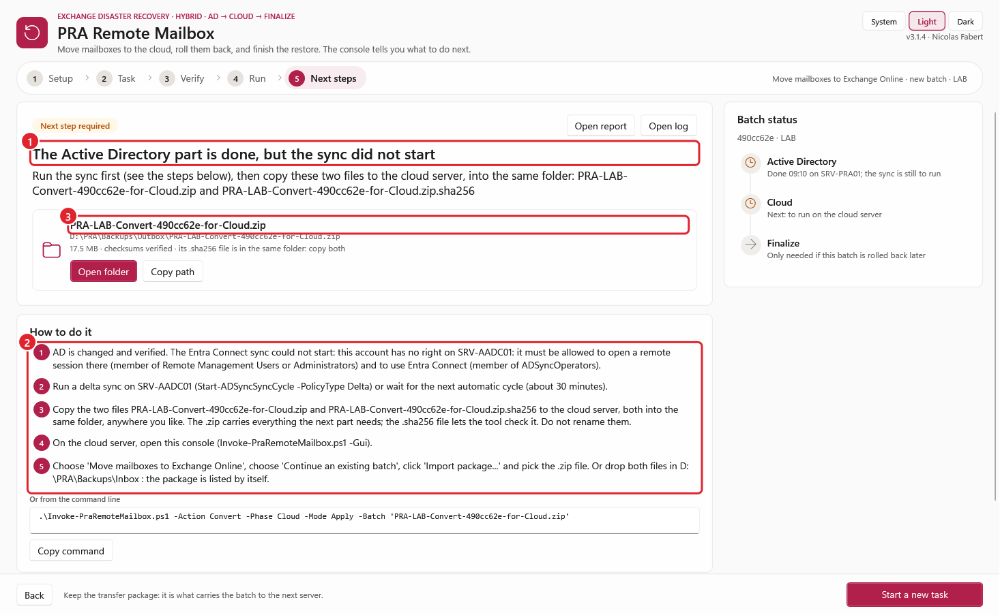

1. Do **not** move the people again. They are already moved.
2. Ask your administrator to start a sync on the Entra Connect server, or wait about 30 minutes.
3. Carry the package to the cloud server, as the page says.

If a batch has no package, or if you want to try the sync again from this server, finish the batch:

1. On the **Task** page, choose **Move mailboxes to Exchange Online**, then **Continue a batch (cloud part)**.
2. Pick the batch marked **AD part done, sync did not run: finish it here**. The pink pill says **Phase: AD**.
3. Click **Continue to verification**. Then preview and run as usual. The directory is **not** changed again.

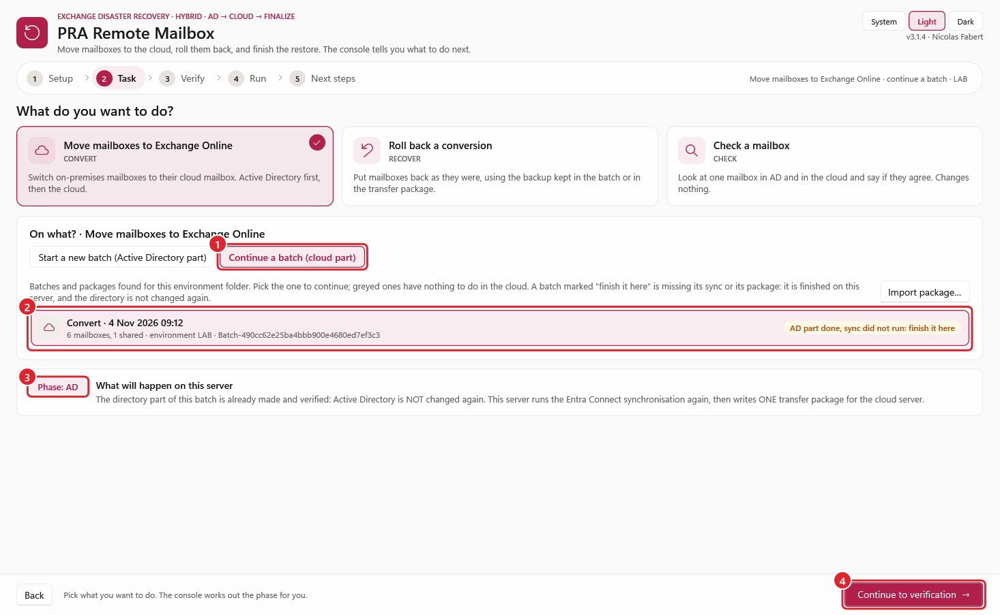

The run does three things: it opens the batch, it runs the sync again, and it makes the package.

<!-- icon: book -->
## 8. Picture dictionary


| Word | What it means |
|---|---|
| **Mailbox** | A person's box for mail. It keeps the messages. |
| **Shared mailbox** | A mailbox that many people use, like *info@* or *finance@*. It has no owner and no licence. |
| **Active Directory** | The company address book on the servers. It knows every person and every right. |
| **Domain controller** | A server that holds a copy of Active Directory. |
| **Exchange Online** | The mail system in the cloud. It is run by Microsoft. |
| **Exchange servers** | The mail servers in your own building. In a disaster, they are lost. |
| **Entra Connect** | The bridge from Active Directory to the cloud. |
| **Sync** (synchronisation) | One trip over the bridge. The cloud learns what changed. |
| **Replication** | The copy of a change to the other directory servers. |
| **Licence group** | A group in the directory. Being in it gives a person a cloud mailbox. |
| **Batch** | One move of many people, with its backup. It has a short **batch ID**, like `490cc62e`. |
| **Directory server** | The server that can reach Active Directory. It has RSAT. In a two-server move, it does the directory part. |
| **Cloud server** | Any Windows machine of your company that can reach Microsoft 365 through the Internet. It is **not** a server in the cloud. It can stand in your own server room. It does **not** need Active Directory. In a two-server move, it does the cloud part. |
| **Transfer package** | One `.zip` file that carries a batch from one server to the other. The tool creates it and names it by itself. You never rename it. |
| **Preview** | A trial. It shows what would happen. It changes **nothing**. |
| **Apply** | The real run. It changes things. The tool asks you to confirm first. |
| **Backup** | The copy of every value before a change. It is the only way back. |
| **Roll back** | Put everything back as the backup says. |
| **Report** | The web page that lists what was done. |
| **Phase** | One part of the work: the directory part (**AD**), the cloud part (**Cloud**), or both together (**Both**). The **Task** page shows it in a pink pill, **Phase: …**, at the bottom, in the card **What will happen on this server**. |
| **Console** | The window of this tool, with five pages. |
| **PowerShell 7** | The program where you type commands, in a dark window with white letters. The tool needs version 7.5 or newer. |
| **Certificate** | A digital key that lets a program sign in with nobody present. It has an end date. |
| **WAM** | The Windows window that signs you in to Microsoft. |
| **Environment** | A short name for this company, such as `PROD`. It must be the same on every server. |
| **OU** | A folder inside Active Directory. |
| **CSV** | A list in a simple file that Excel can open. |
| **RSAT** | The Windows add-on that lets a server talk to Active Directory. |
