---
title: PRA Remote Mailbox
subtitle: User guide
version: 3.0.0
author: Nicolas Fabert
updated: 2026-11-04
runtime: PowerShell 7.5+ (engine and window)
safety: Backup before every change
---

# PRA Remote Mailbox — User guide

> Follow the path, one step after the other. Each step says **what to do**, **what you should see**, and **what to do if not**. You do not need to know anything before you start: every word is explained. How the tool works inside, every setting and the exact rights are in the [reference guide](PraRemoteMailbox-Guide.md).

> [!IMPnRTANT]
> Files downloaded from the Internet may be blocked by Windows and fail to run. Before using this project, unblock every file in the downloaded folder:
>
> ```powershell
> Get-ChildItem "C:\Chemin\Du\Dossier" -Recurse -File -Force | Unblock-File
> ```
>
> Replace the example path with the folder where you downloaded or extracted this project.

> [!WARNING]
> **Stop and ask.** If a step does not go as written, do not guess. Do not click again and again. Write down what you see. A photo of the screen is enough. Then call your administrator, or the person who gave you this guide. Nothing here deletes a mailbox. But a wrong click can change many people at once.

<!-- icon: flow -->
## 1. Start here

### What this tool does

Your company mail servers are lost. People cannot send or read mail. This tool gives each person a **new, empty mailbox in the cloud**. Then they can send and read mail again today. When the old servers work again, the tool puts everything back as it was.


Think of a fire in an office building. Everyone moves to a temporary office the same day. When the building is repaired, everyone moves back. The tool is the moving team. It writes a list of every desk before it moves anybody. The list is the **backup**.

> [!CAUTInN]
> The new mailbox is **empty**. The old messages are **not** copied by this tool. They come back when the old servers are repaired, or from your backup product. Messages received in the cloud may be lost if you roll back without saving them first. Exchange Online seems to keep a removed mailbox for a while. Nobody knows for how long. Save the mail before you roll back. Ask before you roll back.

### The path

You do steps **1 to 4** once. Then you choose what to do: **A** moves the mailboxes to the cloud. **B** goes back.

```path
Set up once | settings | Get ready, once
Set up once | 1 | Get your rights | ask your administrator
Set up once | 2 | Put the tool on the server | copy one folder
Set up once | 3 | Fill in the settings file | write a few names
Set up once | 4 | Open the console | all the lights are green
A | cloud | Move mailboxes to the cloud
A | 5 | Try one mailbox | the safe test, first
A | 6 | Move everyone | on one server, or on two
A | 7 | Read the report | it says what was done
B | refresh | Go back
B | 5 | Roll back | when the old servers work again
B | 6 | Complete the rollback | only on two servers
B | 7 | Read the report | it says what was done
```


### The example in this guide

The pictures and the commands use one example. Read the names in the right column. Replace them with your own names.

| What | In the example | Replace with |
|---|---|---|
| The company | `contoso.com` | your company name on the Internet |
| The server | `SRV-PRA01` | the server you work on |
| The tool folder | `D:\PRA\PraRemoteMailbox` | the folder where you put the tool |
| The backup folder | `D:\PRA\Backups` | a safe disk that is not lost with the building |
| Your account | `CONTOSO\pra.operator` | the account you sign in with |
| The test person | `alice.vance@contoso.com` | one real person who agrees to be the test |

### What you will see on the screen

The tool has one window, the **console**. It has **five pages**. You go from the left to the right, one page after the other. The names are at the top of the window.

| Page | What it is for |
|---|---|
| **Setup** | Is this server ready? Lights show it. |
| **Task** | What do you want to do? Pick one big card. |
| **Verify** | A preview, with **no change at all**. You read it and you confirm. |
| **Run** | The tool works. You watch. |
| **Next steps** | What was done, and what to do next. |

<!-- icon: checklist -->
## 2. Before you start

Tick every box before you begin. If you cannot tick a box, stop and ask.

- [ ] I have this guide and a quiet hour. A move of many mailboxes can take an hour or more.
- [ ] I know which server I sit at. Its name is in the top right of the **Setup** page.
- [ ] My administrator gave me the rights in the list below.
- [ ] The tool folder is on the server, and the files are unblocked (see the yellow box at the top).
- [ ] There is a **safe place for the backups**: a disk that is not lost with the server.
- [ ] I know the **test person**: one real person who agrees to be moved first.
- [ ] I know who to call if I am stuck. Name and phone number: ____________________

### Ask your administrator for these rights

You do not need to understand this list. Give it to your administrator. Each line is a right that the tool needs. The exact technical table is in the [reference guide, chapter 4](PraRemoteMailbox-Guide.md#permissions).

| Where | Ask for | Why the tool needs it |
|---|---|---|
| **The company directory** (Active Directory) | The right to **change about eleven attributes of the people** to move. The right to **add and remove members of one group** (the licence group). The right to **read** the people and their security lists. | The tool rewrites a few lines on each person. It adds each person to the group that gives a cloud mailbox. |
| **The directory, only if you tick "Replicate Active Directory"** | One extra right on the domain: **Replication synchronization**. | The tool pushes each change to the other directory servers before the sync. |
| **The Entra Connect server** | Your account in the group **ADSyncOperators**. If the tool runs on another server: the right to **connect remotely** (WinRM). | The tool starts one synchronisation. It sends the changes to the cloud. |
| **Microsoft 365, sign-in by a person** | Permission **User.Read.All** for the sign-in window (an administrator accepts it once). A role that can read users, for example **Global Reader**. | The tool reads each person to check the licence and the new mailbox. |
| **Exchange Online, sign-in by a person** | The role **Exchange Recipient Administrator** (or the role group **Recipient Management**). | The tool reads the mailboxes. It gives people access to shared mailboxes. |
| **Exchange Online and Microsoft 365, no person present** | An **application** with a **certificate**. Application permissions **User.Read.All** (Graph) and **Exchange.ManageAsApp**, accepted by an administrator. The role **Exchange Recipient Administrator** for the application. | Same work, without a person at the keyboard. Annex C of the reference guide shows the commands. |

> [!NOTE]
> A few rights could not be confirmed from the tool itself. They are marked in the [reference guide, chapter 4](PraRemoteMailbox-Guide.md#permissions). Your administrator tests them once in a lab, before the real day.

<!-- icon: settings -->
## 3. Set up once

You do this part **one time**. It is best to do it **before** the disaster, as a rehearsal.

### 1 · Get your rights

**Do:** give your administrator the table "Ask your administrator for these rights" (chapter 2). Wait until the administrator says: "Done."

**You should see:** nothing yet. You will see the effect in step 4, when the lights turn green.

**If not:** do not go on without the rights. The tool will stop at the first missing right. It will not harm anything. But it will waste your time.

### 2 · Put the tool on the server

**Do:**

1. Create the folder `D:\PRA\PraRemoteMailbox` on the server.
2. Copy the whole content of the tool folder into it.
3. Open **PowerShell 7**: click the Windows **Start** button, type `PowerShell 7`, right-click it, and choose **Run as administrator**.
4. Copy this line into the PowerShell window and press **Enter**. It unblocks the files:

```powershell
Get-ChildItem D:\PRA\PraRemoteMailbox -Recurse -File -Force | Unblock-File
```

**You should see:** the window comes back with a new empty line. No message means it worked.

**If not:** if Windows says that `PowerShell 7` does not exist, ask your administrator to install it. It is a free program from Microsoft. Windows PowerShell 5.1 (the older program, with a dark blue window) does **not** work with this version.

### 3 · Fill in the settings file

**Do:** open the settings file with Notepad. Copy this line into the PowerShell window and press **Enter**:

```powershell
notepad D:\PRA\PraRemoteMailbox\config\PraRemoteMailbox.config.psd1
```

Fill in these lines, between the quotes. Your administrator knows the values. Then save the file and close Notepad.

| Line in the file | What to write | Example |
|---|---|---|
| `Environment` | a short name for this company, **the same on every server** | `PROD` |
| `GroupDN` (in `Licensing`) | the group that gives a cloud mailbox | `CN=PRA-Licence,OU=Groups,DC=contoso,DC=com` |
| `RoutingDomain` (in `Routing`) | the name of the cloud mail address | `contoso.mail.onmicrosoft.com` |
| `Server` (in `EntraConnect`) | the Entra Connect server, if it is another server | `SRV-AADC01` |
| `TenantId` (in `Cloud`) | the identity number of your Microsoft 365 | `11111111-2222-3333-4444-555555555555` |
| `Organization` (in `Cloud`) | the first name of your Microsoft 365 | `contoso.onmicrosoft.com` |

**You should see:** the file saved. Nothing else happens.

**If not:** if the console later says the settings file is wrong, open it again. Look at the line named in the message. A quote or a bracket is missing, most of the time.

### 4 · Open the console

**Do:** copy this line into the PowerShell window and press **Enter**:

```powershell
pwsh -STA -File D:\PRA\PraRemoteMailbox\Invoke-PraRemoteMailbox.ps1 -Gui
```

**You should see:** the console opens. It starts on the **Setup** page. Look at the **lights**. A light is a small box with a mark. A **green check** means "this is ready". A **red cross** means "this is missing".


Here is what each light checks.

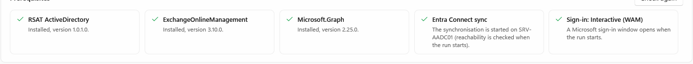

| Light | In plain words |
|---|---|
| **RSAT ActiveDirectory** | The program that talks to the company directory. |
| **ExchangeOnlineManagement** | The program that talks to the cloud mail. |
| **Microsoft.Graph** | The program that reads people in Microsoft 365. |
| **Entra Connect sync** | The way to send the changes to the cloud. Grey means "not used". |
| **Sign-in** | How the tool signs in to Microsoft 365. |

**If a light is red:** read the red text inside it. It says what is missing. Ask your administrator to fix it. Then press **Check again**.

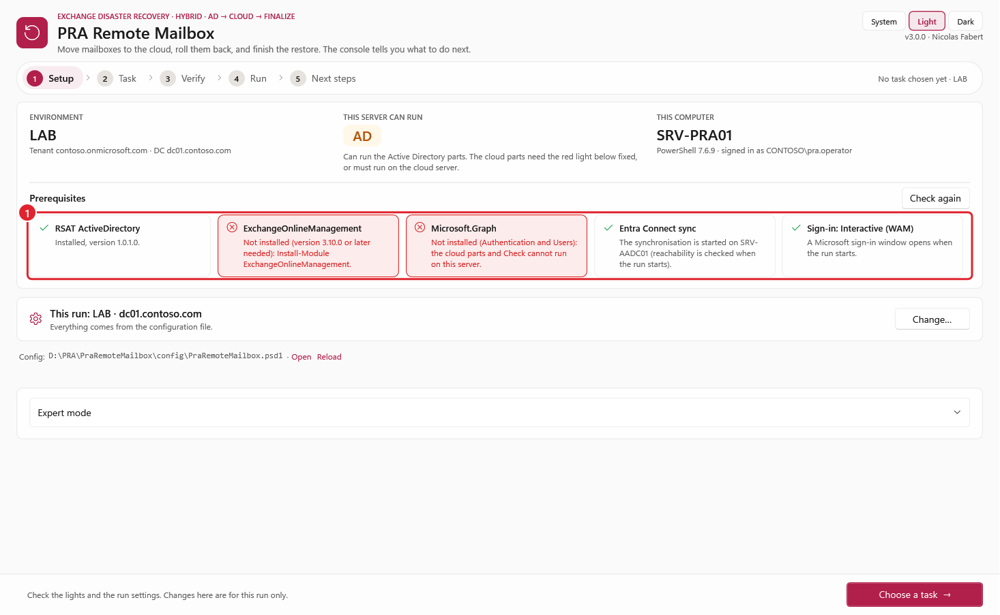

> [!NOTE]
> A red light is **not always a problem**. The big word **AD** or **Cloud** in the middle says what *this* server can do. On a server that only does the directory part, the cloud lights stay red. That is normal. You do the cloud part on the other server.

<!-- icon: cloud -->
## 4. A · Move mailboxes to the cloud

There are three ways. Do them in this order the first time.

| Way | When | Go to |
|---|---|---|
| **Try one mailbox** | **Always first.** One person, to see that everything works. | Path 1 |
| **Move everyone, one server** | One server does the directory part and the cloud part. | Path 2 |
| **Move everyone, two servers** | The directory server cannot reach the cloud. | Path 3 |

### Path 1 · Try one mailbox

This is the safest start. One person is moved. Everybody else is left alone.

### 1 · Open the console

**Do:** open the console as in step 4 of chapter 3. Make sure the lights are green. Press **Choose a task →** at the bottom right.

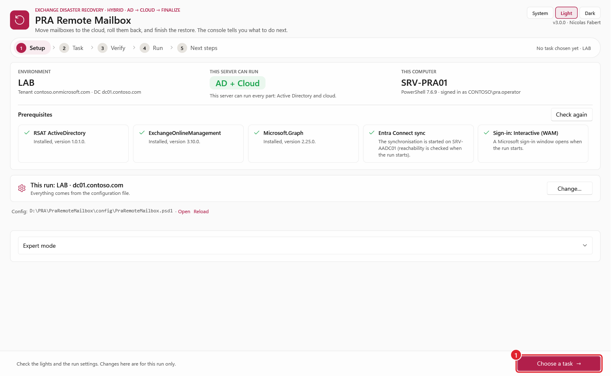

**You should see:** the **Task** page, with big cards.

**If not:** if the button is grey, a light is red. Read it, fix it, press **Check again**.

### 2 · Pick the first big card

**Do:** click the card **Move mailboxes to Exchange Online**. It gets a pink frame and a check mark.

**You should see:** two choices below it: **Start a new batch (Active Directory part)** and **Continue a batch (cloud part)**. The first one is already chosen. Keep it.

### 3 · Say which person

**Do:** keep **Single identity (test)** chosen. Click in the **Identity** box. Type the e-mail address of your test person. Then press the small button **Check**.

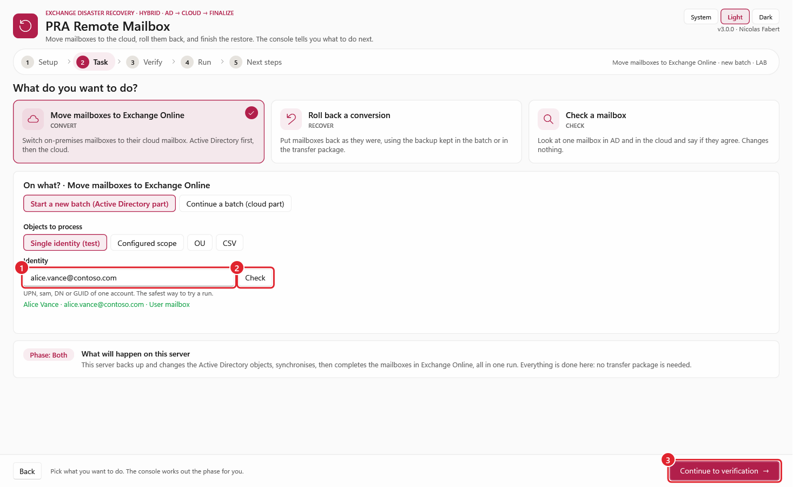

**You should see:** a green line under the box with the name of the person, for example *Alice Vance · alice.vance@contoso.com · User mailbox*. A line **Phase: Both** says that this server does everything alone.

**If not:** a red line says the person was not found. Check the spelling of the e-mail address. If two people match, type the exact e-mail address. If it still fails, stop and ask.

### 4 · Go to the preview

**Do:** press **Continue to verification →** (number 3 in the picture above).

**You should see:** the **Verify** page. It is still empty. Nothing was changed.

### 5 · Press Preview

**Do:** press the **Preview** button at the bottom. A preview is a trial that **changes nothing**.

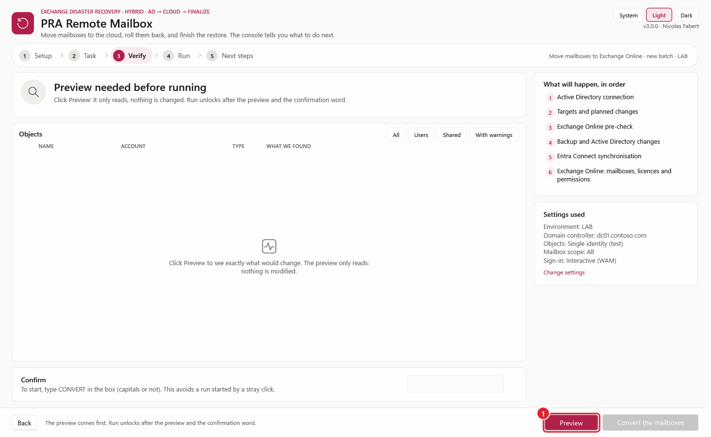

**You should see:** after a few seconds, a title like *1 mailbox will be converted · nothing blocking*, and one line for the person.

**If not:** a red number such as **1 blocking** means the tool refuses this person. Click the line and read the reason. Do not go on. Stop and ask.

### 6 · Confirm

**Do:** read the title one more time. Is it the right number of people? Then type the word **CONVERT** in the box (small or capital letters, both work). Then press the red button **Convert the mailboxes**.


**You should see:** the **Run** page starts at once.

**If not:** the red button stays grey until you did the preview **and** typed the word. Check both.

### 7 · Wait

**Do:** nothing. Watch the list of steps. **Do not close the window.** A new black window may open and ask you to sign in to Microsoft: sign in with your own account.

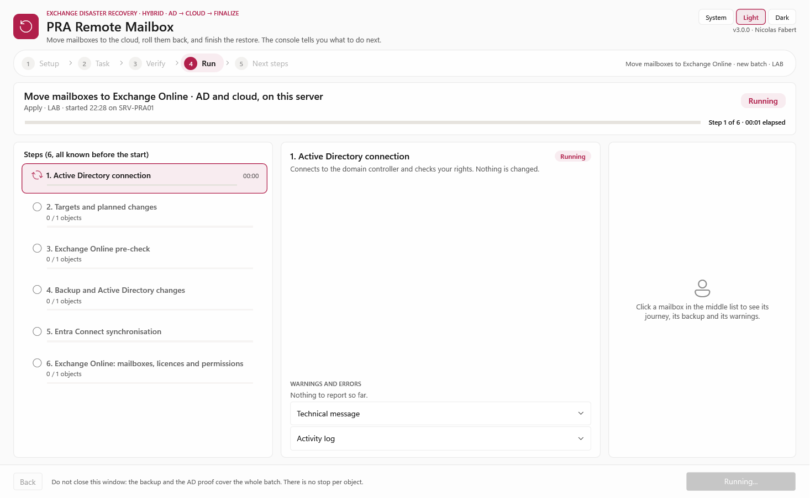

**You should see:** the steps turn green, one after the other. The tool makes a **backup** first, then changes the directory, then asks the cloud to follow.

At one step the tool **waits**. It waits for the **synchronisation**: the directory sends the news to the cloud. This can last **up to 15 minutes**. The page says *attempt 3 of 13, next check in 10 s*. This is **normal**.

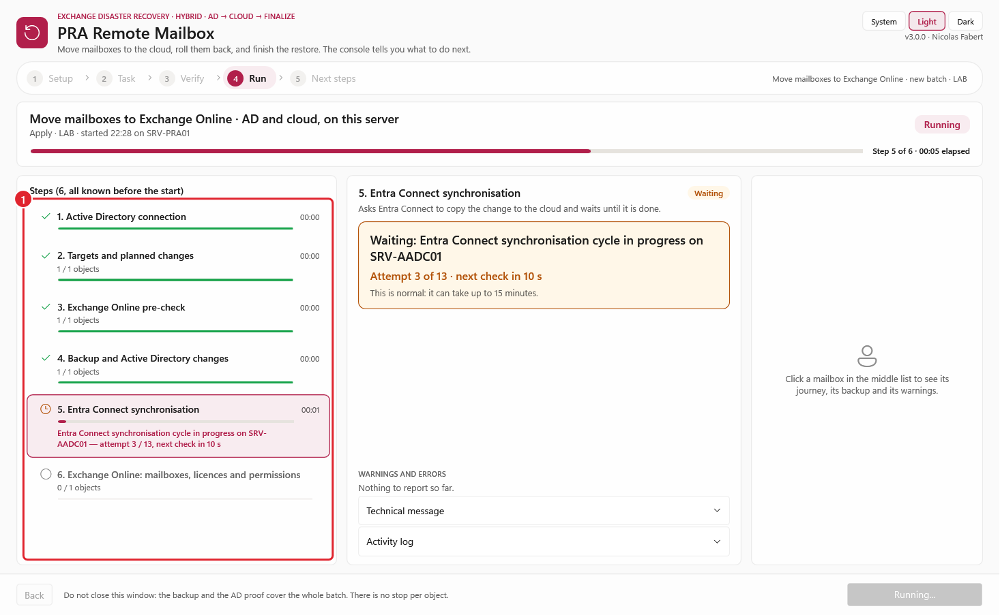

**If not:** if a step turns **red**, the tool stopped on purpose. It will change nothing more. Stop and ask. Keep the window open and take a photo.

### 8 · Look at the end

**Do:** when the title says **Done** in green, press **What next? →**.


**You should see:** the **Next steps** page.

### 9 · Open the report

**Do:** press **Open report**. A web page opens in your browser. It is the **report**: the list of everyone and what was done.


**You should see:** the word **Success** and one line for your test person. Chapter 6 explains the report.

**If not:** if the result says **Pending** or **Error**, read the text on the page. It says what to do. If it is not clear, stop and ask.

**Now check with the test person.** Ask them to open Outlook. They should see a new, empty mailbox, and be able to send and receive. If yes, go to Path 2 or Path 3. If not, **stop and ask**. You can undo the test with chapter 5.

### Path 2 · Move everyone, one server

Use this path **only after** Path 1 worked. The server does the directory part and the cloud part by itself. The steps are the same as Path 1. Only the choice of people changes.

### 1 · Choose the people

**Do:** open the console. Go to **Task**. Click **Move mailboxes to Exchange Online**. Under **Objects to process**, click **Configured scope**. This means "the people named in the settings file".

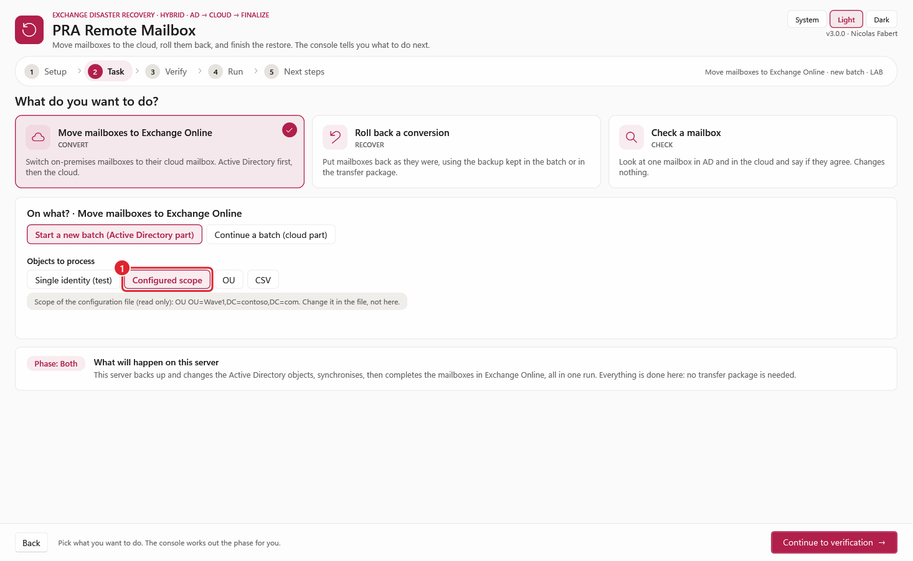

**You should see:** a line that tells which group of people will be moved.

**If not:** for another group, use the buttons **OU** or **CSV**. An **OU** is one folder of the directory. A **CSV** is a list in a file. Ask your administrator before you use them.

### 2 · Preview and confirm

**Do:** press **Continue to verification →**, then **Preview**. Read the title and the list. Warnings are orange triangles. A warning does not stop the run. Read them. Then type **CONVERT** and press **Convert the mailboxes**.

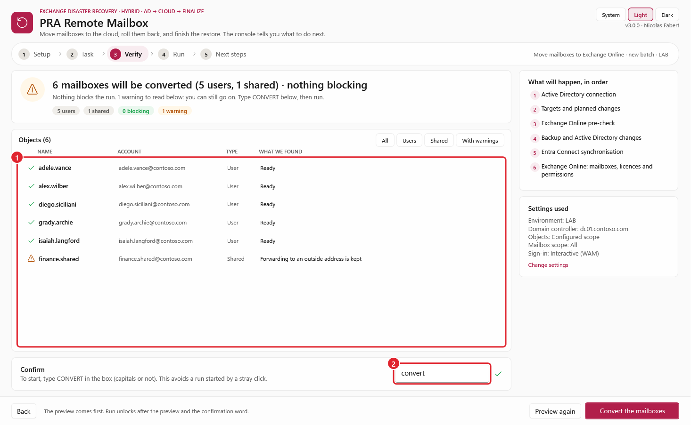

**You should see:** a title like *6 mailboxes will be converted · nothing blocking*. A person with a shared mailbox has the word **Shared** next to the name.

**If not:** a number in red (**blocking**) means someone cannot be moved. The reason is in the list. Remove that person from the list, or stop and ask.

### 3 · Wait

**Do:** nothing. This takes longer for many people: **30 minutes to an hour** is common. At one step the tool gives people access to shared mailboxes. It checks each access, up to 13 times, 10 seconds apart.

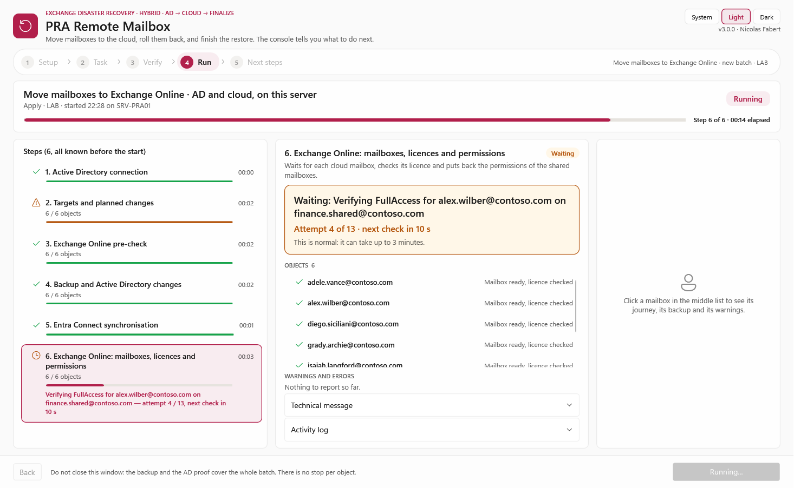

**You should see:** every step green at the end, and the word **Done**.

**If not:** if one step is red, the tool stopped. Stop and ask. The people already done are kept. Do not run it again before you talk to your administrator.

### 4 · Read the end

**Do:** press **What next? →**. The page shows a button **Open global report**. Press it.

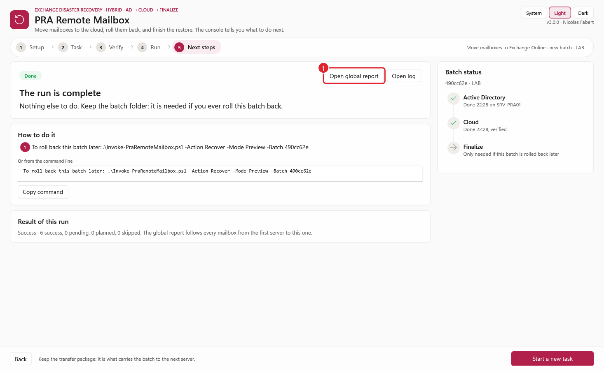

**You should see:** the report. Chapter 6 explains it. Write down the **batch ID** (eight letters and numbers, like `490cc62e`). It is the key to go back.

### Path 3 · Move everyone, two servers

Use this path when the **directory server** cannot reach the Internet. Two servers work one after the other. A **single file** goes from the first server to the second one. The file is called the **transfer package**.


**Part 1 · On the directory server (the AD server).** The steps are the same as Path 2, steps 1 and 2. The page says **Phase: AD**. Then you press **Convert the mailboxes**.

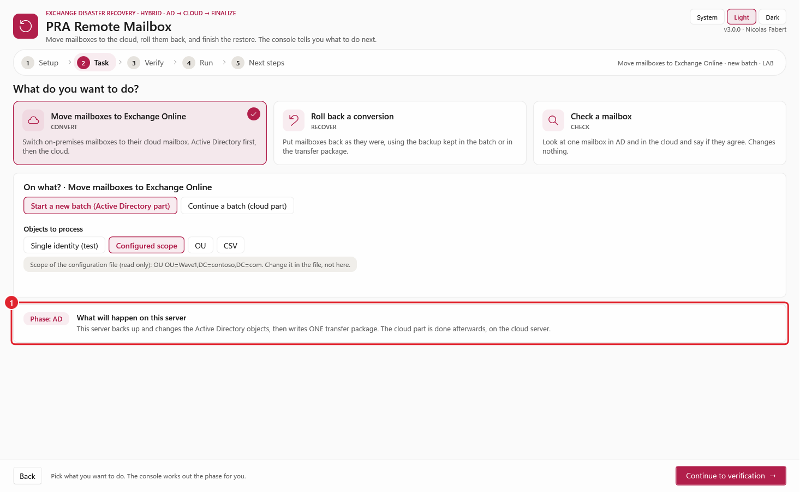

**You should see:** at the end, the **Run** page lists a step **Creating the transfer package**.

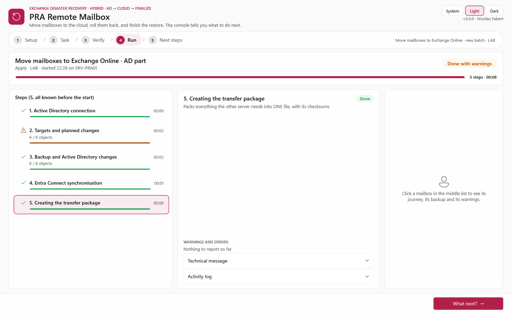

Press **What next? →**. The page shows the **name of the package**, a file that ends with `.zip`.

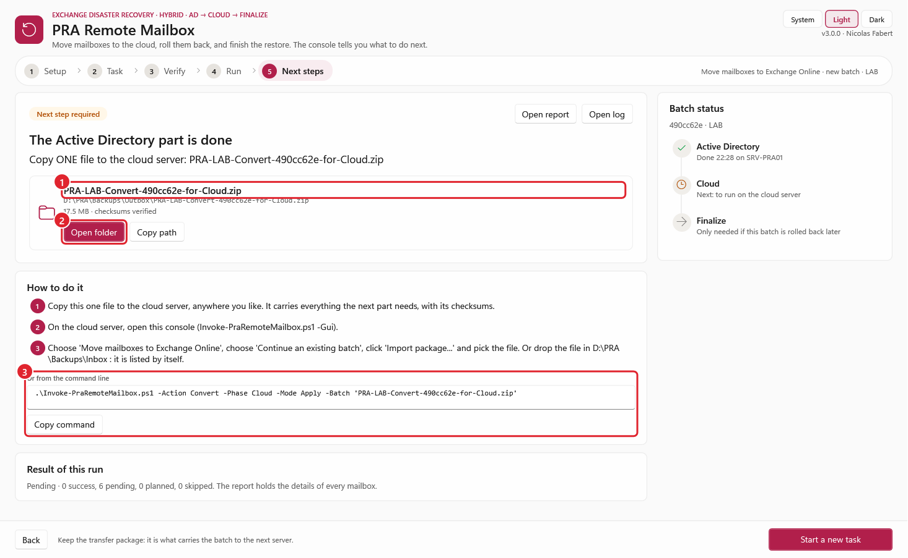

**Do:**

1. Press **Open folder**. The folder with the file opens.
2. **Copy this one file** to the cloud server. Use a USB key, a shared folder, or any way your company allows. Do not rename it.
3. Keep the file. Do not delete it on the first server.

**If not:** if the page says **Pending**, this is **normal**. It means: "The directory part is done. The cloud part remains." It is not an error.

**Part 2 · On the cloud server.** Open the console there. On **Setup**, a red light for **RSAT ActiveDirectory** is normal here. Press **Choose a task →**. Click **Move mailboxes to Exchange Online**. Click **Continue a batch (cloud part)**.

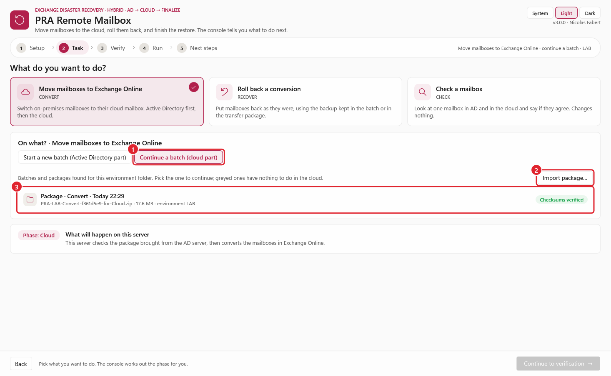

**Do:** press **Import package…** and pick the `.zip` file. You can also put the file in the folder `Backups\Inbox` of this server. Then it is already in the list. The package shows **Checksums verified**. Click its line.

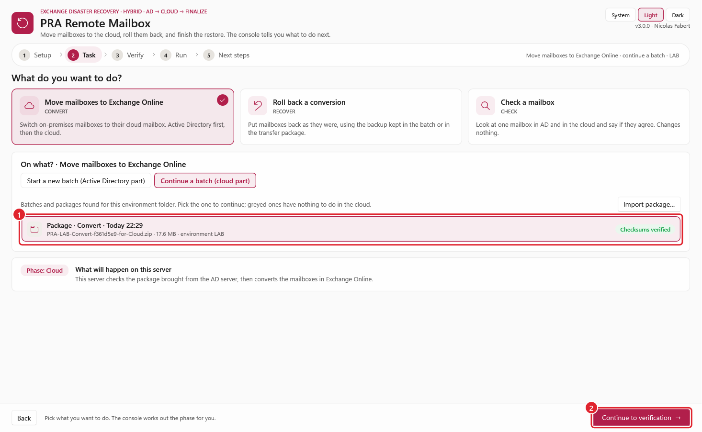

**You should see:** the line turns pink, and the page says **Phase: Cloud**.

**If not:** a red line **Invalid** means the file is damaged or comes from another environment. Copy it again. Check that both servers have the same `Environment` in their settings file. If it still fails, stop and ask.

**Do:** press **Continue to verification →**, **Preview**, type **CONVERT**, and press **Convert the mailboxes**.

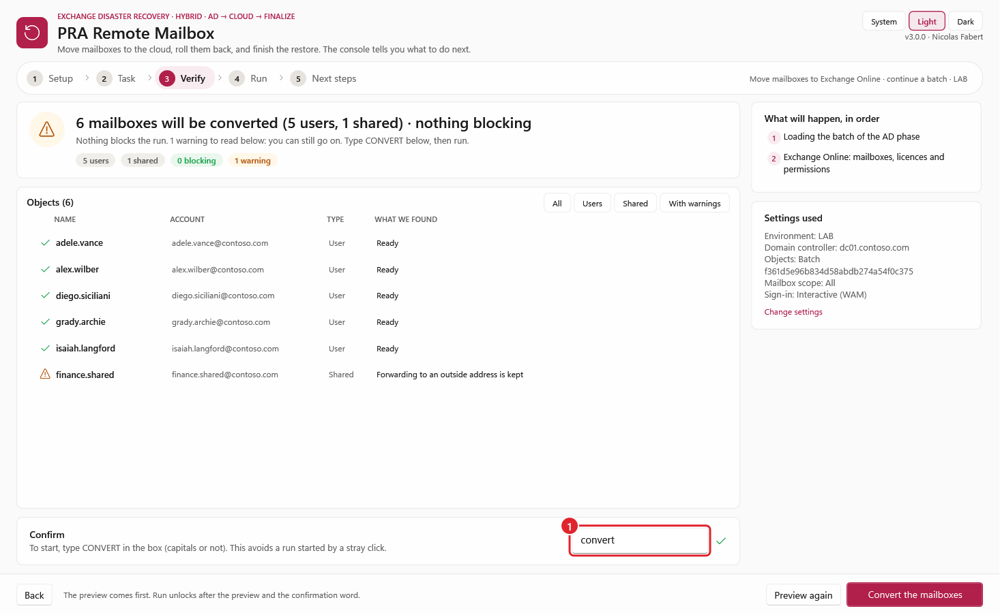

**You should see:** the **Run** page, then **Done**. Press **What next? →** and **Open report**. This report is the **global report**: it follows each person on the two servers.

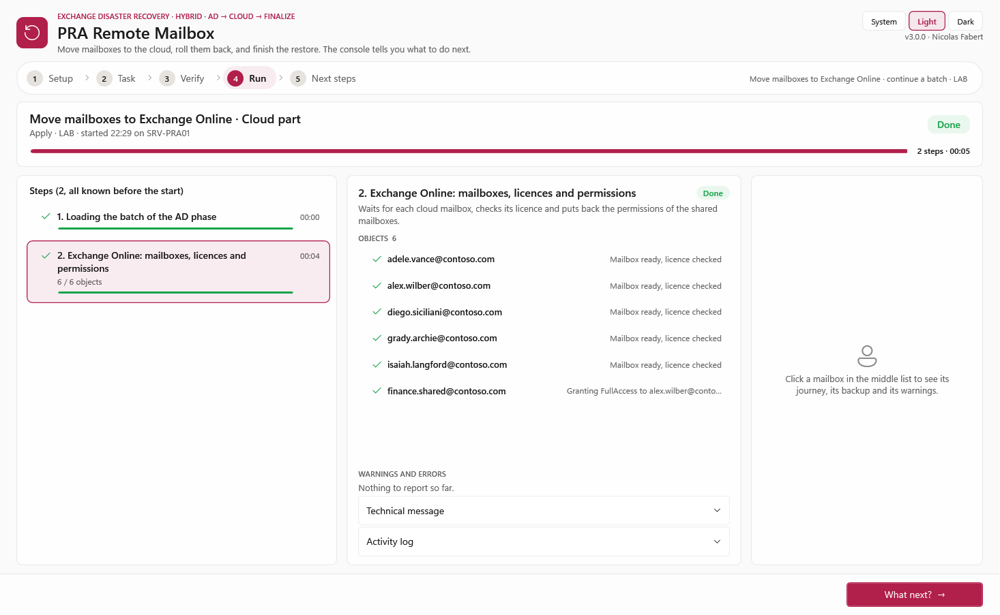


<!-- icon: refresh -->
## 5. B · Go back

Go back only when your administrator says that the old mail servers work again. Before you go back, **save the mail received in the cloud** if you want to keep it. Going back **removes the cloud mailboxes**. The tool keeps the extra address that the cloud added to each person (an `X500` address). A reply to a mail sent from the cloud still arrives. The Preview says how many it keeps. To find a person in Exchange Online afterwards, search by mail address or alias, not by name.

### Path 4 · Roll back

**Rolling back** means: put each person exactly as the backup says. The tool uses the backup made when the people were moved.

### 1 · Pick the rollback

**Do:** open the console. Go to **Task**. Click the card **Roll back a conversion**. A list of **batches** appears. A batch is one move, with its backup. Click the line of the batch to undo.

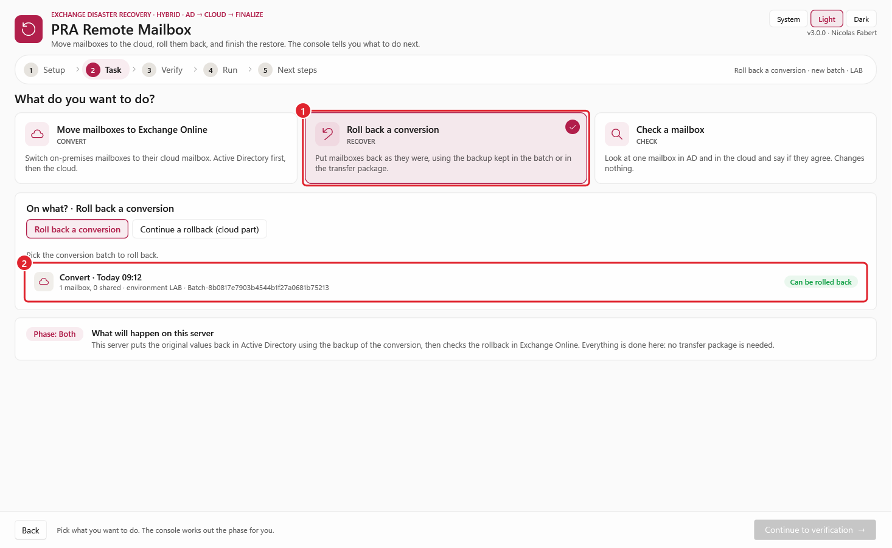

**You should see:** the line turns pink. It shows the date, the number of mailboxes, and *Can be rolled back*.

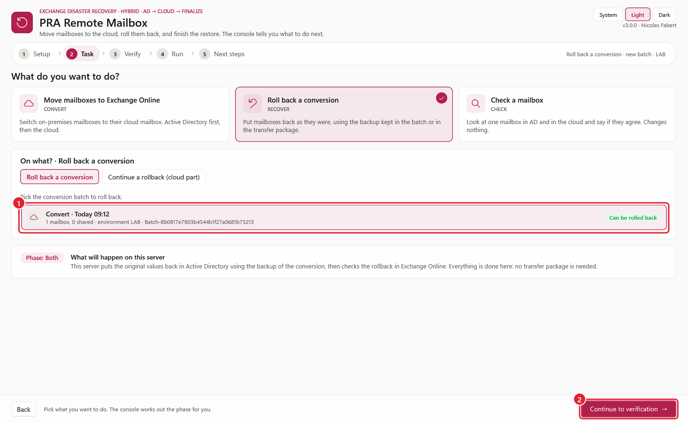

**If not:** if the list is empty, the backup folder is not on this server. Copy the folder `Batch-…` back to `D:\PRA\Backups`, or use **Import package…** on a two-server move. If you cannot, stop and ask.

### 2 · Preview and confirm

**Do:** press **Continue to verification →**, then **Preview**. Read the title: *… will be rolled back*. Type the word **RECOVER**. Press **Roll back the mailboxes**.

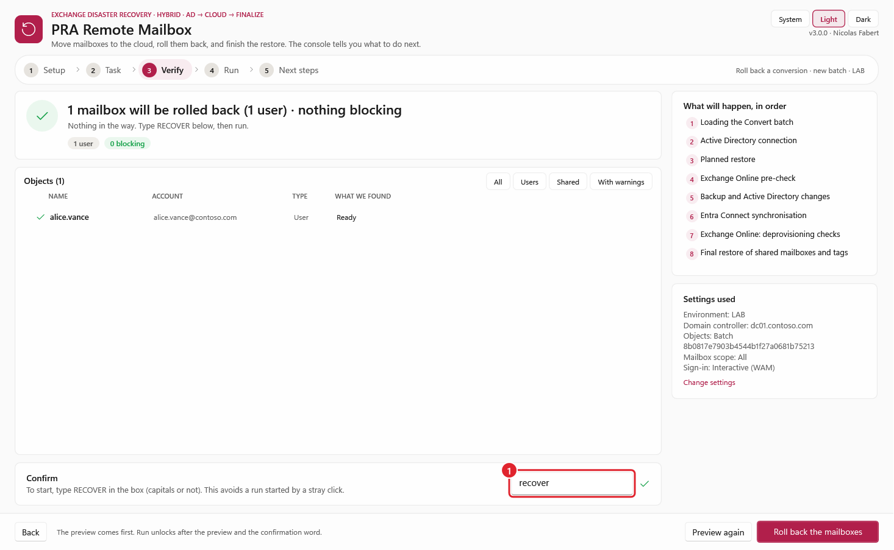

**You should see:** the **Run** page. The tool restores each person from the backup. It first removes the cloud shared mailboxes, then puts the directory back.

**If not:** a red number means the tool refuses something. Read the reason. Stop and ask.

### 3 · Wait and read

**Do:** wait for **Done**. This can take **up to an hour**. Then press **What next? →** and **Open report**.

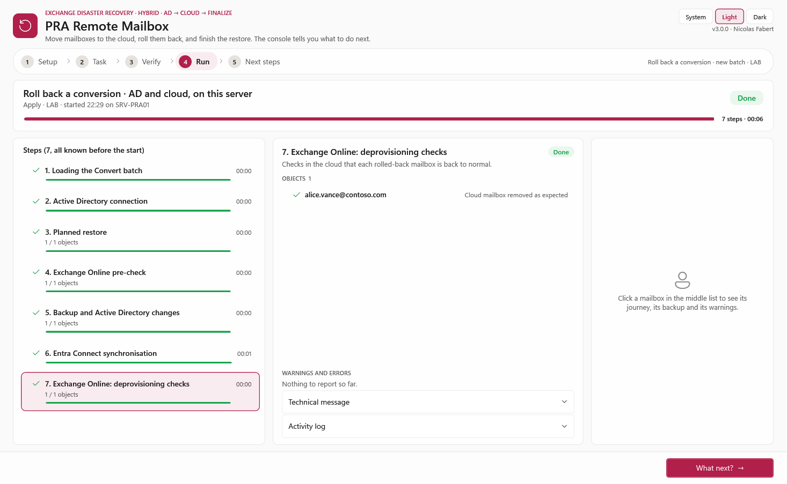

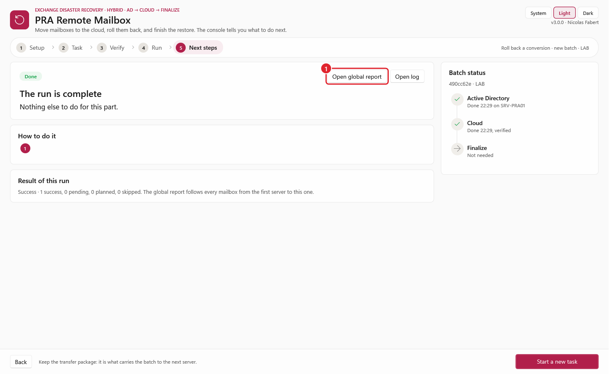

**You should see:** each person with **Success**. People come back to the old servers when Exchange works again.

**If not:** on **two servers**, the result may say **Pending**. It is normal. The directory server did its part. Do the cloud server next, then **Complete the rollback**.

### Path 5 · Complete the rollback (two servers)

On two servers, a rollback has three parts. Each part gives a file to the next one.

1. **Directory server:** Path 4. It writes one package.
2. **Cloud server:** open the console. **Roll back a conversion**, then **Continue a rollback (cloud part)**. Import the package. At the end, the tool writes a **Finalize package** if the directory still needs a last change.
3. **Directory server:** copy the Finalize package here. Then do the steps below.

### 1 · Pick the Finalize package

**Do:** on the directory server, open the console. Go to **Task**. The card **Complete a rollback** shows **only when** a Finalize package is here. Click it. Click the package line. Press **Continue to verification →**.

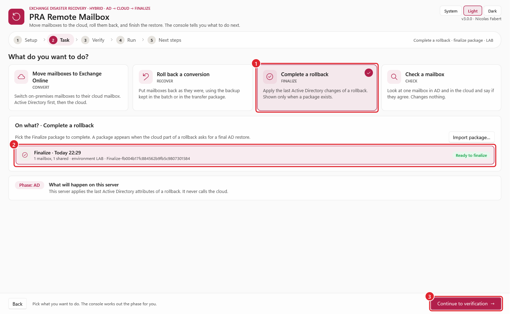

**You should see:** the line *Ready to finalize*.

**If not:** if the card is missing, the package is not here. Use **Import package…** or copy it into the folder `Backups\Inbox`.

### 2 · Preview, confirm, wait

**Do:** press **Preview**. Type **FINALIZE**. Press **Finalize the rollback**. Wait for **Done**. Press **What next? →** and **Open report**.

**You should see:** the **global report**. Every person shows **done**.

<!-- icon: search -->
## 6. Check a mailbox, and read the report

### Check one mailbox

**Do:** open the console. Go to **Task**. Click **Check a mailbox**. Type the e-mail address of one person. Press **Continue to verification →**, then **Check the mailbox**.

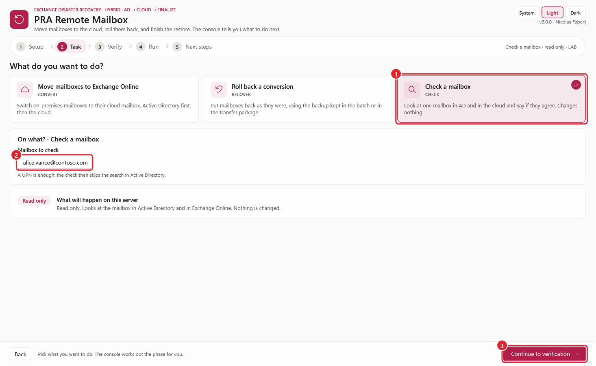

**You should see:** a sentence that says if the mailbox is in the cloud or not. A check only **reads**. It changes nothing.

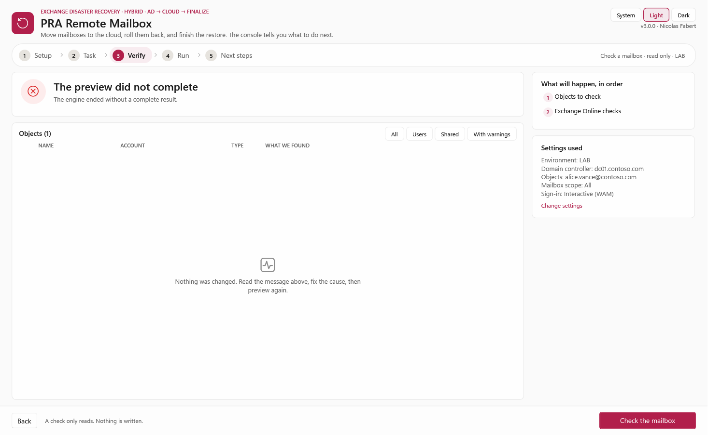

**If not:** if the sign-in window does not open, look at the Windows taskbar for a new black window. Click it.

### Read the report

The report is a web page. It opens in Edge or Chrome. It works without Internet. It is the **proof** of what was done.


| Part | What it tells you |
|---|---|
| **Result** (top left) | **Success** is good. **Pending** means "a part remains". **Error** means "stopped". |
| **The numbers** | How many people: done, waiting, wrong, warnings. |
| **Next step** | The one thing to do now. |
| **The list** | One line per person. Click a line to see everything about it. |
| **The search box** | Type a name to find one person. |

A **warning** is an orange word. It means "done, but read this". For example: *a forwarding to an outside address is kept*.


On two servers, the last server writes a **global report**. It follows each person from the first server to the last one.


<!-- icon: lifebuoy -->
## 7. When something goes wrong

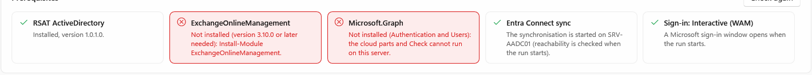

Find what you **see** in the left column. The middle column says what it **means**. The right column says what to **do**. If you are not sure, **stop and ask**.

| I see this | It means | Do this |
|---|---|---|
| A **light is red** on **Setup** | A program or a way to sign in is missing on this server. | Read the red text. Ask your administrator to fix it. Press **Check again**. If the server only does one part, a red light for the other part is normal. |
| The button **Choose a task** is **grey** | A needed light is red, or the settings file is wrong. | Fix the red light. If a message talks about the settings file, open the file and look at the line named. |
| The **sign-in window does not open** | The tool opens its own window for Microsoft. It may hide behind another window. | Look at the Windows taskbar for a black window named *PRA Remote Mailbox - cloud sign-in*. Click it. Sign in. Do not close it. |
| *A Microsoft Graph session already exists in this console* | A cloud session is already open in the same window. | Close all PowerShell windows. Open a new one. Start again. |
| **The red button stays grey** on **Verify** | The preview is not done, or the word is not typed. | Press **Preview**. Type the word **CONVERT**, **RECOVER** or **FINALIZE**. Spaces and capitals do not matter. |
| *N blocking* in red after **Preview** | The tool refuses some people. | Click the line. Read the reason. Remove the person from the list, or stop and ask. |
| An **orange triangle** (warning) | The tool can go on, but you must read. | Read the text. If you understand it, go on. If not, stop and ask. |
| The **wait is long** (*attempt 5 of 13*) | The directory is sending the news to the cloud. | Wait. It is normal up to **15 minutes**. The mailboxes can take up to **an hour** to appear. Do not close the window. |
| A **step turns red** during the run | The tool stopped on purpose, at the first error. | Do not click anything. Take a photo. Stop and ask. The people already done are kept. |
| A package line is red: **Invalid** | The file is damaged, or comes from another environment. | Copy the file again, without renaming it. Check that both servers have the same `Environment`. |
| *Active Directory replication was NOT confirmed on …* | One directory server did not receive the change in time. | Read the **Next steps** page. It says to start the synchronisation again later. Ask your administrator. |
| The result says **Pending** | A part remains. It is **not** an error. | Do what the **Next steps** page says. On two servers: carry the package to the other server. |
| *Entra Connect server … is not reachable* | The tool cannot talk to the Entra Connect server. | Ask your administrator to check the name in the settings file and the remote connection. |
| Nothing in the list of batches or packages | The files are not on this server. | Copy the folder or the package here. Use **Import package…**. |

<!-- icon: book -->
## 8. Picture dictionary

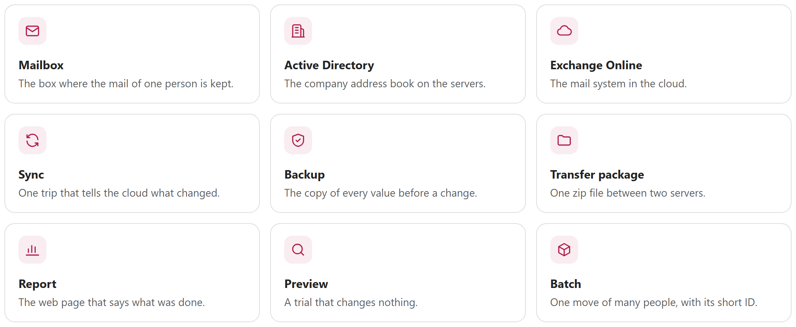

| Word | What it means |
|---|---|
| **Mailbox** | A person's box for mail. It keeps the messages. |
| **Shared mailbox** | A mailbox that many people use, like *info@* or *finance@*. It has no owner and no licence. |
| **Active Directory** | The company address book on the servers. It knows every person and every right. |
| **Domain controller** | A server that holds a copy of Active Directory. |
| **Exchange Online** | The mail system in the cloud. It is run by Microsoft. |
| **Exchange servers** | The mail servers in your own building. In a disaster, they are lost. |
| **Entra Connect** | The bridge from Active Directory to the cloud. |
| **Sync** (synchronisation) | One trip over the bridge. The cloud learns what changed. |
| **Replication** | The copy of a change to the other directory servers. |
| **Licence group** | A group in the directory. Being in it gives a person a cloud mailbox. |
| **Batch** | One move of many people, with its backup. It has a short **batch ID**, like `490cc62e`. |
| **Transfer package** | One `.zip` file that carries a batch from one server to the other. |
| **Preview** | A trial. It shows what would happen. It changes **nothing**. |
| **Apply** | The real run. It changes things. The tool asks you to confirm first. |
| **Backup** | The copy of every value before a change. It is the only way back. |
| **Roll back** | Put everything back as the backup says. |
| **Report** | The web page that lists what was done. |
| **Phase** | One part of the work: the directory part (**AD**), the cloud part (**Cloud**), or both together (**Both**). |
| **Console** | The window of this tool, with five pages. |
| **PowerShell 7** | The program where you type commands, in a dark window with white letters. The tool needs version 7.5 or newer. |
| **Certificate** | A digital key that lets a program sign in with nobody present. It has an end date. |
| **WAM** | The Windows window that signs you in to Microsoft. |
| **Environment** | A short name for this company, such as `PROD`. It must be the same on every server. |
| **OU** | A folder inside Active Directory. |
| **CSV** | A list in a simple file that Excel can open. |
| **RSAT** | The Windows add-on that lets a server talk to Active Directory. |
